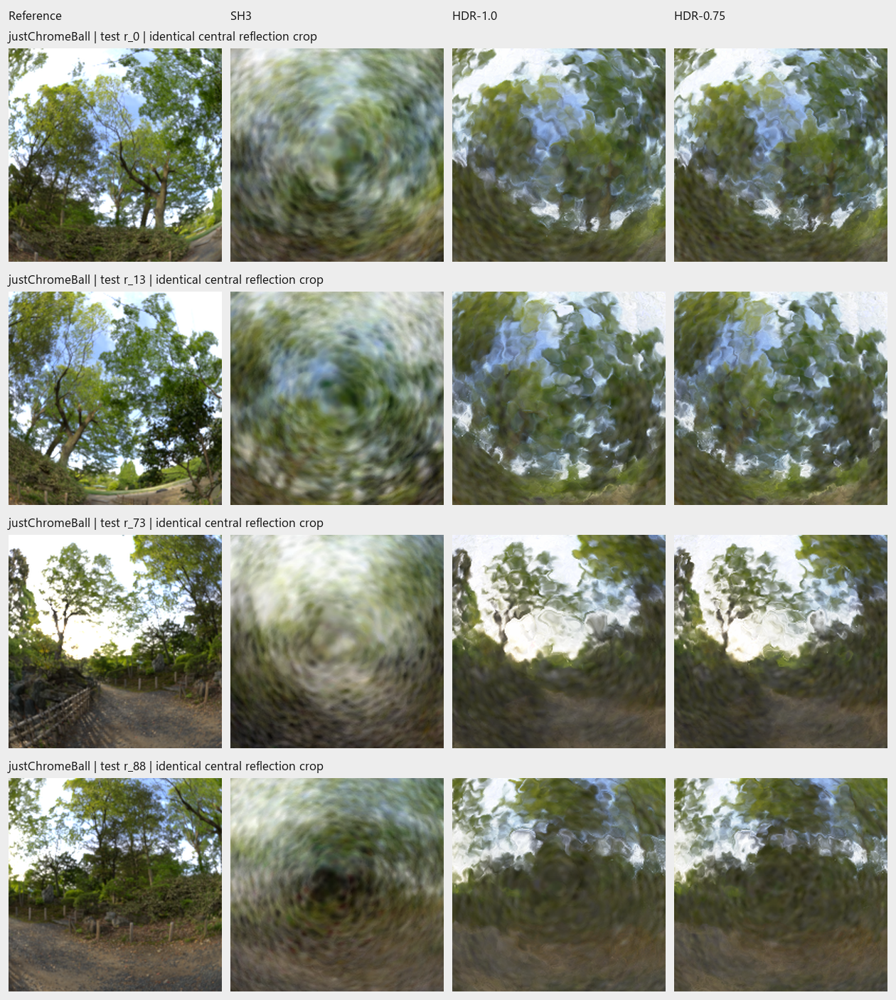

# CP4282 Gaussian Splatting Research

Custom NVIDIA Warp Gaussian/surfel training, built from the CP4282 assignments.
The main experiment compares **SH3 appearance against deferred HDR reflection
shading** on a chrome sphere, using the same starting geometry and training budget.

[Final report](docs/final-report/report.md) ·
[Report build instructions](docs/final-report/README.md) ·
[Evidence map](docs/final-report/evidence-map.md)

## Main experiment and recorded results

| Setting | Meaning |
| --- | --- |
| 100k | 100,000 Gaussian surface patches (surfels), fixed throughout each run |
| 10k + 5k | 10,000 steps fitting appearance with geometry frozen, then 5,000 steps refining geometry and appearance |
| SH3 | Spherical-harmonic appearance up to degree three |
| HDR-1.0 | Deferred HDR/angular reflection model, initial splat-size multiplier 1.0 |
| HDR-0.75 | Same HDR model, initial tangent scales multiplied by 0.75; still 100,000 surfels |
| Dataset | `data/justChromeBall`: 100 training, 100 validation and 200 test images, at 800 × 800 |
| Seed | 7 |

The initializer estimates a rough surface from the **training images' alpha masks
and camera poses**, then samples 100,000 patches. It uses no held-out images or
Blender reference geometry. Both main methods start from the same initializer;
HDR-0.75 changes only its two tangent scales before training. Initialization is
part of the experimental method. Its script and all 400 input images are tracked;
the generated `initial.ply` lives under ignored `outputs/`.

Recorded means over all **200 test views**:

| Model | PSNR ↑, dB | SSIM ↑ | LPIPS AlexNet ↓ |
| --- | ---: | ---: | ---: |
| SH3 | 20.2655 | 0.821398 | 0.128760 |
| HDR-1.0 | 24.5732 | 0.880892 | 0.083517 |
| HDR-0.75 | 24.7453 | 0.884031 | 0.080988 |



*Observed `justChromeBall` test views 0, 13, 73 and 88, top to bottom. Columns:
Blender reference, SH3, HDR-1.0 and HDR-0.75, after 10k + 5k steps. These are
matched crops from the recorded runs. HDR recovers more reflection structure,
but fine branches and ground texture remain blurred. The HDR/SH3 comparison
changes the complete appearance treatment; the size comparison is between the
two HDR variants. [Full per-view scores](docs/reports/assets/2026-11-03-sphere-study/test/metrics.csv)
retain regressions.*

## Reproduce from a fresh clone

Run the following steps in order in **Git Bash on Windows**, from the repository
root after cloning. These use the original launch commands, with paths adapted
to newly generated folders. No checkpoint download or Blender installation is
needed for this training/evaluation sequence.

Use Python 3.12 and an NVIDIA CUDA GPU. The recorded runs used Python 3.12.10,
Warp 1.18.0 and an RTX PRO 5000 Blackwell. `requirements.txt` specifies minimum
versions; different hardware/packages can change scores and timings.

### 1. Install and activate the environment

```bash
git clone https://github.com/wenn5055/3DGSresearch.git
cd 3DGSresearch
py -3.12 -m venv .venv
source .venv/Scripts/activate
python -m pip install -r requirements.txt
```

For an existing clone/environment, just run `source .venv/Scripts/activate`.
Keep this terminal open so the path variables below remain available. Run jobs
sequentially and keep training/evaluation source code unchanged until step 6
finishes, so the source checks pass. Keep `torch` and `lpips` installed to
reproduce the LPIPS comparison. The first LPIPS evaluation may download weights.

### 2. Train HDR-1.0 and create the shared initializer

```bash
python scripts/run_staged_hdr.py data/justChromeBall
```

Subcommands: generate the 100k initializer → train frozen appearance for 10k
steps → refine geometry and appearance for 5k → evaluate validation images after
each training stage. This original command measures PSNR/SSIM; step 5 adds LPIPS
for all three final models.

The launcher prints `Pipeline directory: ...` and `Final model: .../model.ply`.
**Replace both placeholders below** using those printed paths, then run:

```bash
INIT="outputs/REPLACE_WITH_HDR_PIPELINE_FOLDER/initializer/initial.ply"
HDR1="outputs/REPLACE_WITH_HDR_REFINED_RUN_FOLDER"
```

Use repository-relative paths with `/` separators. `INIT` points to the
geometry-only initializer in the pipeline folder. `HDR1` points to the final
model's **containing folder**, which is a separate timestamped run folder.
For example, a printed `Final model: C:\...\outputs\Nov10-1430-justChromeBall-staged-hdr-refine-5k\model.ply`
means `HDR1="outputs/Nov10-1430-justChromeBall-staged-hdr-refine-5k"`.

### 3. Train SH3 from the same initializer

```bash
python scripts/run_staged_hdr.py data/justChromeBall \
  --appearance sh3 \
  --init-ply "$INIT" \
  --metrics psnr ssim lpips
```

Subcommands: reuse the initializer → 10k frozen appearance → 5k refinement →
validation evaluation after each stage.

Replace the placeholder with the containing folder from this run's printed
`Final model`, then run:

```bash
SH3="outputs/REPLACE_WITH_SH3_REFINED_RUN_FOLDER"
```

### 4. Train HDR-0.75 from the same initializer

```bash
python scripts/run_staged_hdr.py data/justChromeBall \
  --appearance hdr --scale-multiplier 0.75 \
  --init-ply "$INIT" \
  --metrics psnr ssim lpips
```

Subcommands: copy the initializer with its two tangent scales multiplied by
0.75 → 10k frozen appearance → 5k refinement → validation evaluation after each
stage. Scales remain learnable during refinement.

Replace the placeholder with this final model's containing folder, then run:

```bash
HDR075="outputs/REPLACE_WITH_HDR075_REFINED_RUN_FOLDER"
```

### 5. Compare all three on validation

Create a fresh timestamped name for the comparison outputs:

```bash
STUDY="outputs/$(date +%b%d-%H%M%S)-sphere-reproduction"

python scripts/evaluate_reflection_suite.py \
  "$SH3" "$HDR1" "$HDR075" \
  --labels SH3 HDR-1.0 HDR-0.75 \
  --output "$STUDY/validation" \
  --manifest transforms_val.json --views 0 13 73 88 51 \
  --metrics psnr ssim lpips --cpu-threads 2
```

Open `$STUDY/validation/index.html` for comparisons and inspect `summary.csv`
and `metrics.csv`. Metrics cover **all 100 validation images**; `--views`
selects illustration cameras only. Use fresh output names when repeating.

### 6. Freeze the selection, then evaluate test images

```bash
python scripts/finalize_sphere_study.py "$STUDY/validation" \
  --selection "$STUDY/selection.json" \
  --test-output "$STUDY/test"
```

The selection retains the same-size SH3/HDR-1.0 comparison. It additionally
retains HDR-0.75 if validation LPIPS improves, foreground PSNR does not decrease
and mean foreground coverage is at least 99%. It records the decision and
checkpoint hashes **before** test evaluation.

Subcommand: evaluate the retained models on **all 200 test views**, with views
0, 13, 73 and 88 used for illustrations. The recorded study retained all three;
a new run's selection follows its own validation results.

Compare `$STUDY/test/summary.csv` with the recorded table above. Open
`$STUDY/test/index.html` to inspect rendered images and crops; `metrics.csv`
contains per-view scores. Test results are for reporting, not further tuning.

## Saved models and verification

A **checkpoint** is a trained model saved to disk. Keep `model.ply` and
`model.surfel.npz` together; SH3 also requires `model.sh.npz`. These files allow
rendering and scoring without retraining. Full checkpoints are outside Git;
the [report instructions](docs/final-report/README.md) describe the separately
prepared bundle, whose persistent download location is still pending.

Each training stage saves `run.json`, resolved configs, `train.log`, package
versions, source snapshots and input hashes in its timestamped run folder.
The pipeline folder's `pipeline.json` records the actual frozen/refined run
paths. Evaluation files called `test-metrics.csv` and `test-renders` inside these
training runs refer to **validation** when `transforms_val.json` was used.

To check the report's tables and tracked evidence without training:

```bash
python docs/final-report/verify_report.py
```

This checks saved evidence/report consistency; steps 5–6 perform model evaluation.
The reproduction sequence was checked through config preparation, matching
settings against archived configs and existing pipeline tests; a complete new
training repetition has not been performed for this README rewrite.

## Other workflows and development

- [Original sphere commands and diagnostics](docs/sphere-study-commands-2026-11-03.md)
- [Full command reference](docs/command-reference.md): logging, Gaussian/SH training and evaluation
- [Research status](docs/research-status.md) and [findings](docs/findings.md)
- [Edited Materials scene workflow](docs/materials-red-rose-silver.md)
- [Earlier Gaussian/RGB/deferred passes](docs/project-passes.md)
- [Output index](docs/output-index.md) and [historical teaching files](docs/archive-candidates.md)
- [Blender scene attribution](data/blender/SOURCE.md)

The original Lego Gaussian baseline remains available:

```bash
python 3dgs_trainer.py config/3dgs_training_gpu.yaml
python 3dgs_evaluator.py outputs/warp-training.ply data/lego
```

Run the existing development checks:

```bash
python -m unittest discover -s scripts -p "test_*.py"
python 3dgs_gradient_check_gpu.py --device cpu
python 3dgs_gradient_check_gpu.py --device cuda:0
```

Use `--help` on individual scripts for their arguments. The report's
[evidence map](docs/final-report/evidence-map.md) links supporting normal,
lighting and loss diagnostics separately from this main comparison.
