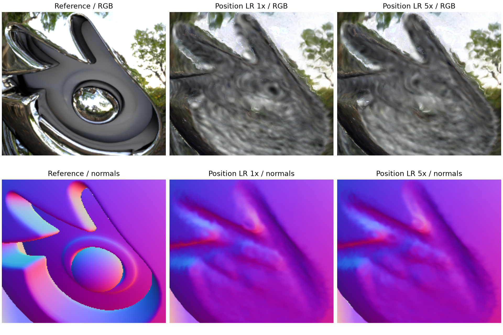

# Chrome logo: matched position learning-rate trial

Specified 2 November 2026 (Singapore), before the trial. Original Materials
remains the primary benchmark; this is an auxiliary Chrome geometry diagnostic.

## Observation and question

The user-selected validation frame 18 has a blurred, distorted Blender logo.
The distortion is already present in the frozen-geometry HDR parent. In a fixed
reference-defined rectangle (x 215:455, y 365:575), mesh normal error changes
28.7344 -> 28.2311 degrees after the original refinement; depth MAE changes
0.060064 -> 0.059900. These are single-view diagnostic-region means, not exact
logo segmentation or an independent final test. Reference geometry is evaluation-only.

Question: are the original small position updates too conservative to recover
local shape during the existing five-thousand-step refinement?

## Fixed experiment

Compare completed `Oct30-1733-materials_chrome-staged-hdr-refine-5k` against
`config/materials_chrome_staged_hdr_refine_position5x.yaml`. Start both from the
same `Oct30-1718-materials_chrome-frozen-hdr-10k/model.ply` and material sidecar,
restarting Adam. Run 5k continuation steps (15k cumulative), seed 7, 800x800,
100k surfels, no growth/pruning, no SH, HDR/angular shading. Keep rotation,
scale, opacity, appearance learning rates and all losses unchanged.

Only position initial/final learning rates change, from 1e-5 / 1e-6 to
5e-5 / 5e-6, with the same 5k decay schedule; the output path also changes.
Audit resolved configurations, source hashes, inputs and parent checkpoints.

## Evaluation and decision

Re-evaluate both frozen models on all 100 validation views with PSNR, SSIM,
LPIPS AlexNet, foreground/visible-Chrome quality, normal/depth error and coverage.
Inspect the existing four pose-selected cameras 0, 13, 73, 88 and the supplemental
user-selected frame 18. Report frame-18 normal/depth and RGB metrics in the same
fixed rectangle. It is a development diagnostic; never call it unseen evidence.
No test views or further tuning are queued.

Keep the baseline if logo geometry/detail do not improve, regardless of a higher
global PSNR. Report any local gain alongside full-validation quality/geometry
tradeoffs. Do not interpret failure as proof that the position rate is irrelevant
under every schedule, or that the logo cannot be reconstructed.

## Execution

Preflight passed: resolved settings differ only in the two position learning-rate
endpoints and output path; training-source hashes are identical to the baseline,
all 204 input hashes match, and the frozen parent checkpoints match provenance.

Run: `outputs/Nov02-1651-materials_chrome-staged-hdr-refine-position5x-5k/`.
Audit and comparison artifacts: `outputs/Nov02-1651-logo-position5x-session/`.
Training started at 16:51 Singapore; all 5k steps completed in 62.60 seconds.
Native validation and the paired report completed; paired validation finished
at 16:55 Singapore. This remains a single-seed development experiment.

## Results

Both frozen models were re-rendered with the same evaluator on all 100 validation
views. The baseline reproduced its archived metrics exactly, renderer-source
fingerprints match training, and the only resolved configuration differences
are the two position-rate endpoints and output path.

| Measure | Position LR 1x | Position LR 5x |
| --- | ---: | ---: |
| Mean validation PSNR | 21.3361 | 21.7076 |
| SSIM | 0.821520 | 0.833744 |
| LPIPS AlexNet, lower better | 0.140111 | 0.132206 |
| Foreground PSNR | 16.3002 | 16.5919 |
| Chrome PSNR | 15.7505 | 16.0461 |
| Chrome normal MAE, degrees | 7.2173 | 6.7867 |
| Chrome depth MAE | 0.017007 | 0.017998 |
| Frame-18 logo-rectangle normal MAE, degrees | 28.2311 | 27.8420 |
| Frame-18 logo-rectangle depth MAE | 0.059900 | 0.058688 |
| Frame-18 logo-rectangle PSNR | 15.0369 | 15.1486 |
| Frame-18 logo-rectangle SSIM | 0.345187 | 0.368560 |

Global PSNR improves 0.3716 dB (99/100 views), SSIM improves on 100/100,
and LPIPS improves on 100/100. Chrome PSNR gains 0.2956 dB and mean normal
error falls 0.4306 degrees. Chrome depth MAE worsens about 5.8%; normal
coherence also falls slightly (0.994098 -> 0.993483). Report both tradeoffs.

The logo's local changes are small: only 0.3891 degrees lower normal error and
0.1117 dB higher PSNR. Matched RGB/normal figures still lack the reference's
recessed centre and distinct ridges. Raising the position rate therefore improves
overall reconstruction under this policy but **does not solve the logo objective**.
This evidence does not isolate the remaining cause among initialization,
orientation/scale updates, surface concentration and appearance ambiguity.

Retain the original baseline and the new candidate separately; do not replace the
shared preset or describe the logo as recovered. A further experiment should
target local shape recovery rather than assuming another position-rate increase
will fix it. No further run is queued.

Stage history records the frozen parent's 10k steps plus this 5k continuation.
Historical training times had different concurrent workloads; do not infer a
training speedup. Forward timing was skipped for this quality diagnostic.

[Full paired report](../../outputs/Nov02-1651-logo-position5x-session/paired-validation/index.html)
and [portable evidence](../reports/assets/2026-11-02-logo-position5x/provenance.json).

## Subsequent scope decision - 2 November

The user clarified that the project targets specular reflection reconstruction,
and closed further logo-specific geometry work. Preserve this experiment as a
limitation and a diagnostic result. The next proposed appearance diagnostic uses
a plain sphere, with original Materials retained as the primary benchmark.
See the [scope decision](../research-scope-2026-11-02.md); the earlier suggestion
to pursue local shape recovery is deferred by this decision.
