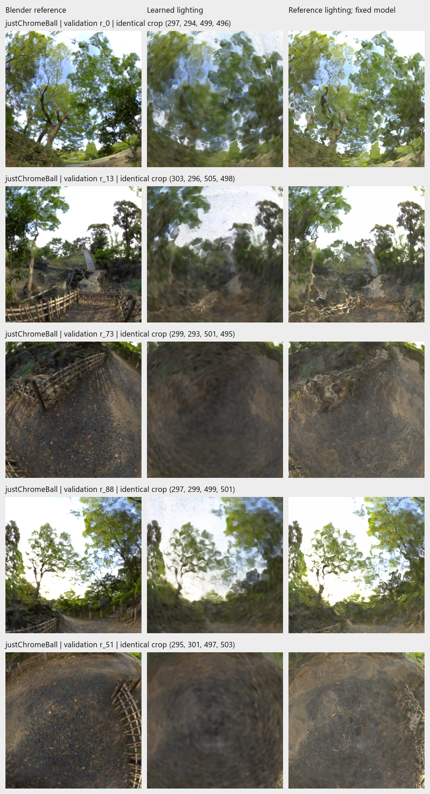
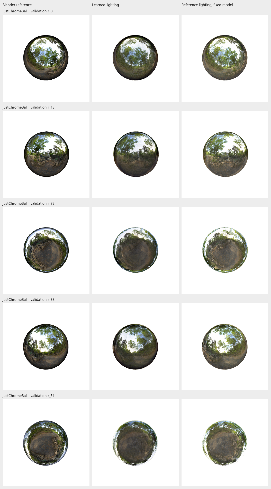

# 3 November 2026: reference-lighting swap on the frozen sphere model

**Result:** Original forest lighting restores finer reflection texture, but the
reflection remains warped and rippled. LPIPS improves; PSNR and SSIM worsen.
Lighting blur contributes to the appearance, but replacing lighting alone does
not recover the Blender reference.

## Controlled intervention

Evaluated `Nov03-1402-justChromeBall-staged-hdr-refine-5k`: **100k surfels,
initial-size multiplier 0.75, 10k frozen + 5k refinement**. This is the older
checkpoint selected for the environment investigation, not a new 200k run.

Both cases use all **100 validation views, 800x800, white background**. Only the
environment array changes, in memory. Positions, tangent scales, quaternions,
opacity, base colors, reflection strengths and angular response are fixed.
Their parameter hashes and all nine rasterized G-buffer fields are **bitwise
identical** across lighting cases for every view. Checkpoint file hashes are
unchanged; no optimization or checkpoint saves occurred.

The packed Blender forest EXR is aligned by world direction and sampled to
the saved model's **512x256** environment grid, using the
[previous environment comparison](../reports/assets/2026-11-03-environment-check/comparison.png).
World strength and exposure are retained; no rotation or brightness gain is
fitted. Scene-linear values are inverse-softplus encoded for the same HDR shader.
Both cases use its existing bilinear interpolation of environment logits.

The source contains **28 negative channels out of 393,216**, minimum
**-0.000872**; these are clamped to zero, encoded at the shader's positive floor
of 1e-8. Two initial attempts rejected these channels before rendering reference
lighting. Their failure records remain in `outputs/Nov03-reference-lighting-swap/`
and `outputs/Nov03-reference-lighting-swap-check/`; the successful evaluation is
`outputs/Nov03-reference-lighting-swap-final/`.

## Measured result

Arithmetic means of per-view metrics, computed on float renders before PNG
quantization; foreground uses reference alpha >= 243/255.

| Lighting, same saved model | PSNR (dB) ↑ | SSIM ↑ | LPIPS AlexNet ↓ | Foreground PSNR (dB) ↑ |
| --- | ---: | ---: | ---: | ---: |
| Learned environment | 24.2308 | 0.877177 | 0.091814 | 17.8693 |
| Reference environment | 20.6415 | 0.848285 | 0.079982 | 14.0497 |

Reference lighting improves LPIPS on **100/100 views**, but decreases PSNR,
foreground PSNR and SSIM on **100/100**. Both retain **100% foreground coverage**.
The learned-lighting baseline exactly reproduces the earlier validation scores.



*Scene: `justChromeBall`. Rows: validation views 0, 13, 73, 88 and the previously
retained failure view 51. Columns: Blender target, learned lighting, reference
lighting with the same saved geometry and materials. Identical central crops
are enlarged for inspection; bounds are printed in the figure. Reference
lighting reveals finer branches/fence/ground texture, while strong local
warping remains. View 51 still fails to recover the target ground detail.*



*Same scene, five views and column order as above, showing full frames. Images
are actual evaluation renders. Cameras were reused from the earlier study;
these examples were not chosen by the lighting-swap scores.*

## Interpretation and next diagnostic

Sharper lighting can pass through the current representation, so the lost
detail is partly attributable to the learned map. The persistent ripples make
the learned normal field a useful next diagnostic before another capacity
sweep. This does **not** establish that normals alone cause the remaining error:
base color, reflection response and lighting were jointly fitted and can
compensate for each other. Swapping the map breaks that compensation. The
finite map resolution and this shader's reflection model also differ from
Blender's rendering. The opposing perceptual and pixel metrics are preserved;
the swap is not an overall quality win or a replacement training result.

Next, compare rendered normals with reference sphere normals on these same
validation cameras; an evaluation-only normal substitution could then test
their contribution. No normal substitution or new training has run here.

## Repeat

From the repository root, using the existing checkpoint and tracked aligned
lighting arrays; choose a fresh output directory:

```powershell
python scripts/test_reference_lighting_swap.py
python scripts/evaluate_reference_lighting.py `
  outputs/Nov03-1402-justChromeBall-staged-hdr-refine-5k `
  --reference-comparison docs/reports/assets/2026-11-03-environment-check `
  --output outputs/reference-lighting-swap-repeat
```

Two numerical/isolation tests pass. The full 200-render validation comparison
passes the parameter, G-buffer and checkpoint-integrity checks. No test-split
evaluation was added. Portable evidence:
[per-view metrics](../reports/assets/2026-11-03-reference-lighting-swap/metrics.csv),
[summary](../reports/assets/2026-11-03-reference-lighting-swap/summary.csv),
[protocol and hashes](../reports/assets/2026-11-03-reference-lighting-swap/protocol.json).
