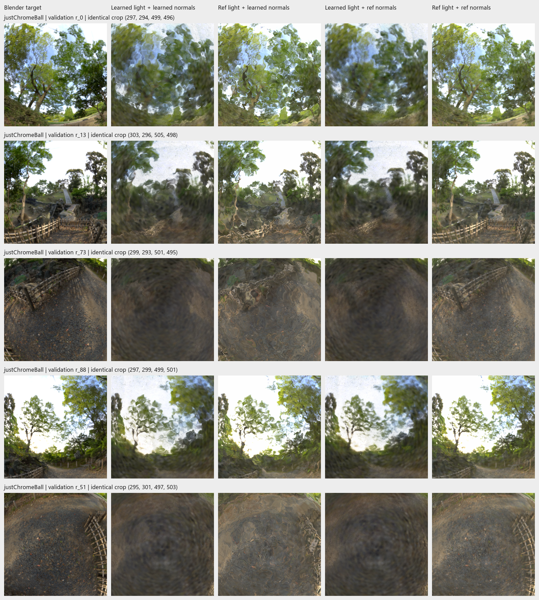
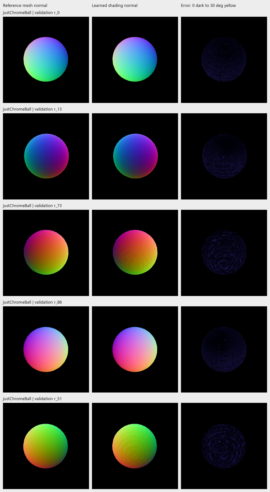
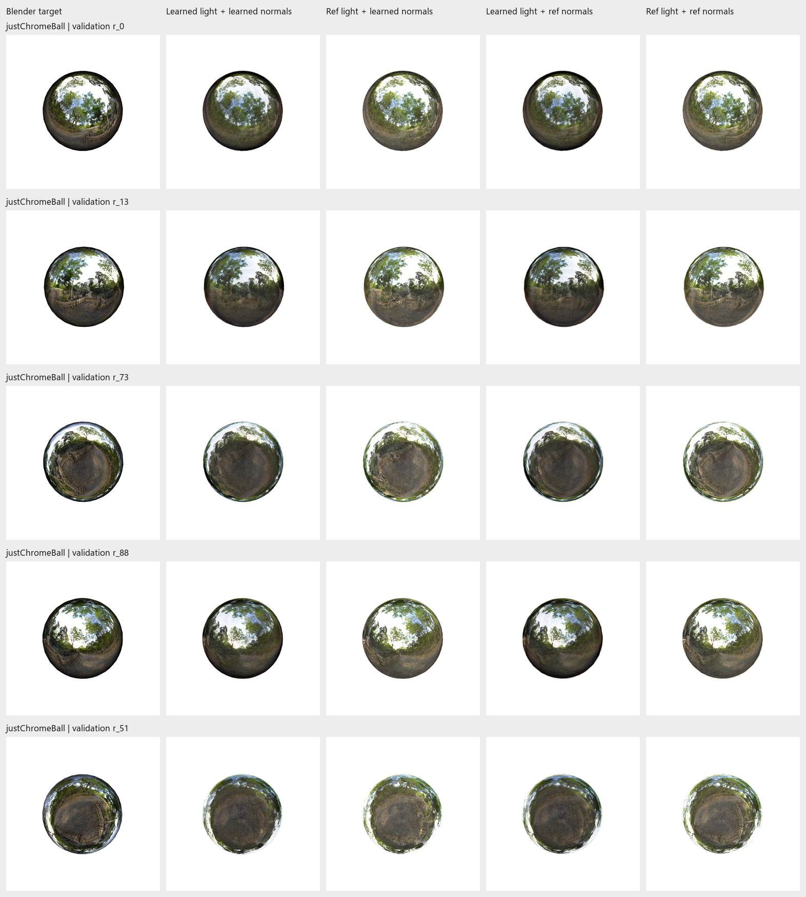

# 3 November 2026: reference-normal intervention on the sphere

**Result:** With reference lighting fixed, replacing the learned shading normals
with Blender mesh normals removes much of the rippling and recovers recognizable
branches and fencing. This is direct evidence that normal errors contribute to
the distorted reflections. The learned environment also remains a source of blur.


*`justChromeBall`, validation view 0, identical crop (297,294)-(499,496).
Left: Blender target. Middle: original forest lighting with learned normals.
Right: same lighting and saved model with reference mesh normals used for
shading. Actual evaluation renders; no optimization or material replacement.*

## Matched setup

Same **100k, initial-size 0.75, 10k + 5k** checkpoint as the
[lighting-swap experiment](2026-11-03-reference-lighting-swap.md):
`outputs/Nov03-1402-justChromeBall-staged-hdr-refine-5k`.
This diagnostic uses **five validation views: 0, 13, 73, 88, 51**, all 800x800.
These are the existing diagnostic cameras, including the ground-detail failure
view; results below are five-view means, not the earlier 100-view averages.

**Label definitions:** "Learned normals" are the per-pixel shading normals
obtained by blending the trained surfels' orientation-derived normals.
"Reference normals" are the Blender mesh normals described below. Column 2
uses learned lighting and learned normals, the original saved-model baseline.

Reference normals come from the existing evaluated Blender mesh ray-hit export,
with scene hash, camera-manifest hash, resolution and focal length verified.
They are interpolated smooth world-space normals from the actual 960-triangle
sphere mesh, not normals from an assumed ideal analytic sphere. They exclude
shader bump effects. Reference geometry is used for evaluation only.

After rasterization, substitute only the direction of the normal sum, retaining
its magnitude. All other raster fields are bitwise unchanged: color sums,
depth, coverage and reflection sums. Positions, scales, quaternions, opacity,
base colors, reflection parameters and angular-response parameters are fixed.
Pixels without a mesh hit or valid model normal/coverage retain their original
normal; the substitution covers 100% of reference foreground in these views.
The existing shader uses the new normal for both reflection direction and
view-angle-dependent response, so both of those effects are included.

Lighting uses the same learned map or the aligned original forest map, at the
same 512x256 grid and without fitted gain/rotation, as the previous diagnostic.
All four combinations are rendered from the same saved model.

## Results

Arithmetic means of per-view float-render metrics; foreground alpha >= 243/255.

| Lighting | Shading normals | PSNR (dB) ↑ | SSIM ↑ | LPIPS AlexNet ↓ | Foreground PSNR ↑ |
| --- | --- | ---: | ---: | ---: | ---: |
| Learned | Learned | 23.8554 | 0.871914 | 0.096202 | 17.4629 |
| Reference | Learned | 20.4016 | 0.844558 | 0.085452 | 13.7974 |
| Learned | Reference | 23.0536 | 0.867943 | 0.101984 | 16.7755 |
| Reference | Reference | 22.7073 | 0.943615 | 0.056796 | 16.3808 |

Under reference lighting, changing normals improves PSNR, SSIM and LPIPS on
**all five views**: mean changes **+2.3057 dB, +0.099057, -0.028657**.
All cases retain 100% foreground coverage. Both learned-normal baselines
reproduce the prior lighting experiment's same-camera metrics exactly.

Learned-normal error is **1.4678 degrees**, averaged across the five per-view
means on covered reference foreground; per-view means range 1.4105-1.5210
degrees and per-view 95th percentiles range 2.6710-3.2550 degrees. Small angular
errors still produce visible distortions of detailed mirror reflections.
Mesh/alpha silhouette IoU is above 0.99993 in every view.



*Scene: `justChromeBall`. Rows: validation 0,13,73,88,51. Columns: Blender target;
learned light/learned normals; reference light/learned normals; learned
light/reference normals; reference light/reference normals. Identical central
crops per row, bounds printed in figure. Reference normals with learned
lighting remain blurred; reference lighting with learned normals remains
rippled. Both reference inputs together recover much more target structure,
including in view 51, while residual differences remain.*



*Same scene and view order. Left/middle: world-space normals mapped from [-1,1]
to RGB. Right: learned-normal angular error, magma scale from 0 degrees (dark)
to 30 degrees (yellow/white), clipped; black outside valid foreground. The broad
sphere shape looks similar, while local normal ripples are visible.*



*Same five views and five-column order as the crop figure. Full frames preserve
the remaining rim/brightness differences; these have not been corrected or
cropped out of the numerical evaluation.*

## What this supports

The ripples have a demonstrable shading-normal contribution. The learned map
also lacks detail: correcting normals alone leaves a smoother but blurred
reflection and worsens all three mean metrics. This interaction is consistent
with normal/light/material compensation during fitting; replacing one input
alone is insufficient.

Both reference inputs yield the best structural/perceptual scores here, but
their PSNR remains below the original learned pair. Residual rim/brightness,
fixed learned materials, map sampling and shader differences remain unresolved.
This is a five-camera oracle diagnostic, not a trained-method improvement or
a new benchmark score. It does not establish the best normal regularizer or
prove that more points cannot help. A targeted training experiment on normal
consistency is now better motivated than another broad capacity sweep.

## Repeat

Use a fresh output directory. This reuses the existing five-view geometry
export and tracked lighting data; no Blender scene or checkpoint is saved.

```powershell
python scripts/test_reference_normal_swap.py
python scripts/evaluate_reference_normals.py `
  outputs/Nov03-1402-justChromeBall-staged-hdr-refine-5k `
  --geometry-reference outputs/Nov03-sphere-geometry-val `
  --reference-comparison docs/reports/assets/2026-11-03-environment-check `
  --lighting-evaluation docs/reports/assets/2026-11-03-reference-lighting-swap `
  --output outputs/reference-normal-swap-repeat
```

Two unit checks pass: only normal direction can change, invalid pixels/holes
remain untouched, and nonunit reference normals are rejected. Twenty renders
completed; model parameter and checkpoint hashes are unchanged; non-normal
raster fields are unchanged; baseline metric maximum difference is zero.
No training or test-split evaluation was added.

Evidence: [per-view metrics](../reports/assets/2026-11-03-reference-normal-swap/metrics.csv),
[means](../reports/assets/2026-11-03-reference-normal-swap/summary.csv),
[normal diagnostics](../reports/assets/2026-11-03-reference-normal-swap/normal-metrics.csv),
[protocol and hashes](../reports/assets/2026-11-03-reference-normal-swap/protocol.json),
[reference geometry metadata](../reports/assets/2026-11-03-reference-normal-swap/reference-geometry.json).
