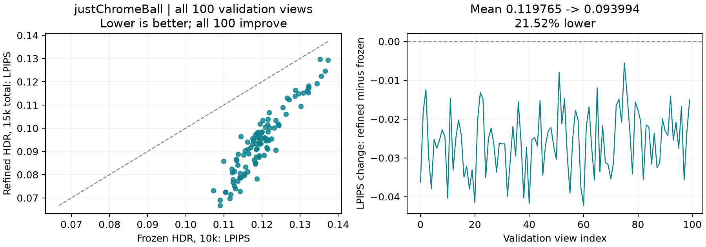
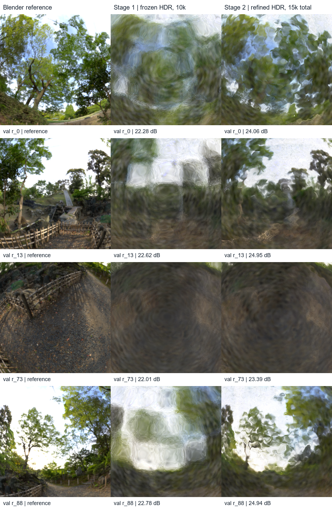

# Sphere follow-up: LPIPS before further tuning

Completed 3 November 2026, Singapore. Evaluation only; no training, geometry
edits or test-set evaluation. This closes the task deferred in the
[2 November write-up](../reports/2026-11-02-research-wrap-up.md).

## Saved-checkpoint comparison

Re-rendered the frozen 10k HDR model and its 5k-refined child at 800x800 on the
same 100 validation cameras. LPIPS uses AlexNet, v0.1 learned weights, full-image
float RGB on white, clipped to [0,1] and mapped to [-1,1], with no metric resize.
The archived checkpoints and training inputs match their hashes; evaluation
source files match the training snapshots. PSNR reproduces within 0.000053 dB
per view and SSIM matches the original CSVs exactly. Tiny GPU floating-point
differences do not affect the reported precision.

| Mean per-view metric | Frozen HDR, 10k | Refined HDR, 15k total |
| --- | ---: | ---: |
| PSNR, dB | 22.4996 | **24.1250** |
| SSIM | 0.842281 | **0.874920** |
| LPIPS AlexNet, lower better | 0.119765 | **0.093994** |

LPIPS decreases **0.025771 (21.52%)**, improving on **100/100** views. This
supports the visual improvement after refinement while leaving a substantial
reflection-detail gap. Extra training, geometry updates and regularization
change together; this is not an equal-budget staging or shader ablation.



*`justChromeBall`, all 100 validation views. Left: each matched camera's LPIPS,
frozen 10k versus refined 15k-total HDR; below the identity line is better.
Right: per-view refinement-minus-frozen change. Existing checkpoint renders
were evaluated without retraining.*

## Splat size: a reasonable hypothesis, not an established cause

The user observes that reflected detail collapses into blobs. The saved crops
show this remaining blur and distortion even after perceptual scores improve.



*`justChromeBall`, validation r_0, r_13, r_73, r_88, top to bottom. Columns:
Blender reference, frozen HDR at 10k, refined HDR at 15k cumulative. Reused actual
images with identical central crops. Labels are whole-image PSNR, not LPIPS or
crop metrics.*

In this implementation, the two tangent scales affect the projected footprint
and which normals blend at each pixel. Stage 2 already learns those scales:
median tangent sigma changes from **0.009119 to 0.008757 scene units**; the
refined 5th/95th percentiles are 0.007528/0.010956. These are stored-primitive
statistics, not evidence that the projected footprints are too large.

Reflection is evaluated **per pixel after normal blending**, rather than assigning
one reflected color to each primitive. The [shader](../../src/cp4282_gs/surfels/hdr_shader.py)
and [projection](../../src/cp4282_gs/surfels/geometry.py) therefore leave several
possible bottlenecks: footprint/overlap, normal-field error and learned lighting.
[3DGS-DR](https://arxiv.org/html/2404.18454v1) also relies on overlapping
primitives to propagate normal gradients. Our inference is that uniformly
shrinking splats could trade smoother blending/coverage for finer support;
sharper reflections are not guaranteed.

Before a size trial, inspect projected footprints and matched normal/environment
diagnostics. If supported, compare one smaller initial tangent-scale multiplier
against the existing size with the same point count, seed, stage budgets and
losses. `--scale-multiplier` exists on the initializer; the staged launcher does
not currently expose it. `learning_rates.scale` changes optimization speed,
not a maximum allowed splat size. No size-tuning experiment was run here.

## Evidence

Portable [per-view frozen CSV](../reports/assets/2026-11-03-sphere-lpips/frozen.csv),
[refined CSV](../reports/assets/2026-11-03-sphere-lpips/refine.csv),
[summary](../reports/assets/2026-11-03-sphere-lpips/summary.csv),
[source/input/checkpoint verification and commands](../reports/assets/2026-11-03-sphere-lpips/evaluation.json),
and [stored scale statistics](../reports/assets/2026-11-03-sphere-lpips/scale-statistics.json).
Full renders and logs remain in `outputs/Nov03-sphere-lpips-verified/`.

To repeat in a new, empty destination:

```bash
python docs/reports/assets/2026-11-03-sphere-lpips/evaluate.py --output outputs/NEW_LPIPS_EVALUATION
```
