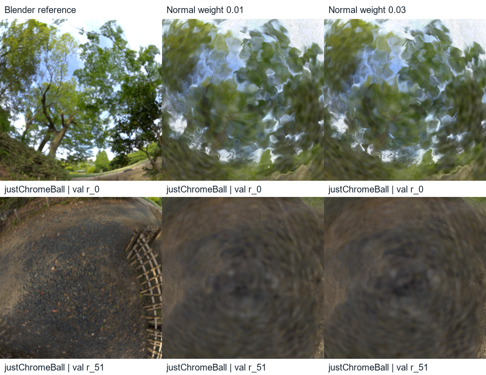
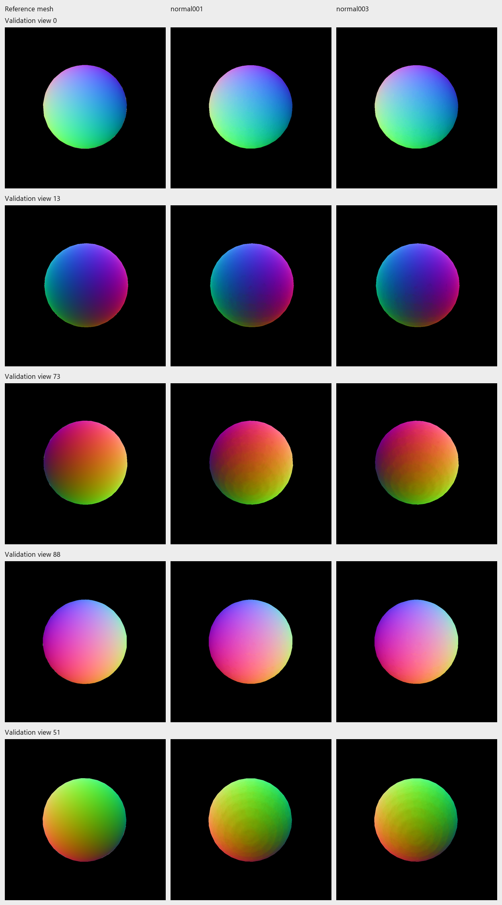
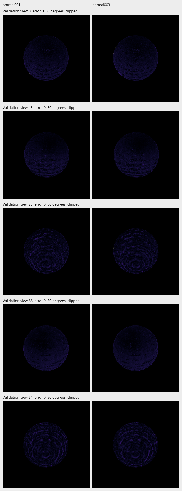

# Normal-weight trial closeout for the final report

The 100k, size-1.0 trial **completed on 3 November**. Earlier instructions calling it prepared/not run were stale. On 7 November, the saved checkpoints were compared with the same evaluator on 100 validation views and with the same Blender normal references on five diagnostic views. No training or test evaluation was run for this closeout.

The parent is `Nov02-2021-justChromeBall-frozen-hdr-10k`; both variants use 5k refinement, 800px, seed 7, 100k surfels, and restarted Adam. Resolved configs differ only in normal–depth weight 0.01 → 0.03 and output. Core training-source fingerprints match. The HDR-0.75 oracle diagnostic is a separate model; do not merge its normal-error means into this comparison.

| Measure | Weight 0.01 | Weight 0.03 |
| --- | ---: | ---: |
| Validation PSNR, 100 views | 24.124931 | 24.085719 |
| SSIM | 0.874920 | 0.874125 |
| LPIPS AlexNet | 0.093994 | 0.094244 |
| Foreground PSNR | 17.751963 | 17.697295 |
| Foreground coverage | 100% | 100% |
| Reference-normal error, mean of five view means | 1.572803° | 1.594260° |
| Normal coherence, mean of five view means | 0.998552 | 0.998927 |

Reference-normal error increases on all five diagnostic views. On validation, 19/100 views improve PSNR, 13/100 improve SSIM and 46/100 improve LPIPS. The small mean changes are a single-seed observation, not a statistical-significance claim. Paired evaluator PSNR differs by about 0.0001 dB from native runner summaries; use the paired table consistently when comparing these checkpoints.



*`justChromeBall`, validation 0 and 51. Columns: reference / normal weight 0.01 / 0.03. Identical reference-defined central crops from actual paired evaluation. Sharp branch/fence structure remains missing; no successful recovery is established.*



*Same sphere, validation 0, 13, 73, 88 and 51 in row order. Columns: reference mesh normals / weight 0.01 / weight 0.03. World normals encoded as RGB. More coherent blended normals do not establish smaller reference error.*



*Same five views. Columns: weight 0.01 / 0.03. Actual angular-error maps, 0–30° clipped display, black outside valid foreground. Small differences should be assessed using the quantitative table as well as these maps.*

The result supports closing this coefficient trial as unsuccessful under the tested policy. Normal–depth consistency compares two learned quantities; increasing its strength is not equivalent to supervising true normals. It remains reasonable to discuss normal/light ambiguity, but this trial does not identify a better regularizer.

## Reproduce the evaluation-only closeout

Use fresh output names and adjust the archival helper if changing them:

```powershell
python scripts/evaluate_reflection_suite.py `
  outputs/Nov02-2023-justChromeBall-staged-hdr-refine-5k `
  outputs/Nov03-1753-justChromeBall-normal003-100k `
  --labels normal001 normal003 --output outputs/Nov07-report-normal003-validation `
  --manifest transforms_val.json --views 0 13 73 88 51 `
  --metrics psnr ssim lpips --cpu-threads 2 --skip-timing
python scripts/diagnose_sphere_footprints.py `
  outputs/Nov02-2023-justChromeBall-staged-hdr-refine-5k `
  outputs/Nov03-1753-justChromeBall-normal003-100k `
  --labels normal001 normal003 --output outputs/Nov07-report-normal003-normals `
  --geometry-reference outputs/Nov03-sphere-geometry-val --views 0 13 73 88 51
python docs/final-report/archive_normal_trial.py
```

[Portable provenance and source hashes](../reports/assets/2026-11-07-normal-weight-closeout/provenance.json), [validation means](../reports/assets/2026-11-07-normal-weight-closeout/validation-summary.csv), [normal measurements](../reports/assets/2026-11-07-normal-weight-closeout/normal-diagnostics.csv). Timing was skipped; no cost claim is added.
