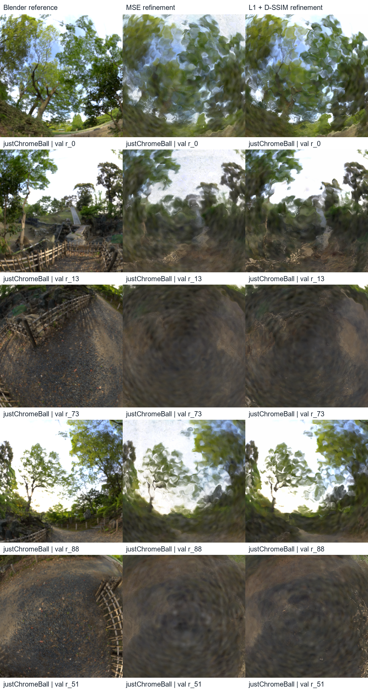
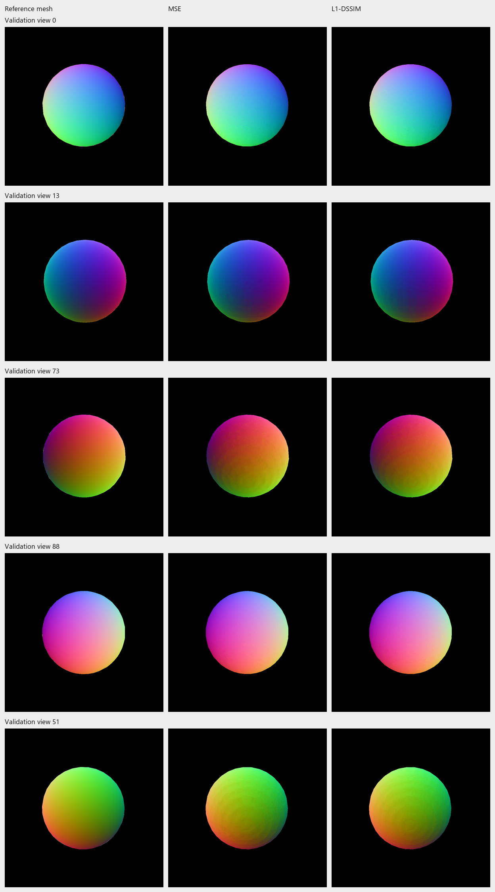
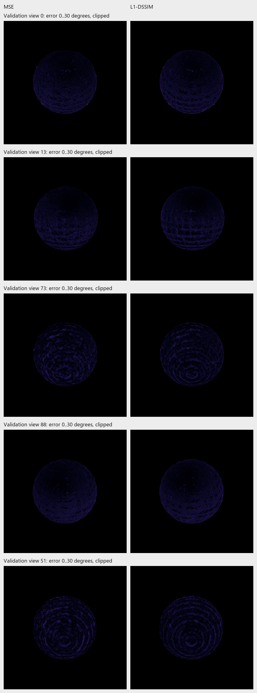

# One refinement-loss trial: MSE versus L1 + D-SSIM

Specified 7 November before launching the trial. This is a validation-only development experiment, separate from the frozen main sphere test comparison.

## Question and fixed protocol

Does replacing the refinement image objective with **0.8 L1 + 0.2 D-SSIM** improve reflection reconstruction compared with the recorded MSE refinement?

- Same parent: `outputs/Nov02-2021-justChromeBall-frozen-hdr-10k/model.ply` and its material sidecar.
- Same 100k surfels, size-1.0 initialization, seed 7, 800px, 5k refinement and restarted Adam.
- Keep learning rates, mask weight 0.1, normal-depth weight 0.01 and its 1k ramp unchanged; no density changes or propagation.
- Change only `surfel.photometric_loss: inherit -> l1_dssim` plus the output destination. The existing override activates L1/D-SSIM from step 1; there is no adaptive gate. D-SSIM is `(1-SSIM)/2` with the repository's reflected 11x11 window.
- Evaluate both saved models on all 100 validation views with the same evaluator. Inspect fixed views 0, 13, 73, 88 and the preserved failure view 51, identical reference-defined reflection crops, foreground quality/coverage and independent reference-normal error.
- No test-set evaluation, additional coefficient sweep, or change to the main study's selected models.

This tests replacement of the complete refinement objective, not SSIM alone or training from scratch. The numerical balance of the image and geometry losses changes even though geometry coefficients stay fixed. Judge lower LPIPS/structural scores together with actual detail, foreground quality and normal error; do not treat a scalar metric gain alone as recovered branches/fencing. Retain either outcome and stop after this trial.

## Completed execution and results

Run: `outputs/Nov07-1548-justChromeBall-l1dssim-100k-refine-5k`. All 5k iterations completed with the logged `l1_dssim` objective, in 70.26 recorded trainer seconds. The earlier MSE refinement recorded 63.84 s, but these separate sessions are not a controlled speed benchmark. Preflight matched all **204 input fingerprints** and **28 training/rendering source files**. Only the configured photometric override and output destination differ. Baseline and parent PLY/material checkpoint hashes remain unchanged.

Both models were re-evaluated with the same current evaluator on all 100 validation views; values below are paired float-render means.

| Measure | MSE refinement | L1 + D-SSIM refinement |
| --- | ---: | ---: |
| PSNR (dB) | 24.124931 | 23.567744 |
| SSIM | 0.874920 | 0.876249 |
| LPIPS AlexNet | 0.093994 | 0.084458 |
| Foreground PSNR (dB) | 17.751963 | 17.200226 |
| Foreground coverage | 100% | 100% |
| Reference-normal error, mean of five view means | 1.572803° | 1.575884° |
| Normal coherence, mean of five view means | 0.998552 | 0.998902 |

LPIPS improves on **100/100 views**, a **10.15%** reduction in its mean. SSIM improves on 64/100 views. PSNR improves on only 1/100 and foreground PSNR on 4/100; their mean changes are −0.5572 and −0.5517 dB. Normal error changes by only +0.0031 degrees across the five diagnostic means, which is essentially unchanged at this experiment's scope, not established geometry degradation or improvement.



*Actual `justChromeBall`, validation views 0, 13, 73, 88 and 51 in row order. Columns: Blender reference / MSE refinement / L1 + D-SSIM refinement. Identical reference-defined central crops. The new objective changes contrast and the appearance of broad structures, but thin branches, fence slats and ground texture remain blurred or warped.*



*Same sphere and five-view order. Columns: reference mesh normals / MSE / L1 + D-SSIM. Actual world-normal maps encoded as RGB. Broad surface shape remains similar; quantitative error is reported independently above.*



*Same five views; columns MSE / L1 + D-SSIM. Actual mesh-normal angular-error maps, clipped at 30°, black outside valid foreground. The small mean error difference does not establish a change in geometry quality.*

## Interpretation and decision

The replacement objective yields a consistent LPIPS benefit with a pixelwise/foreground PSNR cost. It does not recover accurate fine reflection structure or improve reference-normal accuracy in this continuation. This shows that the objective influences the image-quality trade-off, while the remaining failure is not resolved by this single change.

Keep the main SH3/HDR study unchanged. Preserve this run as a supplementary validation-only loss diagnostic, not a new test winner or evidence that D-SSIM alone caused the change. The common parent was fitted with MSE, and unchanged geometry coefficients have a different relative balance against the new image loss. No more loss variants or test evaluations are queued.

## Reproduction and evidence

The original config is `config/experiments/justChromeBall_l1dssim_100k.yaml`. With the saved parent available, run:

```powershell
python scripts/run_experiment.py config/experiments/justChromeBall_l1dssim_100k.yaml `
  --pipeline surfel --name l1dssim-100k-refine-5k `
  --eval-manifest transforms_val.json --metrics psnr ssim lpips
```

`docs/final-report/run_loss_trial.py` records the complete preflight, training, paired validation and normal diagnostics. Its fixed session output must be fresh; choose different names when repeating. It launches no test evaluation. Paths in the archived config are machine-specific and must be rebased on another checkout.

[Protocol and hashes](../reports/assets/2026-11-07-refinement-loss/provenance.json), [paired means](../reports/assets/2026-11-07-refinement-loss/validation-summary.csv), [per-view scores](../reports/assets/2026-11-07-refinement-loss/validation-metrics.csv), [normal errors](../reports/assets/2026-11-07-refinement-loss/normal-diagnostics.csv). Renderer-source differences are empty for both arms; timing of paired rendering was intentionally skipped.

**Good commit point:** the separate loss config, controller, this note, actual figures/CSV/provenance and the report update. Full trial checkpoints remain in ignored `outputs/`.
