# Reconstructing Reflections with Deferred Gaussian Surfels

**CP4282 individual project — draft, revised 11 November 2026**<br>
**Author:** [AUTHOR REVIEW: add name and student number]<br>
**Code and experiment records:** [github.com/wenn5055/3DGSresearch](https://github.com/wenn5055/3DGSresearch)

## Abstract

A chrome sphere reflects a detailed image of its surroundings. Reconstructing that image is difficult: a small error in the surface direction can move an entire reflected branch or highlight. This project extends the course's Warp Gaussian splatting trainer with flat surface patches and a reflection model. On a controlled sphere scene, it compares this model with degree-three spherical harmonics (SH3), using the same starting surface and training budget. Across 200 test views, the reflection model raises mean PSNR from 20.2655 to 24.5732 dB and reduces LPIPS by 35.1%. Fine reflections nevertheless remain blurred or distorted. Further experiments examine lighting, surface normals and training losses. Correcting both lighting and normals restores much more structure; increasing normal–depth consistency alone does not. Replacing MSE with L1 plus D-SSIM improves validation LPIPS by 10.1% but lowers PSNR. The project shows both the benefit of explicit reflection modelling and why a better image score does not necessarily mean correct geometry or sharp reflections.

## 1. Introduction

The aim of novel-view synthesis is to reconstruct a scene from photographs and render it from cameras that were not used for training. Reflective objects are a demanding case. As the camera moves, their highlights and reflected surroundings move across the surface. A model must explain these changes while also learning the object's shape.

This project asks: **Can a surface-based reflection model reconstruct a chrome sphere better than SH3 appearance under the same initialization and training budget?** It also investigates two practical questions: what prevents the remaining reflections from becoming sharp, and which training losses help?

The work builds on the course trainer and the appearance-model discussion in Unit 11. Its main addition is a renderer that first combines surface information at each pixel, then computes the reflection. The experiments compare image quality, inspect reflection crops and measure surface-normal errors. A separate loss study follows up the consultation advice to investigate the training objective.

### 1.1 Initial exploration on Materials

The original plan included Materials and Ship. Work began on Materials by extending the course trainer from fixed RGB to view-dependent SH3 colour, building a working baseline before investigating reflection models. With staged MSE/D-SSIM training, the early fixed-RGB model reached **24.9365 dB PSNR / 0.907943 SSIM**, while SH3 reached **26.0690 dB / 0.922090**. These are means over the same 200 test views at 800 × 800, with seed 7, 30,000 completed iterations, 1,000 random initial Gaussians and capacity for one million.

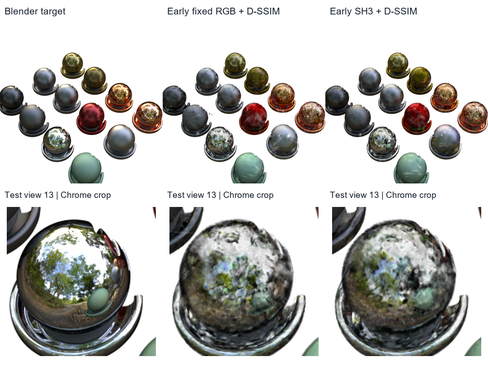

*Figure E1. Original Materials, test view 13. Columns: Blender target, fixed RGB with staged MSE/D-SSIM, SH3 with staged MSE/D-SSIM. Top: full images; bottom: identical Chrome crops, image bounds (200, 505)–(380, 685). Actual saved renders show recognisable materials and reflected colour, but both models miss the target's sharp Chrome detail. View 13 reuses an existing illustration camera; this is an early baseline result, not the later surfel comparison.*

This was an **initial exploration phase**, before the later decisions about training-only surface initialization, fixed surfel count and appearance-first refinement. The historical trainer also used validation images when computing its initial mean colour; the later study uses training-only initialization. These results document baseline development rather than an exact reproduction of the course's published scores, and are not pooled with the main study. [Archived results and protocol](../findings.md#matched-materials-test-comparison)

Later Materials experiments mixed several difficulties: reflective appearance, recessed geometry and reflections of nearby objects. The main study therefore uses a simpler scene: one chrome sphere under forest lighting. Completed Materials experiments remain supporting evidence. This narrower setting makes the reflection question easier to investigate, although it limits how widely the results can be generalised.

## 2. Background: from directional colour to reflections

### 2.1 What this project takes from the course

Gaussian splatting represents a scene with many small, overlapping Gaussian blobs. A renderer projects them into an image and blends their contributions. Training changes their positions, shapes, opacity and appearance to reduce image error. Units 8 and 9 provide the Warp training framework used as this project's starting point. [Unit 8](https://weitsang.github.io/gaussian-splatting-notes/unit-8/), [Unit 9](https://weitsang.github.io/gaussian-splatting-notes/unit-9/)

Unit 11 explains how spherical harmonics let each primitive's colour change with viewing direction. SH is a weighted combination of fixed directional functions: lower degrees describe broader changes, while higher degrees provide more angular detail. The unit also motivates using surface normals and reflected directions for reflective appearance. That is the direction pursued here. [Unit 11: appearance beyond SH](https://weitsang.github.io/gaussian-splatting-notes/unit-11/#project-ideas-appearance-models-beyond-spherical-harmonics)

Our control uses **SH3**, meaning spherical harmonics up to degree three. It stores 16 coefficients per colour channel, or 48 scalar values including the constant term. It predicts colour from viewing direction. The reflection model instead uses a surface normal to determine which part of a shared image of the surroundings should be visible, combined with base colour and an angle-dependent reflection strength. This gives neighbouring surface elements a common source of reflected detail. The comparison tests these two ways of predicting appearance. Several appearance components change together, so it does not isolate the contribution of each component.

### 2.2 Papers that informed the implementation

| Work | Relevant idea | How it is used here |
| --- | --- | --- |
| [3DGS, Kerbl et al.](https://repo-sam.inria.fr/fungraph/3d-gaussian-splatting/) | Gaussian scene representation and splatting | Background for the course framework |
| [Gaussian Surfels, Dai et al.](https://arxiv.org/abs/2404.17774) | Flat Gaussian surface patches and normal–depth consistency | Surface representation and geometry loss |
| [3DGS-DR, Ye et al.](https://arxiv.org/abs/2404.18454) | Compute reflections after blending surface attributes | Two-pass reflection rendering |
| [RGS-DR, Kouros et al.](https://arxiv.org/abs/2504.18468) | Deferred surfel shading and residual appearance | Closely related work; its full system is not reproduced |

[2DGS](https://surfsplatting.github.io/) is also relevant to surface-based rendering, but uses perspective-accurate ray–splat intersections. This project retains the course renderer's projection approximation: each Gaussian contributes over a soft, elliptical area in the image, called its **projected footprint**. A pixel filter broadens that footprint to reduce aliasing, such as flickering when a primitive becomes smaller than a pixel. Appendix A gives the technical distinction from 2DGS.

[Ref-NeRF](https://dorverbin.github.io/refnerf/) provides broader context for describing appearance through reflected directions. It uses a **neural radiance field (NeRF)**: a neural network predicts density and view-dependent colour at locations in space, and rendering combines samples along each camera ray. Our model instead stores explicit Gaussian surface elements.

These papers inform the design. The project contribution is implementing and investigating the chosen combination in Warp, with controlled comparisons and diagnostics. It does not claim a new rendering algorithm.

## 3. How the method works

### 3.1 Represent the object with surfels

A **surfel** is a small, flat surface element. Here it is a Gaussian patch with a position, orientation and two scales controlling its width within the surface plane. Its thickness is fixed to zero. Its **normal** is a unit vector perpendicular to the patch, describing which direction the surface faces.

The initial surfels come from the training images' alpha masks, which separate the object from the background. Combining these silhouettes across cameras estimates a surface around the object. This is a training-derived estimate, not the Blender mesh. The same 100,000 surfels initialise both main methods. Unit 12 explains why initialization matters: a primitive's projected footprint affects which image regions can provide a useful training signal. [Unit 12: initialization and local optimization](https://weitsang.github.io/gaussian-splatting-notes/unit-12/#why-the-renderer-makes-optimization-local)

Silhouettes cannot recover hidden recesses. That mattered in the earlier logo experiment and helped motivate using a plain sphere.

### 3.2 Render the surface, then compute its reflection

Rendering has two steps:

1. **Combine surface information at each pixel.** Blend the contributing surfels' base colours, normals, depth and reflection strengths, using the same visibility weights as image compositing.
2. **Shade the pixel.** Use the combined normal and camera ray to find the reflected direction. Sample the learned environment map in that direction, then blend the reflected light with the base colour.

An **environment map** is an image of the surroundings indexed by direction. The map here is learned from training images; the original forest texture is not supplied to the optimizer. It contains positive high-dynamic-range (HDR) lighting values and has resolution 512 × 256.

The shader also learns how the reflection contribution changes with viewing angle. It uses a shared table of 16 adjustable values. This choice followed inspection of the scene's artistic Chrome material, whose colour varies with angle. The material inspection informed the model's design; its actual curve values were not copied into training.

The reflection is evaluated **after** surface attributes have been combined, which is why the method is called deferred shading. Overlapping surfels then contribute to one pixel's shading calculation. During training, an image error can therefore update the normals of all those contributors. This is the gradient path motivated by 3DGS-DR and discussed in Unit 11. The exact equations are provided in Appendix A.

The implemented model is an HDR reflection blend. It does not estimate a full roughness-based material model or trace reflections of nearby objects.

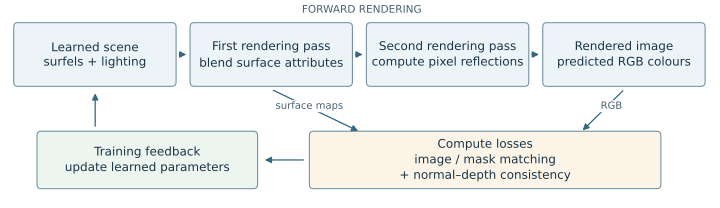

*Figure M1. Schematic of the implemented method, not an experimental render. Image loss uses RGB; mask and normal–depth losses use the surface maps. Feedback updates appearance first, then geometry as well during refinement.*

### 3.3 Fit appearance first, then refine the surface

Both main methods follow the same schedule:

| Stage | Iterations | Parameters that can change |
| --- | ---: | --- |
| Appearance fitting | 10,000 | Appearance only; position, scale, orientation and opacity stay fixed |
| Refinement | 5,000 | Geometry, opacity and appearance |

The first stage lets appearance fit the estimated surface before geometry starts moving. Refinement then allows smaller geometry updates. Adam, the parameter-update algorithm, restarts its optimizer state at the transition; the learned model parameters are retained.

Both methods use the same geometry-loss settings and learning-rate schedules. Each retains **100,000 surfels** throughout training and completes **15,000 iterations: 10,000 appearance-fitting steps plus 5,000 refinement steps**. No surfels are added or removed, and early stopping is disabled. Here, a reported point count means the number of surfel primitives, not image pixels or sampled camera rays. The SH3 control gradually enables its three directional bands during the first stage. Following the same update policy does not force the two methods to learn identical final surfaces.

## 4. Loss functions: what training is asked to improve

A **loss** gives the optimizer a training objective. A **metric** measures the quality of a saved result. A quantity such as SSIM can serve both roles, but it must be differentiated to be used for training. This distinction is introduced in Units 5 and 10. [Unit 5: image loss](https://weitsang.github.io/gaussian-splatting-notes/unit-5/#loss-measure-image-error), [Unit 10: structural loss](https://weitsang.github.io/gaussian-splatting-notes/unit-10/#from-ssim-metric-to-structural-loss)

Three types of loss are used here: image matching, foreground-mask matching and normal–depth consistency. They address different errors.

### 4.1 Image loss: match the reference colours and structure

**MSE** averages the squared difference between rendered and target RGB values. If e is one colour-channel error, its contribution is e². Doubling that error multiplies its squared penalty by four. MSE is simple to differentiate and penalises large colour errors strongly.

The main SH3/HDR comparison uses MSE in both training stages. This was inherited from the fixed-surface appearance experiment to keep a shared objective. It was not selected because a loss study proved it was best. Unit 10 discusses the limitation: matching pixel values does not explicitly require neighbouring pixels to form the correct local structure. [Unit 10: MSE as a starting point](https://weitsang.github.io/gaussian-splatting-notes/unit-10/#why-mse-is-a-useful-but-limited-starting-point)

The additional loss experiment uses **L1 + D-SSIM**:

L1 averages absolute RGB differences, |e|. Its penalty doubles when the error doubles. SSIM compares local brightness, contrast and structure; converting it to D-SSIM makes smaller values better. Together they ask for colour agreement and local structural similarity. Our implementation uses reflected, uniform 11 × 11 RGB windows.

<div class="equation">L<sub>image</sub> = 0.8 L<sub>1</sub> + 0.2 L<sub>D-SSIM</sub>, &nbsp; L<sub>D-SSIM</sub> = (1 − SSIM) / 2.</div>

Unit 10 combines **MSE** with D-SSIM after a warm-up. Our additional trial instead combines **L1** with D-SSIM from the first refinement step, reusing an existing implementation. It therefore tests a replacement objective, not an exact reproduction of the course curriculum. Because the surface pass already renders full images, its MSE baseline does not use the course curriculum's sparse warm-up. LPIPS is used for evaluation only, not as a training loss.

### 4.2 Mask loss: keep the object separate from the background

RGB matching alone can miss a geometry error if an incorrectly placed surfel has the same colour as the background. The mask loss separately compares rendered coverage—the accumulated opacity at each pixel—with the training image's alpha mask. It penalises missing object coverage and unwanted background coverage, using binary cross-entropy.

The mask weight is **0.1** during refinement. This supplies foreground information independently of the RGB colours. It uses only training masks and does not supply the true surface depth or orientation.

### 4.3 Normal–depth consistency: make two descriptions of the surface agree

The model describes surface orientation in two ways. Surfel orientations produce a normal map: an image recording the surface direction at each pixel. The depth map records surface depth at each pixel, from which another normal can be estimated.

To obtain that second normal, use the camera geometry and neighbouring depth values to locate their points in 3D. The vectors from left to right and from top to bottom describe the local surface slopes. Their cross product gives a direction perpendicular to that surface. After normalisation and alignment to the same camera coordinates, compare it with the rendered surfel normal:

<div class="equation">L<sub>normal-depth</sub> = mean(1 − n<sub>rendered</sub> · n<sub>from depth</sub>).</div>

Both vectors have unit length. Agreement gives zero loss; angular disagreement increases it. Gradients flow through both paths, so training can change surfel orientations and the geometry producing the depth map. Unreliable pixels near depth jumps, low coverage or invalid neighbourhoods are excluded.

This encourages agreement with the local surface slope; it does not simply make all normals point in one direction. Crucially, **both predictions come from the model itself**. Two incorrect predictions can agree, so consistency is not proof of accurate geometry. The separate Blender-normal evaluation checks that accuracy.

### 4.4 The objective actually used

The main refinement objective is

<div class="equation">L = L<sub>MSE</sub> + 0.1 L<sub>mask</sub> + λ<sub>n</sub>(t) L<sub>normal-depth</sub>.</div>

The normal weight increases from zero to **0.01** over the first 1,000 refinement steps. During the frozen stage, geometry losses are disabled. The image-loss trial replaces only L<sub>MSE</sub> with the L1/D-SSIM expression above. The consistency-weight trial changes the final normal weight from 0.01 to 0.03.

These coefficients are fixed experimental settings, not demonstrated optima. Keeping geometry coefficients unchanged also does not preserve their relative influence when the image-loss scale changes. Unit 10's discussion of geometric losses motivates checking geometry separately from image scores. [Unit 10: geometric terms](https://weitsang.github.io/gaussian-splatting-notes/unit-10/#3-add-a-geometric-term-when-extra-signals-are-available)

## 5. Experimental setup and evaluation

### 5.1 Scene, splits and fair comparison

The `justChromeBall` scene contains one smooth chrome sphere under forest lighting. It was captured in Blender at 800 × 800 pixels, with 100 training, 100 validation and 200 test views. Cameras come from the Materials templates, with disjoint split poses. Targets are composited on white.

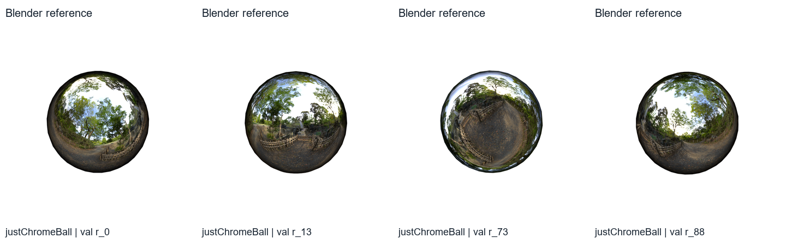

*Figure 1. Chrome sphere, validation views 0, 13, 73 and 88, left to right. Actual Blender target images show the reflected scene the model should reconstruct.*

The main comparison holds the starting surface, 100,000 surfels, seed 7, resolution and 15k-step schedule fixed. SH3 uses directional colour; HDR-1.0 uses the reflection model. Both use surfels, so this comparison concerns appearance on a common representation rather than a switch from volumetric Gaussians to surfels.

An additional model, **HDR-0.75**, starts with tangent scales reduced to 75% of the original; all other initializer fields are preserved. The scales can change during refinement. This variant is included as a supplementary result and supplies the lighting/normal diagnostics. The primary comparison is SH3 versus same-size HDR-1.0.

Only training RGB and alpha supply fitting gradients. Validation supports monitoring and selection. Blender normals and the original environment are used only for diagnostic rendering. The loss and normal-weight trials are validation-only follow-ups and do not replace the main test models.

### 5.2 What is measured

| Measure | What it tells us | Better direction |
| --- | --- | --- |
| PSNR | Pixelwise colour accuracy, expressed from MSE in decibels | Higher |
| SSIM | Similarity of local image structure | Higher |
| LPIPS, AlexNet | Similarity of image features computed by a fixed neural network | Lower |
| Foreground PSNR | Pixel accuracy restricted to the object | Higher |
| Normal error | Angular difference from reference mesh normals | Lower |

Unit 6 recommends reading image metrics together and investigating disagreements. We therefore pair them with actual reflection crops. Metrics use float renders with RGB values scaled to [0, 1], rather than saved 8-bit figures. Foreground PSNR uses reference alpha ≥ 0.95; coverage counts foreground pixels whose rendered coverage reaches 0.5. [Unit 6: evaluation](https://weitsang.github.io/gaussian-splatting-notes/unit-6/#reading-the-three-together)

Main test figures use cameras 0, 13, 73 and 88. Validation diagnostics also preserve view 51, an earlier failure. Crop bounds are identical across compared methods. Five-view normal diagnostics are labelled separately from 100-view validation and 200-view test averages.

## 6. Results and what they mean

### 6.1 The reflection model improves the main comparison

*Table 1. All 200 sphere test views; 100k surfels and 15k training steps per model. Higher PSNR/SSIM and lower LPIPS are better.*

| Model | PSNR (dB) | SSIM | LPIPS | Foreground PSNR (dB) |
| --- | ---: | ---: | ---: | ---: |
| SH3 | 20.2655 | 0.821398 | 0.128760 | 13.6520 |
| HDR-1.0, matched primary | 24.5732 | 0.880892 | 0.083517 | 18.2494 |
| HDR-0.75, additional variant | 24.7453 | 0.884031 | 0.080988 | 18.4427 |

At the same starting size, HDR gains **4.31 dB PSNR** and reduces LPIPS by **35.1%**. The foreground gain is 4.60 dB, showing that the benefit is also present on the object. All models retain full foreground coverage under the stated threshold.

The benefit appears on **200/200 views** for PSNR, SSIM, LPIPS and foreground PSNR. The per-view PSNR gain has median 4.4439 dB and range 2.9349–5.5425 dB. This describes variation across cameras in one fitted model pair; it does not measure uncertainty across training seeds.

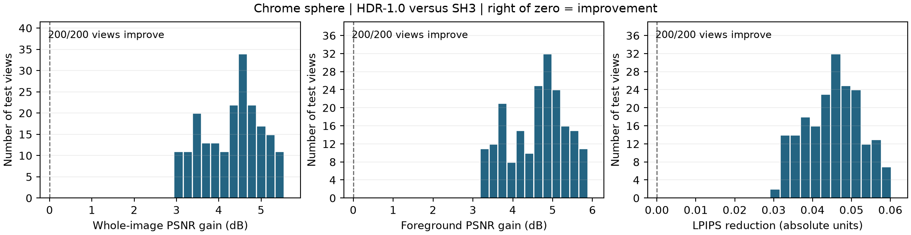

*Figure 2. Chrome sphere, all 200 test views, HDR-1.0 versus SH3. Each bar counts views within an improvement range: the horizontal axis gives the gain, and the vertical axis gives the number of views. PSNR gain is HDR minus SH3, in dB; LPIPS reduction is SH3 minus HDR, in absolute metric units. Zero means no change; values to its right favour HDR. All 200 views improve in every panel. These histograms use saved metrics, without additional rendering or model selection.*

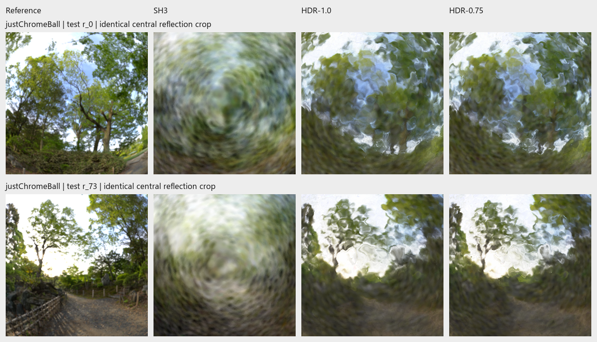

*Figure 3. Sphere test views 0 and 73. Columns: target, SH3, HDR-1.0, HDR-0.75. Actual crops show more tree/sky structure with HDR, while thin branches and fencing remain smeared or distorted. The full four-view comparison remains in the experiment evidence.*

The smaller-size model adds a modest mean gain of 0.17 dB over HDR-1.0. It improves PSNR on 198/200 views and LPIPS on 189/200. It does not remove the visible reflection defects.

### 6.2 Refinement improves reflected structure, with remaining failures

For size-1.0 HDR, adding 5k refinement steps improves validation PSNR from 22.4996 to 24.1250 dB and LPIPS from 0.119765 to 0.093994. PSNR improves on 95/100 views; SSIM and LPIPS improve on all 100. This comparison includes extra training as well as geometry refinement, so it does not isolate the effect of geometry updates alone.

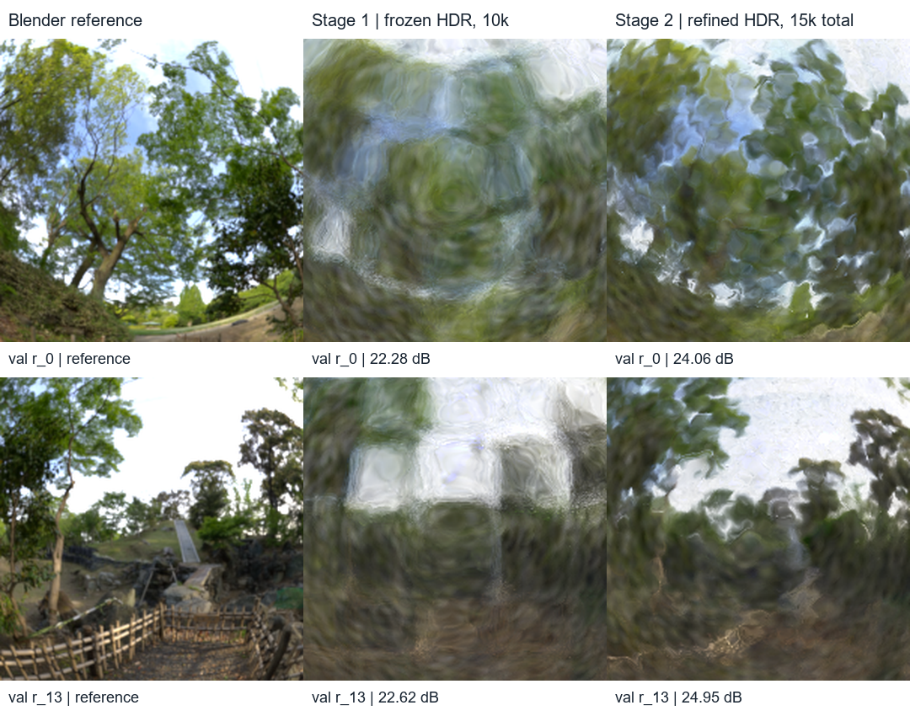

*Figure 4a. Chrome sphere, validation views 0 and 13, top to bottom; size-1.0 HDR. Columns: target, frozen appearance fit at 10k steps, refinement at 15k total. Identical reflection crops show better separation of tree/sky regions in view 0 and a clearer sky opening, tree shapes and foreground boundary in view 13. Fine branches and fencing remain unresolved. These actual saved renders reuse the original illustration views; the complete four-view comparison is preserved in the experiment evidence.*

The improvement is visible before considering the scores: broad reflected structures become more recognisable after refinement, although they remain distorted. The following failure illustrates a remaining limit rather than the typical direction of change.

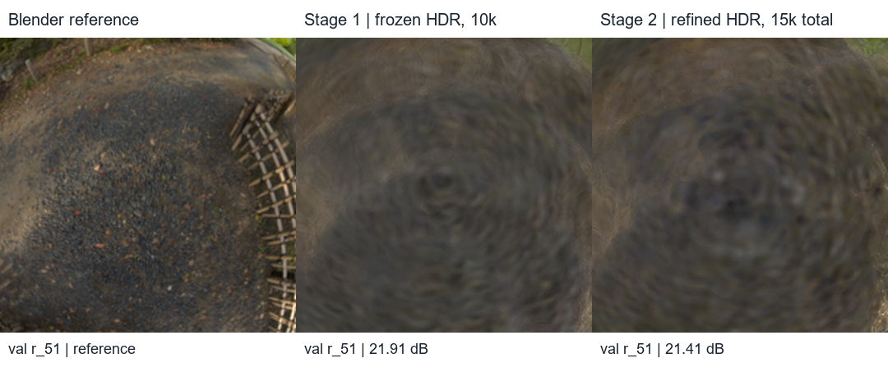

*Figure 4b. Chrome sphere, validation view 51: target, frozen size-1.0 HDR at 10k steps, refined HDR at 15k total. This is the largest PSNR-regression view, selected after inspecting validation scores. It preserves the missing ground and fence detail despite the average improvement.*

The reflection model also uses less stored checkpoint data: **8.54 MB versus 23.50 MB** for SH3 in this implementation. A shared environment replaces many per-surfel directional coefficients. Observed forward rates are of similar scale, about 274–304 FPS. Exact timing/memory definitions and measurements are in Appendix C; these values do not establish a general shader-speed advantage.

### 6.3 Lighting and normal errors both limit detail

These lighting/normal diagnostics use the saved **HDR-0.75 additional variant**, rather than the primary HDR-1.0 model. All substitutions below use the same HDR-0.75 checkpoint; they diagnose its errors and do not replace the main comparison. Its learned environment is visibly less detailed than the original forest map, even when both are shown at the same resolution and display exposure.

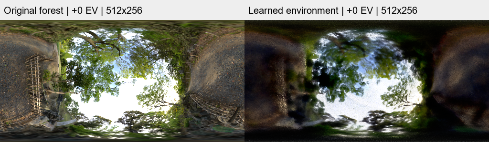

*Figure 5. Forest lighting for the chrome sphere: original map on the left; environment learned by HDR-0.75 on the right. Both are 512 × 256 in the renderer's direction convention and use the same display exposure (0 EV). Actual maps show missing branch, fence and ground structure in the learned lighting. This is a display comparison, not another training variant.*

Replacing the learned map with the original lighting lowers validation LPIPS from 0.091814 to 0.079982, but reflections remain distorted and PSNR falls. To check the normal contribution, a second diagnostic renders the same saved model with learned or reference lighting and learned or reference shading normals.

Here **reference** means Blender information used only for this diagnostic. Reference normals come from the actual sphere mesh, rather than an ideal analytic sphere. Normal replacement changes the blended normal's direction after rasterization; coverage, depth, colours and learned material parameters stay fixed. It affects both reflected direction and the angle-dependent blend.

*Table 2. Means over five fixed validation views: 0, 13, 73, 88 and 51. Same HDR-0.75 model in all cases.*

| Lighting | Normals | PSNR (dB) | SSIM | LPIPS |
| --- | --- | ---: | ---: | ---: |
| Learned | Learned | 23.8554 | 0.871914 | 0.096202 |
| Reference | Learned | 20.4016 | 0.844558 | 0.085452 |
| Learned | Reference | 23.0536 | 0.867943 | 0.101984 |
| Reference | Reference | 22.7073 | 0.943615 | 0.056796 |

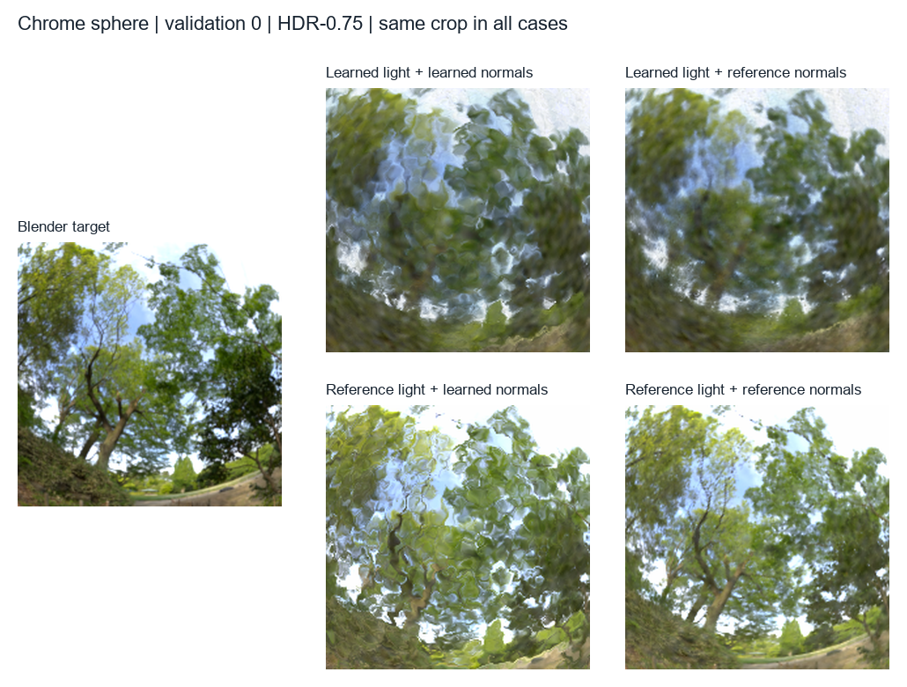

*Figure 6. Chrome sphere, validation view 0, same HDR-0.75 checkpoint and identical reflection crop. Left: Blender target. In the 2 × 2 grid, rows use learned/reference lighting and columns use learned/reference normals. Top left: trained result, blurred and rippled; top right: reference normals with learned lighting, still blurred; bottom left: reference lighting with learned normals, detailed but rippled; bottom right: both reference inputs, recovering much more recognisable structure. All four are actual saved diagnostic renders; the five-view comparison remains in the experiment evidence.*

Correcting normals helps strongly **when reference lighting is used**: PSNR rises by 2.31 dB and LPIPS improves by 0.0287. Under learned lighting, the same normal replacement instead worsens mean LPIPS by 0.0058. This dependence on the lighting suggests that the learned map and normals have fitted together; correcting one input alone need not improve the image.

The learned normals' mean error is only about **1.47°**. Even a small error can move fine reflected content. For illustration, in a coplanar mirror example a 1.5° normal rotation turns the reflected ray by 3°—about four longitude texels on a 512-wide environment map at its equator. This is an explanatory example, not a measured average ray displacement.

The joint reference case gives the best SSIM and LPIPS here, but its PSNR remains below the learned pair. Brightness, learned materials and shader/sampling differences remain. The diagnostic therefore reveals a limitation; it is not an improvement achieved by training.

### 6.4 Stronger consistency does not produce more accurate normals

The consistency experiment changes only the final normal–depth weight from 0.01 to 0.03, using the same frozen parent and 5k refinement. It uses the size-1.0 model, separately from the size-0.75 diagnostic above.

*Table 3. All 100 validation views for image scores; five diagnostic views for normal error.*

| Normal–depth weight | PSNR (dB) | SSIM | LPIPS | Normal error (degrees) |
| --- | ---: | ---: | ---: | ---: |
| 0.01 | 24.1249 | 0.874920 | 0.093994 | 1.5728 |
| 0.03 | 24.0857 | 0.874125 | 0.094244 | 1.5943 |

The stronger weight slightly worsens image scores and reference-normal error. Contributing normals become more aligned with each other, but not more accurate against Blender. This is the distinction in Section 4.3: agreement between the model's normals and depth is not independent evidence that either is correct. The result concerns one coefficient and schedule, not all possible geometry losses.

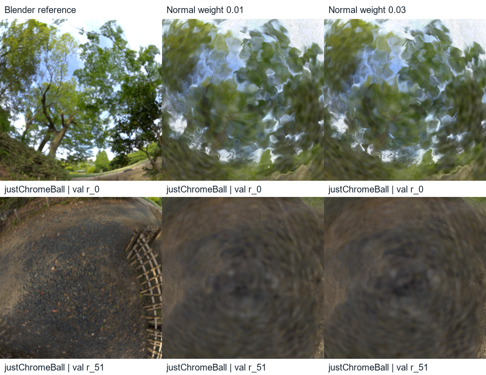

*Figure 7. Sphere validation views 0 and 51: target, consistency weight 0.01, weight 0.03. Identical actual crops preserve the missing branch and fence detail; increasing the weight does not recover it.*

### 6.5 L1 + D-SSIM improves LPIPS, at a PSNR cost

The image-loss trial keeps the same size-1.0 frozen parent, seed, 5k refinement, learning rates and geometry-loss coefficients. Only the image objective changes from MSE to 0.8 L1 + 0.2 D-SSIM.

*Table 4. All 100 validation views for image scores; five diagnostic views for normal error. This is a follow-up, not a replacement for the main test comparison.*

| Refinement image loss | PSNR (dB) | SSIM | LPIPS | Normal error (degrees) |
| --- | ---: | ---: | ---: | ---: |
| MSE | 24.1249 | 0.874920 | 0.093994 | 1.5728 |
| L1 + D-SSIM | 23.5677 | 0.876249 | 0.084458 | 1.5759 |

LPIPS improves on **all 100 views**, with a **10.15% lower mean**. SSIM improves on 64/100. However, PSNR falls by 0.56 dB on average and improves on only 1/100 views. Foreground PSNR also falls by 0.55 dB, while coverage stays complete. Normal error is essentially unchanged.

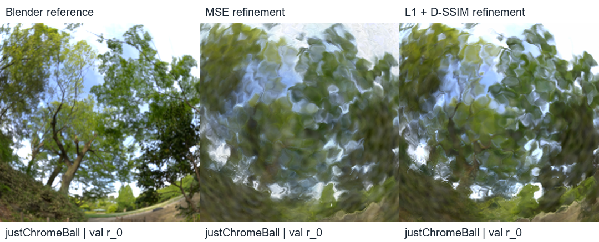

*Figure 8. Sphere validation view 0: target, MSE refinement, L1 + D-SSIM refinement. Actual central crops show changed contrast, while thin branches remain smeared or distorted. The full five-view comparison is preserved with the loss experiment.*

The loss choice changes the image-quality trade-off, but this trial does not recover the missing fine reflections. It also changes both the pixel penalty and the structural term, so it cannot tell us which caused the gain. A separate MSE + D-SSIM control would be needed to isolate those effects. This is a useful next comparison if loss design is pursued further; it is not a result supplied by the current study.

## 7. Discussion and limitations

Three findings answer the project's questions. First, the reflection model improves the tested SH3 comparison consistently across cameras. Second, accurate normals and lighting matter together: correcting both recovers detail that the trained model misses. Third, neither a stronger consistency penalty nor a better LPIPS score establishes more accurate geometry.

The main comparison has one scene and one training seed. Its 200 cameras provide many views of those fitted models, not 200 independent training repetitions. The method also changes several appearance components together, and its final geometry can differ from SH3's. Further controls would be needed to separate the effects of HDR, angular response and deferred evaluation.

The loss trial changes an existing MSE-trained model rather than starting both objectives from scratch. Its geometry coefficients also have a different relative scale after the image-loss change. The normal/lighting replacement tests use information unavailable during fitting and inspect five development cameras. They explain errors but do not demonstrate recovered lighting or materials suitable for general relighting.

The main settings were selected on validation and recorded before the main test evaluation. Later diagnostics occurred after those test scores were visible; historical Materials test results had also been inspected. The main models are therefore preserved as a recorded comparison, rather than repeatedly retuned using those test results. The follow-up loss and normal-weight trials use validation only.

## 8. Conclusion

Deferred reflection shading improves this controlled sphere reconstruction over SH3: +4.31 dB test PSNR and 35.1% lower LPIPS, with smaller stored checkpoints. It still misses fine reflected structure.

The most useful lesson is to check what an improvement means. Reference-lighting/normal renders reveal errors hidden by a jointly fitted image. Stronger consistency makes learned surface descriptions agree without improving their accuracy. L1 + D-SSIM improves perceptual similarity while sacrificing pixel accuracy. These results support evaluating losses with image metrics, reflection crops and independent geometry checks together.

With more time, I would make those diagnostics part of the process earlier, isolate the image-loss components, and repeat the main comparison across seeds and another reflective scene. The next step should answer one of those specific questions rather than continue broad parameter tuning.

## AI-use declaration

**Proposed wording for author review:** OpenAI Codex assisted with code inspection, implementation/debugging, experiment tooling, literature lookup and report drafting. Outputs were checked against recorded gradient tests, source/input/checkpoint hashes, saved evaluation results and actual rendered figures. **[AUTHOR REVIEW: confirm this account, add other AI tools used, and describe the research decisions and verification you personally performed.]**

## References

1. CP4282, *Gaussian Splatting Notes*: [Unit 5—differentiable rendering](https://weitsang.github.io/gaussian-splatting-notes/unit-5/), [Unit 6—evaluation](https://weitsang.github.io/gaussian-splatting-notes/unit-6/), [Unit 8—synthetic Warp training](https://weitsang.github.io/gaussian-splatting-notes/unit-8/), [Unit 9—full Warp trainer](https://weitsang.github.io/gaussian-splatting-notes/unit-9/), [Unit 10—training loss](https://weitsang.github.io/gaussian-splatting-notes/unit-10/), [Unit 11—view-dependent appearance](https://weitsang.github.io/gaussian-splatting-notes/unit-11/), [Unit 12—initialization](https://weitsang.github.io/gaussian-splatting-notes/unit-12/). Accessed 7 November 2026.
2. Kerbl, B., Kopanas, G., Leimkühler, T., and Drettakis, G. (2023). *3D Gaussian Splatting for Real-Time Radiance Field Rendering*. ACM TOG. [Paper](https://repo-sam.inria.fr/fungraph/3d-gaussian-splatting/).
3. Dai, P., Xu, J., Xie, W., Liu, X., Wang, H., and Xu, W. (2024). *High-quality Surface Reconstruction using Gaussian Surfels*. SIGGRAPH. [Paper](https://arxiv.org/abs/2404.17774).
4. Ye, K., Hou, Q., and Zhou, K. (2024). *3D Gaussian Splatting with Deferred Reflection*. SIGGRAPH. [Paper](https://arxiv.org/abs/2404.18454).
5. Kouros, G., Wu, M., and Tuytelaars, T. (2025). *RGS-DR: Deferred Reflections and Residual Shading in 2D Gaussian Splatting*. arXiv:2504.18468. [Paper](https://arxiv.org/abs/2504.18468).
6. Huang, B., Yu, Z., Chen, A., Geiger, A., and Gao, S. (2024). *2D Gaussian Splatting for Geometrically Accurate Radiance Fields*. SIGGRAPH. [Paper](https://surfsplatting.github.io/).
7. Verbin, D., Hedman, P., Mildenhall, B., Zickler, T., Barron, J. T., and Srinivasan, P. P. (2022). *Ref-NeRF: Structured View-Dependent Appearance for Neural Radiance Fields*. CVPR. [Paper](https://dorverbin.github.io/refnerf/).
8. Wang, Z., Bovik, A. C., Sheikh, H. R., and Simoncelli, E. P. (2004). *Image Quality Assessment: From Error Visibility to Structural Similarity*. IEEE TIP. [Paper](https://www.cns.nyu.edu/~lcv/ssim/).
9. Zhang, R., Isola, P., Efros, A. A., Shechtman, E., and Wang, O. (2018). *The Unreasonable Effectiveness of Deep Features as a Perceptual Metric*. CVPR. [Paper](https://richzhang.github.io/PerceptualSimilarity/).
10. Mildenhall, B., Srinivasan, P. P., Tancik, M., Barron, J. T., Ramamoorthi, R., and Ng, R. (2020). *NeRF: Representing Scenes as Neural Radiance Fields for View Synthesis*. ECCV. [Project and dataset source](https://www.matthewtancik.com/nerf).

## Appendix A. Technical details and attribution

The core renderer keeps filtered screen-space Gaussian footprints and front-to-back blending. For rotation Rᵢ and positive tangent scales sₓᵢ, sᵧᵢ, a surfel has covariance Rᵢ diag(sₓᵢ², sᵧᵢ², 0) Rᵢᵀ and normal Rᵢ(0,0,1)ᵀ. Depth uses contributor ray–plane intersections with guarded fallback to centre depth. This does not replace the footprint with the complete perspective-accurate 2DGS rasterizer. The main study disables growth, pruning, opacity resets, the published normal-propagation procedure and early stopping.

For visibility weights wᵢ, the first pass stores colour C = Σwᵢcᵢ, normal sum N = Σwᵢnᵢ, coverage A = Σwᵢ and reflection sum S = Σwᵢσ(mᵢ). The shading normal is n = N/‖N‖. The incoming camera-to-surface ray d reflects to r = d − 2(d·n)n.

The shader bilinearly samples raw environment parameters and decodes them with softplus. Its reflection blend is s = σ(logit(clamp(S/A)) + g(|d·n|)), where g linearly interpolates 16 learned values initially set to zero. Base RGB is converted to linear light, mixed with reflected radiance, clipped and converted to display RGB before composition over white. Training compares display RGB. No reference environment pixels, mesh normals or material-curve values enter fitting.

Ignoring the normalization epsilon and holding weights fixed, the normal-only gradient is wᵢ(I−nnᵀ)/‖N‖ times the pixel-normal gradient. This connects overlapping contributors to the same shading objective. The implementation also differentiates compositing weights and the angle-dependent blend.

| Component | Origin or influence |
| --- | --- |
| Projection, compositing and Adam infrastructure | Course/assignment Warp framework |
| Flat surfels and consistency formulation | Adapted Gaussian Surfels ideas |
| Deferred normal/environment shading | Adapted 3DGS-DR ideas |
| HDR/angular model, staged experiments and diagnostics | Project implementation |

**[AUTHOR REVIEW: confirm the exact assignment/project boundary and any external code copied verbatim; add file-level attribution and licence acknowledgements where needed.]**

Recorded correctness checks include 22 HDR finite-difference cases per device on CPU and CUDA, plus save/reload and 800px integration checks. Tests verify display conversion before coverage composition. Normal-replacement checks preserve checkpoint hashes and non-normal buffer fields and reproduce the previous lighting baselines. These are recorded development checks, not newly repeated training runs. The [test code](https://github.com/wenn5055/3DGSresearch/blob/59c553f/scripts/test_surfel_hdr.py) and dated experiment records supply details. Unit 9 explains why checking derivatives separately from forward rendering matters. [Unit 9: gradient checks](https://weitsang.github.io/gaussian-splatting-notes/unit-9/#the-central-idea-differentiate-the-primitive-hand-write-the-blend)

## Appendix B. Reproduce the results

The repository's recorded study code/evidence commit is `59c553f`; later report helpers accompany this draft. Each run retains its settings and source/input hashes. All 400 sphere images and split manifests are tracked. Capture used Blender 5.0.1, 128 samples, seed 7, Standard colour transform, exposure zero and gamma one. Scene/data attribution is recorded in `data/blender/SOURCE.md`: Materials comes from the NeRF scene distribution, with the original asset credited to elbrujodelatribu (CC0).

### B.1 Evaluate the saved main models

The locally prepared `outputs/final-report-reproduction/checkpoints.zip` contains the three main final models. Extract it into a **fresh clone** to preserve the original workspace's metadata. PLY and surfel sidecars are required together; SH3 also needs its SH sidecar. **[AUTHOR REVIEW: upload or attach the prepared bundle and add its persistent location here; full checkpoints are outside Git.]**

Install `requirements.txt` in the research environment. From the clone's root, run:

```powershell
python scripts/evaluate_reflection_suite.py `
  outputs/Nov03-1357-justChromeBall-staged-sh3-refine-5k `
  outputs/Nov02-2023-justChromeBall-staged-hdr-refine-5k `
  outputs/Nov03-1402-justChromeBall-staged-hdr-refine-5k `
  --labels SH3 HDR-1.0 HDR-0.75 `
  --output outputs/report-main-test-repeat `
  --manifest transforms_test.json --views 0 13 73 88 `
  --metrics psnr ssim lpips --cpu-threads 2
```

### B.2 Retrain or repeat a diagnostic

`python docs/final-report/reproduce_study.py --output outputs/NEW_PLAN` prepares the six archived 100k stage configs with local paths. Add `--run` with a fresh output directory to initialize and train them. Preparation was checked; full training was not repeated for this rewrite. This helper validates models without automatically evaluating test views. Default sphere presets were restored to 100k on 10 November; the archived configs preserve the recorded study settings.

The dated lighting, normal and loss experiment notes under `docs/experiments/` give diagnostic commands and their required exports. The [evidence map](evidence-map.md) links every main claim and figure to its saved data. Reference geometry and lighting remain evaluation-only. No new experiments were run for the readability rewrite.

## Appendix C. Computational cost

*Table C1. Required model files, observed rendering rate, sum of two training-stage times, and largest stage Warp allocation. Decimal MB/GB.*

| Model | Checkpoint (MB) | Forward FPS | 10k + 5k training (s) | Warp allocation (GB) |
| --- | ---: | ---: | ---: | ---: |
| SH3 | 23.50 | 273.63 | 172.42 | 1.320 |
| HDR-1.0 | 8.54 | 287.61 | 172.92 | 1.253 |
| HDR-0.75 | 8.54 | 303.98 | 173.17 | 1.253 |

Runs used an NVIDIA RTX PRO 5000 Blackwell, Warp 1.18.0 and Python 3.12.10. Forward timing warms four views once, then measures ten repeated sequences with device synchronization. It includes host tiling, rendering and MSE, excluding image download, file I/O and perceptual metrics. Rates depend on separately learned footprints and visibility.

Training times exclude the common initializer (68.79 s), evaluation and startup. Jobs may overlap other work, so they are descriptive rather than a controlled speed comparison. Warp allocations exclude driver/context and external memory; they are not total VRAM. File sizes include required sidecars in this serialization format.

The separate loss trial recorded 70.26 s for 5k L1/D-SSIM refinement, compared with 63.84 s for the MSE refinement. These are observations from different sessions, not a repeated timing benchmark.

## Appendix D. Supporting scenes and normal maps

In original Materials, protected deferred + SH3 improves validation PSNR from 27.3575 to 28.4721 dB but worsens LPIPS from 0.036361 to 0.038978. Chrome normal error improves from 25.88° to 15.71°, while thin reflected details remain missing. A ray diagnostic also found reflected rays hitting nearby objects, a limitation of a direction-only environment map.

The enlarged Chrome scene contains a recessed logo and base. Increasing position learning rates fivefold improves global image scores, but logo-region normal error changes only from 28.23° to 27.84°. The recess remains missing. These failures motivated simplifying the main scene, and are not pooled with the sphere results.

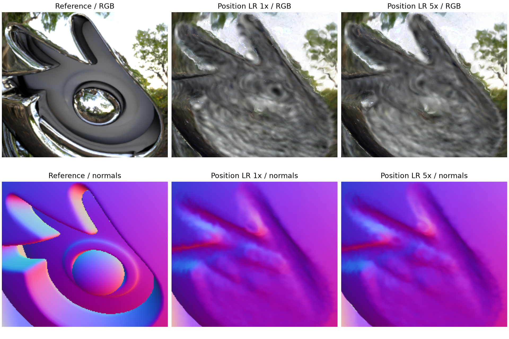

*Figure D1. Enlarged Chrome, validation view 18. Columns: target, original refinement, fivefold position-rate refinement; rows: RGB and normals. Actual crops preserve the unrecovered logo geometry. This is a separate scene and protocol.*

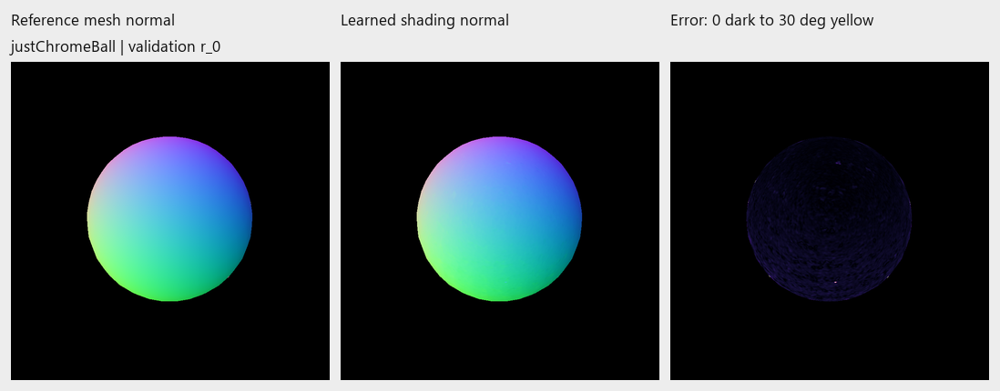

*Figure D2. Sphere validation view 0: reference mesh normal, HDR-0.75 shading normal, angular error clipped at 30°. Actual maps, with world-space normals encoded as RGB. The full five-view sheet remains in the saved diagnostic evidence.*
