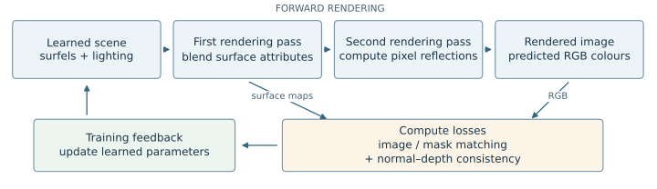

# Readability and course-reference revision

Revised 7 November following the user's request to write for interested peers and explain loss choices clearly. This is an editorial/source-verification pass, not another experiment.

- Rebuilt the main sequence as problem → background → method → losses → setup → findings → discussion. Definitions precede the detailed results.
- Added a dedicated Section 4: loss versus metric, why MSE was retained, L1 and D-SSIM, mask BCE, normal–depth consistency, and the exact total objective/weights. It states which comparisons were actually run and which were not.
- Distinguished the course's MSE/D-SSIM curriculum from the project's fixed-geometry/geometry-refinement schedule and its later L1/D-SSIM continuation.
- Read the primary course pages for Units 5, 6, 8, 9, 10, 11 and 12. Added section-specific citations and an offline-checked source manifest: seven pages, fifteen unique report links and eight section anchors.
- Defined surfels, normals, environment maps, deferred shading, coverage and the evaluation metrics in plain language. Reduced unnecessary terminology and repetitive qualifiers.
- Kept all fourteen verified numerical result rows and all ten actual experiment figures. A separately labelled vector schematic explains the implemented rendering/training flow; it is not an experiment image.
- Moved shader algebra, gradient details, audit records, exact timing scopes and supporting scene history to Appendices A–D. Rounded narrative numbers while preserving precise table values and CSVs.
- Preserved the loss experiment's trade-off and the missing MSE + D-SSIM control. No claim that a metric improvement proves sharper reflections or accurate normals was added.

The previous prose/PDF was backed up locally in ignored `outputs/report-before-readability-rewrite/`. The current PDF/HTML are rebuilt from `report.md`. Author identity, copied-code attribution, AI-use confirmation and a persistent checkpoint-bundle location still need review.

*Schematic of the implemented two-pass renderer and training feedback, not an experimental result. Surface maps and RGB provide different inputs to the losses; geometry is fixed during the first stage.*

**Good commit point:** the rewritten report, course-source manifest/guide/verifier, method schematic, and updated report checks. These are new edits after the user's initial consolidation commit.
