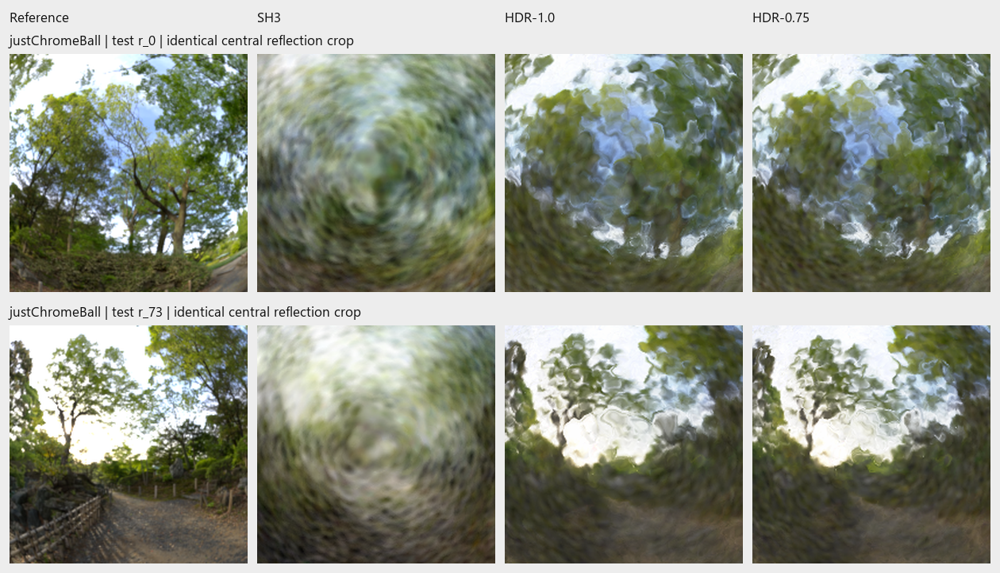

# Preliminary 20-minute presentation

Ten main slides rehearsed to 18 minutes, with two minutes of buffer and three
backup slides. Built from the reviewed report and tracked actual experimental
images. No training, evaluation, or image synthesis is performed.

## Build and open

```powershell
py -3.12 -m venv outputs/presentation-tools
./outputs/presentation-tools/Scripts/python.exe -m pip install -r docs/presentation/requirements.txt
./outputs/presentation-tools/Scripts/python.exe docs/presentation/build_deck.py
```

Requires an installed Chrome or Edge. Outputs under `outputs/presentation-preliminary/`:

- `reflections-preliminary.pptx`: native editable text, shapes and embedded figures; speaker notes included.
- `reflections-preliminary.pdf`: 16:9 reading copy, including backup slides.
- `reflections-preliminary.html`: standalone offline slideshow. Arrow keys/Space advance; N shows notes; F enters fullscreen.
- `speaker-notes.txt`: timed speaking cues and transitions, not a verbatim 18-minute script.
- `overview.png` and `slide-01.png` through `slide-13.png`: visual previews.
- `asset-manifest.json`: exact source hashes and crop coordinates.
- `validation.json`: HTML text overflow checks and PDF page count.

PDF and PNG previews use the HTML layout. PowerPoint uses the same coordinates
and editable objects; font/layout differences between Office versions remain
possible. Review the PowerPoint in the application before presenting.

## Narrative

1. Reconstructing reflections — question and visual target (1 minute).
2. Why reflections need more than directional colour (1.5).
3. Blend the surface, then shade the reflection (2.5).
4. Fit appearance first, then refine geometry (2).
5. A controlled appearance comparison (1.5).
6. Explicit reflections improve every tested view (2.5).
7. Higher scores still leave distorted reflections (1).
8. Normals and lighting must be checked together (3).
9. Changing the loss changes the trade-off (2).
10. Reconstruction quality needs more than one score (1).

Backup: full test results, four-case lighting/normal diagnostic, and attribution.

## Visual evidence



*Sphere, test views 0 and 73: target, SH3, HDR-1.0, HDR-0.75. Slides 2, 6 and 7
reuse identical source crop rectangles; no experimental pixels are retouched.*


*Sphere, validation view 0: target, reference lighting with learned normals,
reference lighting with reference normals. Diagnostic reference information is
not available to training. The five-view means are separate from test results.*

Main headline: matched HDR-1.0 versus SH3, +4.31 dB test PSNR and 35.1% lower
LPIPS. Keep the additional size variant and validation-only loss trials distinct.
One scene and one seed; the 200 cameras are not independent training repeats.

Before presenting: add author details, confirm personal attribution/AI-use
wording, rehearse timing, and review fonts in PowerPoint. Full claims and sources
are in [the report](../final-report/report.md).

**Good commit point:** deck source, build requirements and this narrative.
Generated presentations remain under ignored `outputs/` and can be rebuilt.
