# Research presentation visual appendix for questions

Seven planned backup slides to place **after the conclusion** of the [15-minute talk](speaker-script-15min.md). Open only the slide that answers the question; these do not add to the timed presentation. Each includes actual evidence, a short answer and the scale or scope needed to interpret the image.

For legibility, show one complete view row at a time when a sheet contains several rows. Keep the row label and relevant colour bar visible. Link the slide titles in an appendix menu when building the deck.

| Backup slide | Use when asked | Main visual |
| --- | --- | --- |
| A1 | Does the improvement hold in other views? | Full reference/SH3/HDR-1.0 views and matched crops |
| A2 | Where are the image errors? | RGB comparisons with absolute-difference maps |
| A3 | How accurate are the learned normals? | Reference/SH3/HDR-1.0 normals and angular error |
| A4 | Does similar RGB imply similar depth? | Reference/SH3/HDR-1.0 depth and absolute depth error |
| A5 | Is the remaining problem lighting or normals? | All four substitutions across five views and the environment maps |
| A6 | Did either loss trial improve the surface? | Independent normal-error maps for both trials |
| A7 | Why did the scope become a sphere? | Recessed-logo failure and nearby-object reflection diagnostic |

## A1 — More complete views and reflection details

**Question:** “Are the displayed results representative, or did you select one successful camera?”

**Layout:** Two full-frame rows: test views 13 and 88, with reference / SH3 / HDR-1.0 in each. The main result slide shows view 0. The complete four-view sheet and reflection crops below provide the wider evidence; the offline slideshow also lets you enlarge any image.

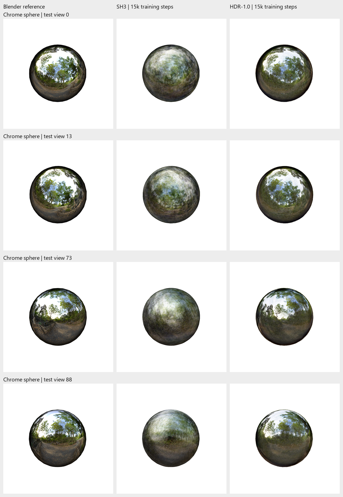

*Chrome sphere, test views 0, 13, 73 and 88, top to bottom. Columns: Blender reference, SH3, HDR-1.0. Actual full frames, matched camera framing; 100,000 surfels and 15k steps for both trained models.*

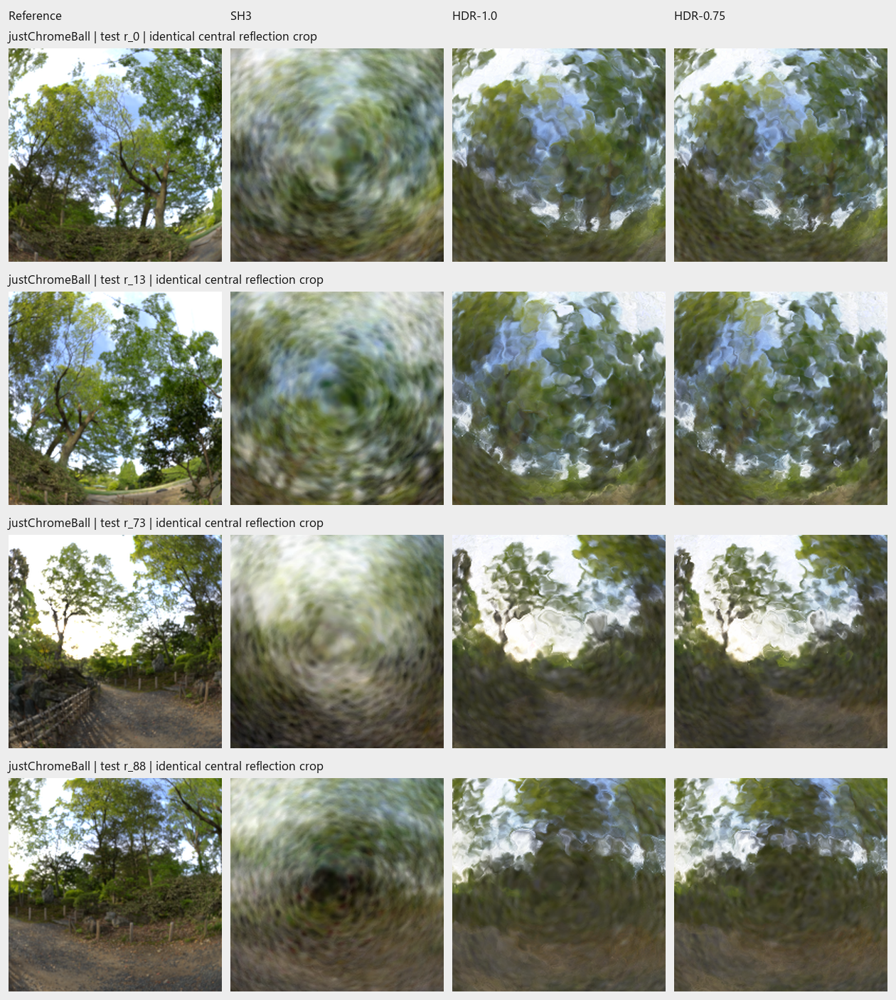

*Same scene and test-view order. Columns: target, SH3, HDR-1.0, supplementary HDR-0.75. Actual identical reflection crops. Preserve the fourth column's label if using this original sheet; the primary contrast remains SH3 versus HDR-1.0.*

**Short answer:** “These are the four illustration cameras already used in the experiment record. The reflection model improves all three image metrics on all 200 test views, so the numerical gain is not confined to these examples. The pictures also show what the averages miss: more recognisable broad structures, with thin reflected details still blurred.”

**If asked for the distribution:** use the [paired test histograms](../reports/assets/2026-11-07-report-analysis/paired-test-effects.png), with improvement horizontally and number of cameras vertically. These are camera variations within one trained pair, not repeated-seed uncertainty.

## A2 — RGB differences locate the remaining image errors

**Question:** “Which parts are still wrong, and is HDR-1.0 improving the object rather than just the background?”

**Layout:** Show one row of target / SH3 / HDR-1.0 / SH3 difference / HDR-1.0 difference. Keep the shared colour bar.

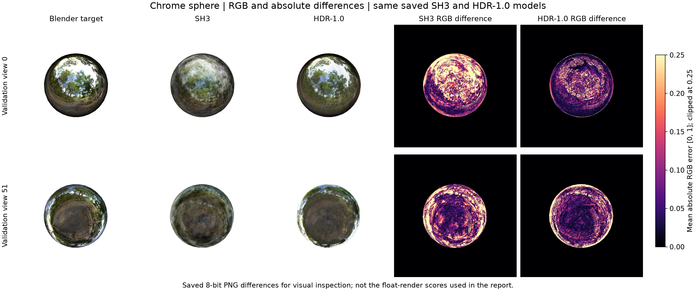

*Chrome sphere, validation views 0 and 51, top to bottom. Columns: Blender target, SH3, HDR-1.0, SH3 absolute RGB difference, HDR-1.0 absolute RGB difference. These plots are derived from saved 8-bit PNGs; they are not new renders. Each error pixel is the mean absolute difference over RGB, after dividing channel values by 255. Both maps use the same 0–0.25 colour scale; larger values are clipped to the brightest colour.*

**Short answer:** “Darker error regions mean closer RGB agreement. The same scale is used for both models. The reflection model reduces many errors on the sphere, but the remaining bright regions show mismatched reflected structures and rim appearance. These are pixel differences, so they show where agreement fails without identifying a unique cause.”

**Interpretation:** The black background in the error panels means small or zero difference, not missing data. These are **validation** cameras; validation view 0 is a different camera pose from test view 0. The report's PSNR uses float renders, so do not calculate or quote its scores from these quantised PNG differences.

## A3 — Normal maps need an independent angular-error check

**Question:** “The sphere looks smooth. How do you know its normals are wrong?”

**Layout:** Blender mesh normal / SH3 normal / HDR-1.0 normal / HDR-1.0 angular error. Show view 0 first; use view 51 to explain local rippling and faceting.

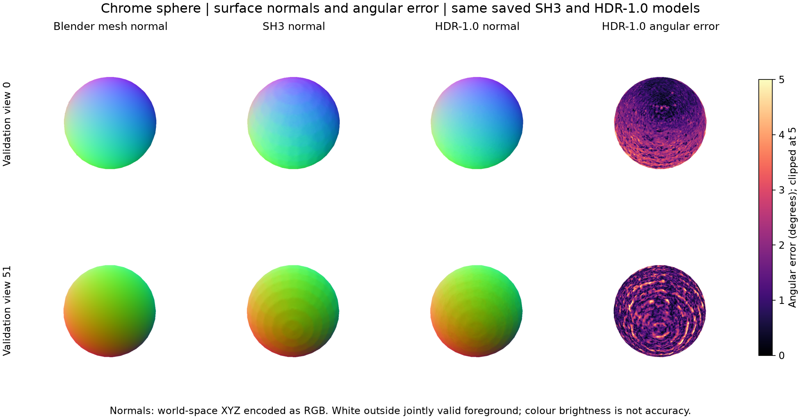

*Chrome sphere, validation views 0 and 51. First three columns: world-space surface normals encoded as RGB, with each XYZ component mapped from −1…1 to 0…1. Last column: HDR-1.0's angular difference from the Blender mesh normal, in degrees. The shared error display spans 0–5°, clipped. White pixels are outside the jointly valid covered foreground; they do not represent zero error.*

**Short answer:** “The RGB colours encode surface direction, not material colour. Broadly similar maps can conceal small local orientation errors. The last column measures those errors against independently exported Blender mesh normals. The residual pattern shows that an apparently smooth sphere can still have local normal errors that affect fine reflections.”

**Interpretation:** This is the primary **HDR-1.0** model, not the HDR-0.75 substitution model. The two per-view HDR-1.0 mean errors are approximately **1.61° and 1.54°**, on the common covered-foreground mask. They are not the report's five-view mean. Other archived normal-error figures use a 0–30° scale; compare the colour bars before comparing brightness. Reference normals were used for this evaluation, not for training.

## A4 — Depth checks a different part of the reconstruction

**Question:** “Do the image improvements also mean the geometry is accurate?”

**Layout:** Blender mesh depth / SH3 depth / HDR-1.0 depth / HDR-1.0 absolute depth error. Retain both colour bars. Do not use the individually normalised debug depth PNGs as a quantitative side-by-side comparison.

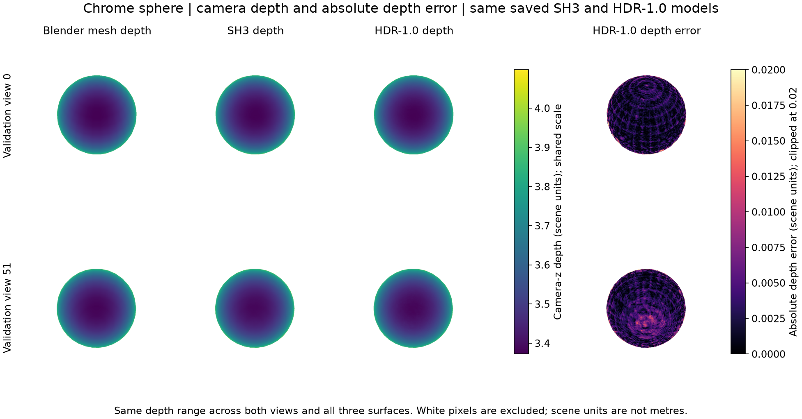

*Chrome sphere, validation views 0 and 51. Depth is positive camera-z distance, in scene units, not Euclidean ray distance or metres. The first three columns share one depth range across both views and all surfaces. The final column shows |predicted depth − Blender mesh depth| on a shared 0–0.02 scene-unit error scale, clipped. White is excluded foreground/background, not measured zero error. Plots use existing saved float depth buffers and matching Blender exports.*

**Short answer:** “The broad depth shape is close to a sphere, but the error map reveals local deviations. The shared range lets us compare the depths directly. A small depth error does not automatically imply correct normals, because normals depend on local surface orientation and slope. That is why I inspect both depth and normal error rather than treating an improved RGB score as proof of correct geometry.”

**Interpretation:** These are two development views, including the retained view-51 failure. They are diagnostic illustrations, not a full-split depth benchmark. Values above the displayed error limit remain recorded in the saved arrays; the plotting limit is not an error bound.

## A5 — More lighting and normal substitutions

**Question:** “Could a sharper environment map alone solve the problem?” or “Does the normal replacement work in other views?”

**Layout:** Show the matched original/learned environment maps, then reveal the five-view intervention sheet. Keep all four combinations alongside the target. This is an extended version of main Slide 8.

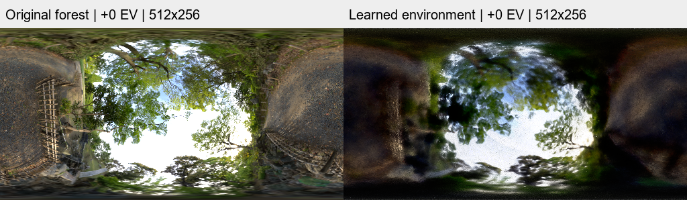

*Original forest map / HDR-0.75 learned environment, both 512 × 256 with matched 0 EV display exposure. Actual saved maps, not separate training conditions.*

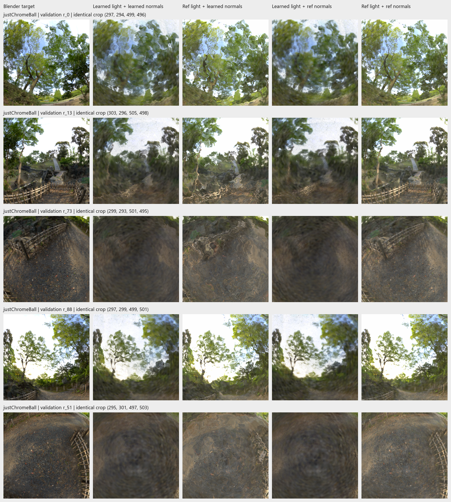

*Chrome sphere, validation views 0, 13, 73, 88 and 51. Columns: target; learned lighting/learned normals; reference lighting/learned normals; learned lighting/reference normals; reference lighting/reference normals. Actual matched crops from the same HDR-0.75 checkpoint, with no further optimisation.*

**Short answer:** “Sharper lighting adds detail but leaves rippling when the learned normals are retained. Correcting the normals alone leaves the learned lighting blur. Correcting both recovers much more structure across these views, including view 51, but still misses some target contrast and darker tones. The result supports an interaction between the fitted lighting and normals.”

**If asked about metrics:** the joint reference case has the best five-view SSIM and LPIPS, while the original learned pair retains the higher PSNR. Those are diagnostic substitutions using Blender information, not improvements achieved by training.

## A6 — Loss-trial normal errors beyond the RGB crops

**Question:** “Does the stronger regulariser actually improve the normals?” or “Did the L1/D-SSIM trial improve geometry?”

**Layout:** Two selectable evidence panels, chosen according to the question. Show a complete view row and its labels rather than shrinking both five-row sheets onto one slide. Keep the associated reference-normal error numbers visible.

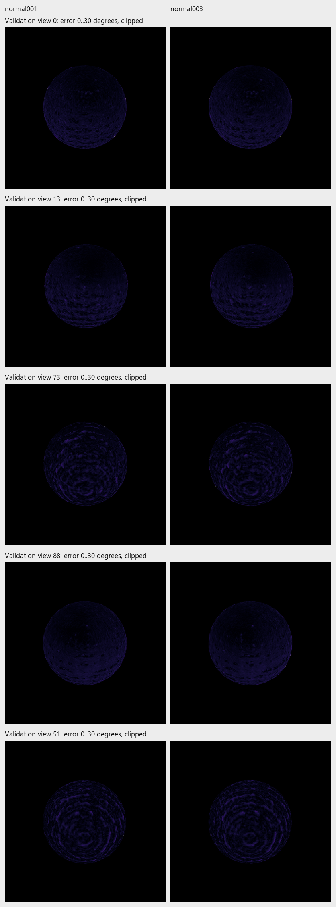

*Chrome sphere, validation views 0, 13, 73, 88 and 51. Columns: baseline normal–depth weight 0.01 / trial weight 0.03. Reference mesh angular errors, displayed on a shared 0–30° scale, clipped; black outside the valid foreground. Both use the same HDR-1.0 frozen parent and 5k refinement.*

**Short answer for Trial 1:** “The stronger penalty encourages agreement between the model's own surface descriptions, but does not make the normals closer to Blender. The five-view mean reference-normal error changes from about 1.573° to 1.594°, so this trial provides no normal-accuracy improvement.”

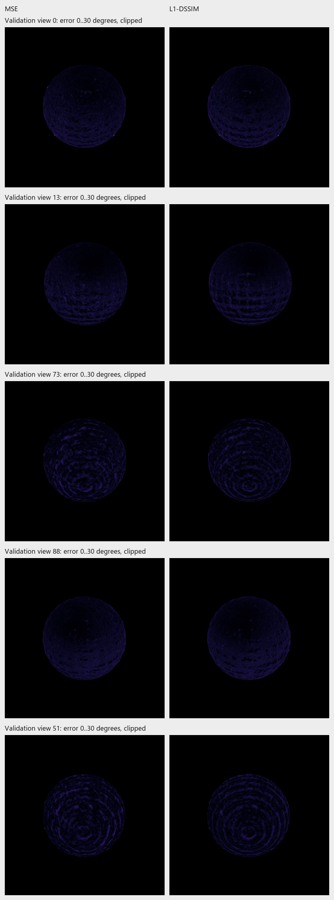

*Same scene and five-view order. Columns: MSE / L1 + D-SSIM refinement, with shared 0–30° angular-error display, clipped, and black outside valid foreground. The parent and 5k refinement budget are shared; the image objective differs.*

**Short answer for Trial 2:** “LPIPS improves, but the independently measured normal error is essentially unchanged, at about 1.573° versus 1.576°. The visual change is therefore not evidence of a more accurate surface.”

**Optional RGB follow-through:** the full [five-view loss comparison](../reports/assets/2026-11-07-refinement-loss/validation-rgb-comparison.png) and [reflection crops](../reports/assets/2026-11-07-refinement-loss/reflection-crops.png) show the image trade-off beyond the single example in main Slide 10. All of these are validation results, separate from the main test comparison.

## A7 — The earlier scenes explain the scope decision

**Question:** “Why not continue with Materials?” or “Does the simple sphere avoid a problem the model cannot solve?”

**Layout:** Recessed-logo RGB/normal comparison, followed by the original Materials reflected-ray categories if asked about nearby objects. Treat these as two separate scene diagnostics.

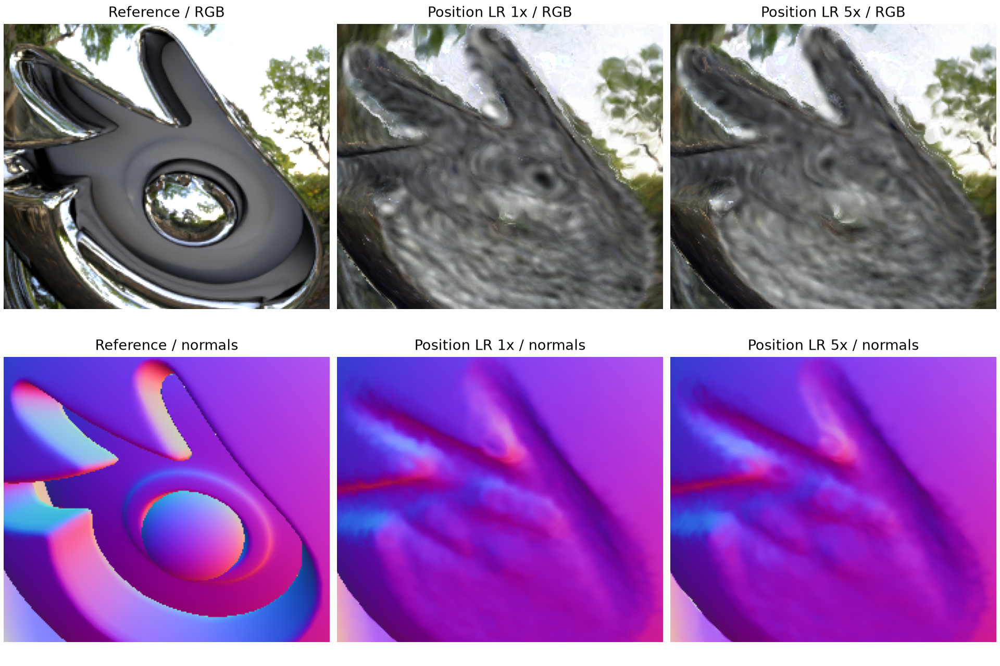

*Enlarged Chrome, validation view 18. Columns: target, original refinement, fivefold position-learning-rate refinement. Rows: RGB and normals. Actual images preserve the recessed-logo failure; this is a separate scene and protocol from the sphere study.*

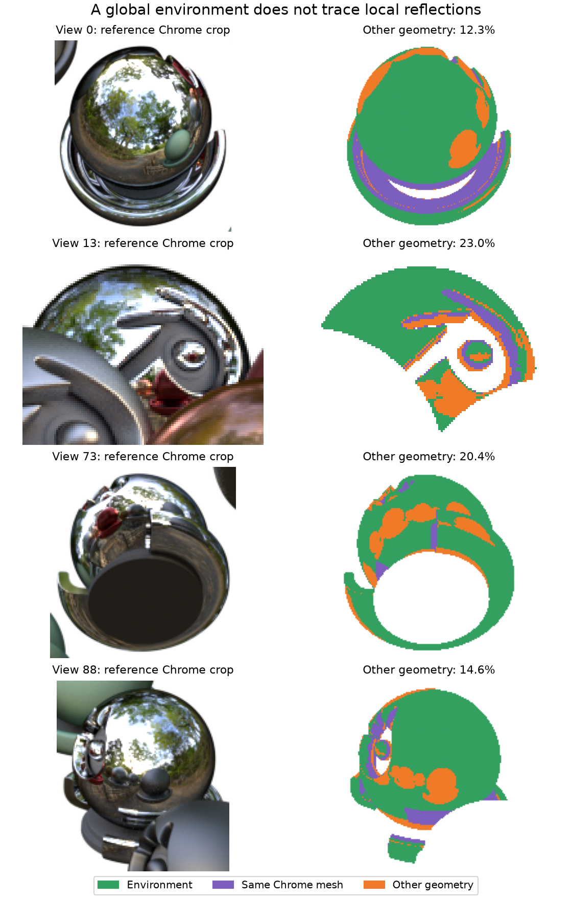

*Original Materials, the four predefined validation cameras 0, 13, 73 and 88. Actual first-bounce reflected-ray category diagnostic: environment escape, the same Chrome mesh and other geometry. These are ray categories, not an image-error heatmap or an energy-weighted rendering contribution.*

**Short answer:** “These examples explain why I narrowed the question. The silhouette starting surface misses hidden recesses, while the direction-only environment model cannot directly represent local visibility and reflections of nearby objects. The isolated smooth sphere reduces those additional complications. Its results therefore answer a focused environment-reflection question rather than demonstrating complete reconstruction of Materials.”

**If asked for numbers:** the original four-view ray audit finds **12–23%** of the traced Chrome rays hit other geometry. That is evidence that local transport matters in that scene, not a claim that it accounts for that fraction of image error. See the [reflection-scope audit](../experiments/2026-10-30-reflection-model-scope.md).

## Asset preparation and checks

The first four backup topics provide the most useful immediate comparisons. A5–A7 explain the failure mechanisms, loss studies and scope choices if those questions arise.

The three new diagnostic figures are reproducible with:

```powershell
.venv/Scripts/python.exe docs/presentation/make_qna_figures.py
```

Default rebuilding uses the archived input arrays under `assets/2026-11-12-qna/inputs/`; no Blender, GPU rendering or model loading is involved. `--archive-inputs` is only for reconstructing that archive from the existing local validation outputs and reference exports. [Provenance](assets/2026-11-12-qna/provenance.json) records definitions, source hashes, valid-pixel masks, display ranges and the fraction of errors above each plotted scale. [The archive record](assets/2026-11-12-qna/archive.json) preserves the original source paths and hashes.

The new normal-map values reproduce the corresponding saved SH3/HDR-1.0 normal diagnostics on these views. Keep their two-view scope separate from the five-view diagnostic means and full validation/test image scores. The RGB differences use saved PNGs; normal and depth differences use saved float geometry arrays. Existing failures and all four lighting/normal permutations remain available.

**Good commit point:** this Q&A appendix, the script/README links, the plotting helper and its portable images/input arrays. The 15-minute spoken script remains the main talk.
