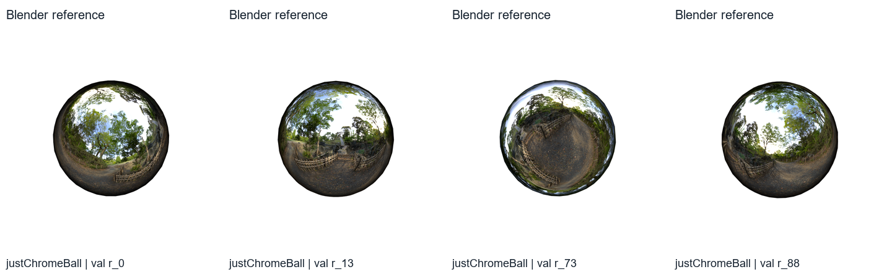
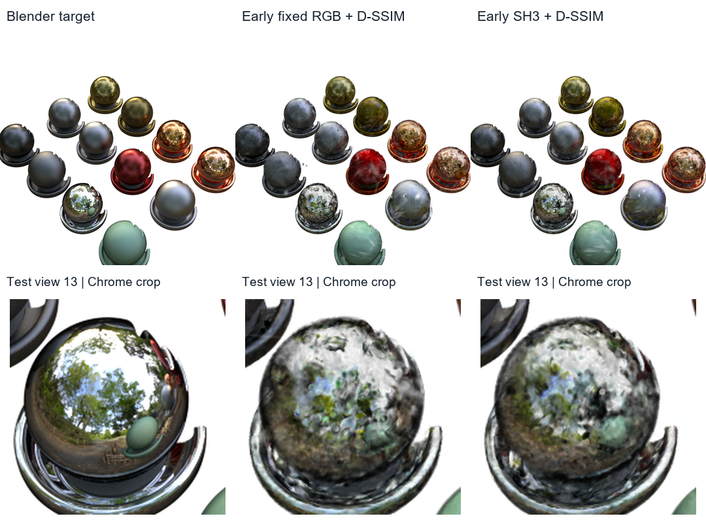
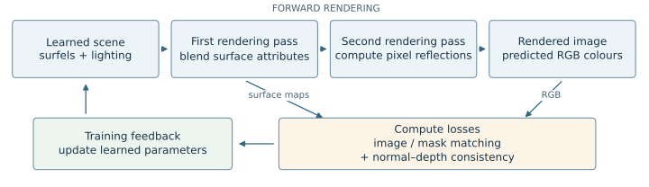
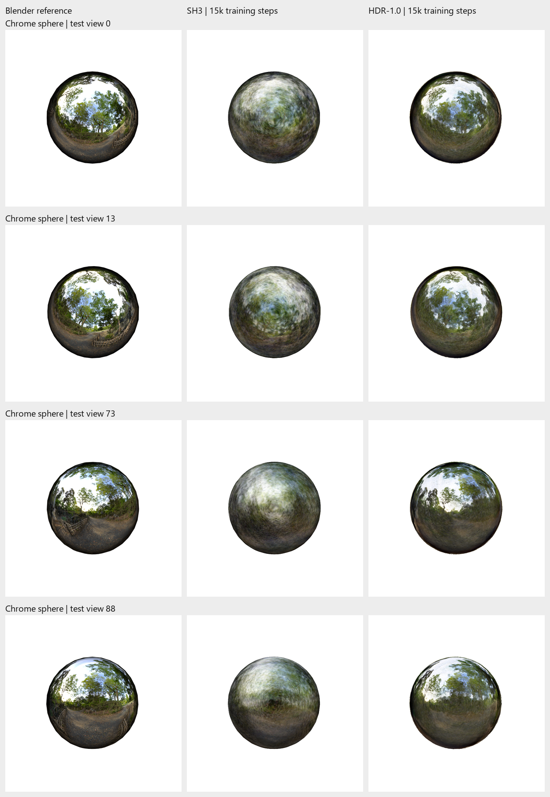
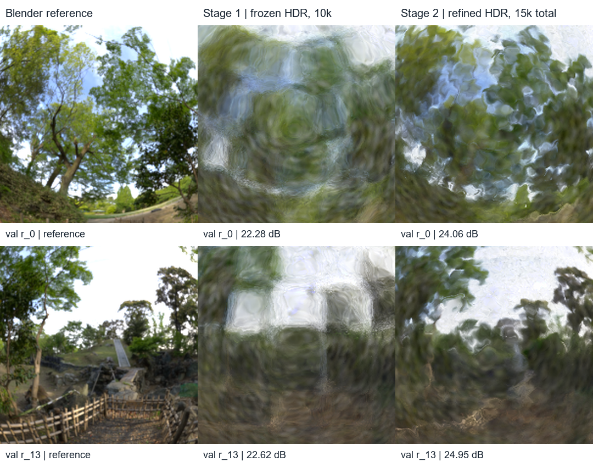
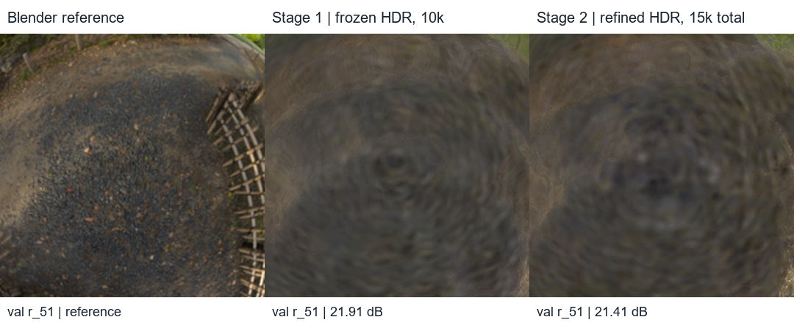
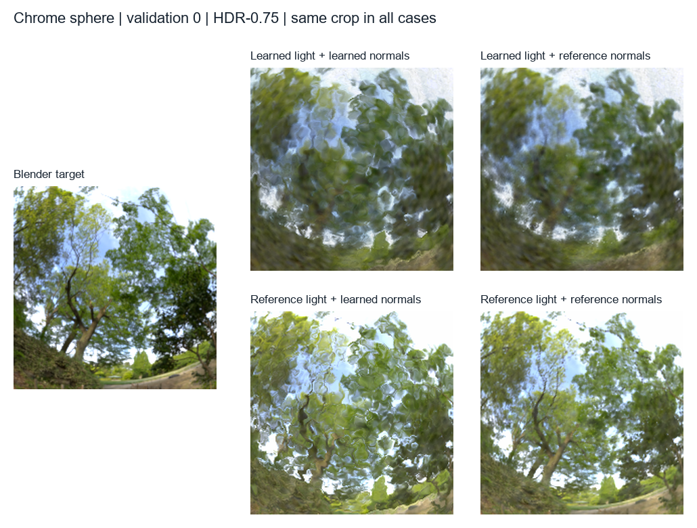
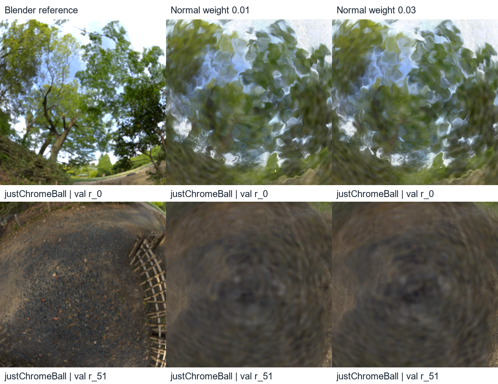
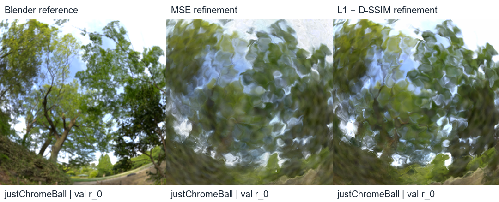

# Reconstructing reflections with deferred Gaussian surfels

**Speaker:** Tang Xiao Di Wendy  
**Format:** 12 planned slides; 15-minute speaking slot, excluding questions.  
**Audience:** Classmates familiar with the course's Gaussian splatting trainer.  
**Status:** Script draft, revised 13 November 2026. Timings are rehearsal targets, not measured delivery times.

Read the paragraphs under **Say** aloud. Visual directions, captions, tables and backup answers are preparation notes. Allow time to point at the comparisons rather than reading every number. The slide titles state the main message; the spoken paragraphs provide the explanation.

The spoken draft contains approximately **1,600 words**. At 120–130 words per minute, that leaves roughly two to three minutes within the slot for figure inspection, pointing and slide transitions. Rehearse once with those pauses before adjusting the wording or timing.

The narrative is: **why reflections are difficult → why the scope became a sphere → method and fair comparison → measured improvement → remaining errors → two loss trials → conclusions**. The [report](../final-report/report.md) supplies the full method and evidence.

## Slide plan and timing

| Slide | Main message | Target time | Elapsed |
| --- | --- | ---: | --- |
| 1 | Reconstructing the reflection is harder than reconstructing the outline | 0:45 | 0:00–0:45 |
| 2 | Materials motivated a more focused experiment | 1:10 | 0:45–1:55 |
| 3 | SH3 and reflection shading predict appearance differently | 1:15 | 1:55–3:10 |
| 4 | Blend surface attributes first, then compute the reflection | 1:40 | 3:10–4:50 |
| 5 | Compare the methods with the same surface and training schedule | 1:30 | 4:50–6:20 |
| 6 | The reflection model improves all 200 test views | 1:20 | 6:20–7:40 |
| 7 | Refinement improves visible structure, with remaining failures | 1:00 | 7:40–8:40 |
| 8 | Lighting and normal errors interact | 2:00 | 8:40–10:40 |
| 9 | Trial 1: stronger consistency does not improve normal accuracy | 1:00 | 10:40–11:40 |
| 10 | Trial 2: changing the image loss improves LPIPS at a PSNR cost | 1:20 | 11:40–13:00 |
| 11 | What the evidence establishes and what to test next | 1:00 | 13:00–14:00 |
| 12 | Better reflection images require more than one score | 1:00 | 14:00–15:00 |

## Slide 1 — Reconstructing the reflection is harder than reconstructing the outline

**On screen:** Project title, name, one large Blender reference sphere. One question: “Can explicit reflection shading improve on SH3?”

*Visual source: chrome sphere, validation views 0, 13, 73 and 88, left to right; Blender targets only. For the slide, use one complete reference panel from this sheet.*

**Say**

Hi, I'm Wendy. My project looks at reconstructing reflections with Gaussian splatting.

At first glance, this looks like a simple object: just a sphere. But the image on its surface contains trees, sky and fencing. As the camera moves, those reflections move too.

So matching the sphere's outline is only part of the problem. The model also needs to put the reflected details in the right places.

My question is whether explicitly modelling reflections can improve on the SH3 appearance model from the course, and what still prevents the result from becoming sharp.

## Slide 2 — Materials motivated a more focused experiment

**On screen:** Early Materials target/RGB/SH3 comparison. Small headline: “Start with a working baseline, then simplify the research question.” Keep detailed run settings off this slide.

*Original Materials, test view 13. Columns: Blender target, early fixed RGB, early SH3; both trained variants use staged MSE/D-SSIM. These are initial exploration results, separate from the later sphere protocol.*

**Say**

I started with the Materials dataset used in the course. I first extended the trainer from fixed RGB to SH3, so colour could vary with viewing direction. In these early runs, test PSNR increased from about 24.94 to 26.07 decibels.

But Materials introduced several problems at once. The chrome object reflects nearby objects, which a single environment map cannot directly represent. In a separate enlarged-Chrome experiment, the silhouette-based starting surface also missed a recessed logo.

That made it difficult to tell whether a poor reflection came from the appearance model or from these other complications.

I therefore narrowed the main study to one smooth sphere under forest lighting. The aim was to examine environment reflections more directly, while still learning the surface and lighting from the training images.

## Slide 3 — SH3 and reflection shading predict appearance differently

**On screen:** Two short explanatory paths: “SH3: viewing direction → directional colour” and “Reflection model: viewing direction + surface normal → environment lookup”. Label this as an explanatory diagram when making the slide.

**Say**

The two approaches differ in how they predict colour.

With SH3, each primitive stores coefficients that describe how its colour changes with viewing direction. This is useful for directional appearance, but degree-three spherical harmonics have limited angular detail. Fine mirror reflections are therefore difficult to represent sharply.

The reflection model uses the surface normal as well. The normal tells us which direction a camera ray reflects towards. We then look up the light arriving from that direction in an environment map.

You can think of that map as an image of the surroundings wrapped around the object. Neighbouring surface elements share the same map, so their reflected details come from a common source.

The idea is to give the model a more suitable way to describe reflections, rather than asking directional colour coefficients to encode everything independently.

## Slide 4 — Blend surface attributes first, then compute the reflection

**On screen:** The implemented two-pass pipeline. Emphasise “blend attributes → reflect and sample lighting → predicted RGB”. Brief attribution footer: course Warp trainer; Gaussian Surfels; 3DGS-DR.

*Schematic of the implemented forward and training computation; not an experimental render. Feedback changes appearance first and then geometry during refinement.*

**Say**

I implemented this on top of the course's Warp trainer, using ideas from Gaussian Surfels and deferred reflection rendering.

A surfel is a small, flat Gaussian surface element. It has a position, two in-plane scales and an orientation. That orientation gives us a surface normal.

The renderer works in two passes. First, it projects the surfels and blends their surface information at each pixel, including colour, depth, normals and reflection strength.

Second, it uses the combined normal and the camera ray to compute a reflected direction. It samples the learned environment map and blends that reflected light with the base colour. The model also learns how the reflection contribution changes with viewing angle.

The key point is that the reflection is computed after the surface attributes have been combined. That is what deferred shading means here. An image error can then update the normals of the surfels contributing to that pixel.

The original forest map is not supplied during fitting. The lighting map itself has to be learned from the training images.

## Slide 5 — Compare the methods with the same surface and training schedule

**On screen:** A compact two-stage timeline and the shared settings below. Use one short loss expression: “image matching + mask matching + normal–depth consistency”.

| Shared setting | Main comparison |
| --- | --- |
| Representation | 100,000 surfels for both SH3 and HDR-1.0 |
| Initialisation | Same surface estimated from training silhouettes |
| Stage 1 | 10,000 steps; appearance changes, geometry and opacity fixed |
| Stage 2 | 5,000 steps; geometry, opacity and appearance can change |
| Data | 100 training, 100 validation, 200 test views; 800 × 800 |
| Training signals | RGB and alpha masks; no reference normals or lighting |

**Say**

To make the comparison meaningful, both main methods use surfels. I am comparing their appearance approaches, rather than comparing volumetric Gaussians against a different surface representation.

Both start from the same 100,000 surfels, estimated from the training silhouettes. For the first 10,000 steps, I keep the surface fixed and fit appearance. The aim is to avoid early geometry changes that compensate for inaccurate appearance or lighting. I then allow geometry and opacity to change during another 5,000 refinement steps. No surfels are added or removed.

Both methods use the same MSE image objective, mask constraint and normal–depth consistency settings. The renderer produces the depth map from the current surfel geometry. Consistency compares the rendered normal with a normal calculated from that depth, without supplying Blender geometry.

The scene has 100 training, 100 validation and 200 test views. Validation images help compare settings without providing fitting gradients. The main results I will show next are from the 200 test views, using SH3 and the same-initial-size reflection model, HDR-1.0.

## Slide 6 — The reflection model improves all 200 test views

**On screen:** One large full-view reference/SH3/HDR-1.0 row, plus three metric changes. The deck shows test view 0 here and additional full-view comparisons in Q&A slide A1. The complete four-view sheet remains linked below.

*Chrome sphere, test views 0, 13, 73 and 88, top to bottom. Columns: Blender reference, SH3, HDR-1.0. Both trained models use 100,000 surfels and 15k steps. Actual saved full frames; matching camera framing.*

| Mean over 200 test views | SH3 | HDR-1.0 |
| --- | ---: | ---: |
| PSNR, higher is better | 20.27 dB | 24.57 dB |
| SSIM, higher is better | 0.821 | 0.881 |
| LPIPS, lower is better | 0.129 | 0.084 |

**Say**

Here are the full-view results: reference on the left, SH3 in the middle, and HDR-1.0 on the right.

Look at the separation between the bright sky and the darker trees. SH3 produces a much smoother reflection, while the reflection model recovers more recognisable regions of the surroundings.

Across all 200 test views, mean PSNR increases by 4.31 decibels, and SSIM increases from about 0.821 to 0.881. LPIPS, where lower is better, falls by 35.1 per cent.

These metrics measure pixel accuracy, local image structure and perceptual similarity respectively. All three improve on every test view in this saved model pair.

So the main comparison supports the reflection approach. But the reference still contains much finer branches and fencing. The improvement is substantial without being a complete recovery of the reflected scene.

## Slide 7 — Refinement improves visible structure, with remaining failures

**On screen:** Show the positive stage comparison prominently. Add the preserved view-51 failure as a smaller second example or a reveal. Mark “10k frozen” and “15k total” clearly.

*Chrome sphere, validation views 0 and 13. Columns: target, frozen HDR-1.0 at 10k steps, refined HDR-1.0 at 15k total. Actual matched reflection crops.*

*Same scene, validation view 51. Target/frozen/refined HDR-1.0. This is the largest PSNR-regression view; fine ground and fence details remain missing.*

**Say**

The two-stage training also produces a visible improvement.

After the appearance-only stage, the reflected scene is cloudy. Following refinement, the sky opening and broad tree shapes are clearer. Validation PSNR improves from about 22.50 to 24.13 decibels, and LPIPS also improves.

This compares 10,000 steps against 15,000, so the gain includes both extra training and releasing the geometry. It does not isolate geometry refinement alone.

There are also failures. View 51 still misses the ground and fencing detail and has lower PSNR after refinement.

That leaves the next question: what is stopping the remaining reflections from becoming sharp?

## Slide 8 — Lighting and normal errors interact

**On screen:** Target beside the complete 2 × 2 lighting/normal grid. Reveal the four cases in the same order as the script. Footer: “Diagnostic substitutions; same HDR-0.75 checkpoint; five validation views”. Do not show only the successful cases.

*Chrome sphere, validation view 0. Left: Blender target. Grid rows: learned/reference lighting; columns: learned/reference normals. Actual saved diagnostic renders from HDR-0.75, whose initial in-plane surfel scales are 75% of the original. Model geometry and learned material parameters remain fixed.*

**Say**

I investigated lighting and surface normals by replacing them during evaluation, while keeping the saved model fixed. These tests use the supplementary HDR-0.75 model, which starts with smaller surfel widths. All four cases here use that same checkpoint.

The top-left case is the trained result, using learned lighting and learned normals. It contains both blur and rippling.

At the bottom left, I replace only the lighting with the original forest map. More detailed texture appears, but it is still warped. So supplying sharper lighting alone is not enough.

At the top right, I replace only the normals with Blender reference normals. The reflection remains blurred, and mean LPIPS actually gets worse across the five diagnostic views.

At the bottom right, both lighting and normals are replaced. Much more recognisable structure returns, although the contrast and darker tones still differ from the target.

The interaction matters: correcting the normals helps strongly when reference lighting is used, but not when the learned lighting is retained. This suggests that the learned lighting and normals have fitted together.

The joint replacement gives the best SSIM and LPIPS here, but not the best PSNR. That is why I need to inspect the images and several metrics together.

## Slide 9 — Trial 1: stronger consistency does not improve normal accuracy

**On screen:** “Normal–depth weight: 0.01 → 0.03”. Beside the actual crops, show “Normal error: 1.573° → 1.594°”. Label normal error as a five-view mean and image metrics as 100-view validation results.

*Chrome sphere, validation views 0 and 51. Columns: target, normal–depth weight 0.01, weight 0.03. Same HDR-1.0 frozen parent and 5k refinement; actual saved crops.*

**Say**

The diagnostic motivated checking whether a stronger normal–depth regulariser could improve the learned surface.

In Trial 1, I increased its final weight from 0.01 to 0.03. The frozen parent, training budget and other settings stayed the same.

It did not help. Image scores became slightly worse, and mean reference-normal error increased from about 1.573 to 1.594 degrees.

The important distinction is between consistency and accuracy. The model predicts both its normals and its depth, so two incorrect predictions can agree. Making that agreement stronger does not automatically make either prediction closer to the real surface.

The crops show the practical result: the missing reflection detail is still missing.

## Slide 10 — Trial 2: changing the image loss improves LPIPS at a PSNR cost

**On screen:** “MSE → 0.8 L1 + 0.2 D-SSIM”. Show the actual reflection crop and just three outcomes: “LPIPS −10.1%”, “PSNR −0.56 dB”, “Normal accuracy essentially unchanged”. Footer: “100 validation views; five-view normal diagnostic”.

*Chrome sphere, validation view 0. Columns: target, MSE refinement, L1 + D-SSIM refinement. Actual identical crops; same HDR-1.0 frozen parent and 5k refinement.*

**Say**

Trial 2 asks whether the image objective itself is limiting the result.

I replaced MSE during refinement with a combination of L1 and D-SSIM. L1 measures absolute colour differences, while D-SSIM adds a local structural comparison. This is an additional trial, separate from the main SH3 comparison.

Starting from the same frozen HDR-1.0 parent, I ran the same 5,000 refinement steps with the geometry-loss coefficients unchanged.

LPIPS improved on all 100 validation views, with a mean reduction of about 10.1 per cent. SSIM improved slightly on average. However, PSNR fell by about 0.56 decibels, and reference-normal accuracy was essentially unchanged.

Visually, the objective changes contrast and broad structure, but the thin branches remain blurred or distorted.

So changing the loss improves the perceptual score, but it does not resolve the fine-reflection problem or establish a better surface.

## Slide 11 — What the evidence establishes and what to test next

**On screen:** Three short points: “One scene and seed”, “Appearance components change together”, “Next: separate the loss components and repeat the comparison”. Put detailed ablation proposals in backup.

**Say**

There are two main limits to the conclusions.

First, this is one scene and one training seed. The 200 test cameras show that the gain is consistent across views of these fitted models; they are not 200 independent training repetitions.

Second, the reflection model changes several appearance components together. The comparison supports that combined approach, but it does not identify the separate contribution of each component.

The most useful next steps would be a matched MSE-plus-D-SSIM control to separate the image-loss changes, and repeating the main comparison with another seed and another controlled reflective scene.

Those experiments would answer specific unresolved questions rather than simply adding more parameters.

## Slide 12 — Better reflection images require more than one score

**On screen:** One strong actual reference/SH3/HDR-1.0 comparison and three takeaways. Reuse an existing test-view row; do not introduce a new example or metric here.

**Say**

To conclude, explicit reflection shading improves this controlled sphere reconstruction over SH3: about 4.31 decibels higher PSNR, higher SSIM, and 35.1 per cent lower LPIPS on the test views.

The diagnostics show that the remaining errors involve lighting and surface normals together. The loss trials show that stronger consistency and a better perceptual score do not necessarily produce more accurate geometry or recover sharp reflected details.

My main takeaway is to evaluate the reconstruction from several angles: the scores, the visible reflection structure and an independent check of the geometry.

That tells us both where the method helps and what the next experiment needs to address. Thank you.

## Backup answers for questions

These are not part of the timed script. The [visual Q&A appendix](qna-visual-appendix.md) plans seven extra slides with full comparisons, RGB differences, normal/depth maps and error scales. Keep them after the conclusion and open the relevant one when asked.

**Why use a sphere?** A smooth isolated sphere removes nearby-object reflections and recessed shape recovery as additional problems. It still requires learning accurate surface normals and environment appearance. The result is scoped to that setting.

**Why not train using Blender normals?** That would provide additional geometric supervision unavailable in the RGB-and-mask setting studied here. Normal maps describe orientation, not the complete positions, visibility, lighting or appearance, so they would not make reconstruction unnecessary. They would change the training problem. The implemented regulariser compares two model predictions instead.

**Where does the depth map come from?** The surfel renderer generates it from the model's current geometry. At each pixel, it computes camera-ray intersections with contributing surfel planes and takes their visibility-weighted average camera-z depth. Neighbouring depths are back-projected to 3D to estimate the surface normal used by the consistency loss. No supplied depth map or separate depth network is used. Blender depth is exported separately for evaluation comparisons only.

**What does HDR-0.75 mean, and is it the main result?** Its initial two in-plane surfel scales are multiplied by 0.75; the count stays at 100,000 and scales can change later. It is supplementary. The primary matched test comparison is SH3 versus HDR-1.0. HDR-0.75 adds about 0.17 dB mean test PSNR and does not remove the reflection defects. Its checkpoint supplies the lighting/normal substitution diagnostic.

**Does refinement itself cause the full stage improvement?** The sphere comparison adds 5k steps while allowing geometry updates. It does not isolate those updates from extra optimisation time. An equal-total-budget fixed-geometry control would address that question.

**Why can better structure have worse PSNR?** PSNR penalises pixelwise differences. A result can recover more recognisable structure but have brightness, contrast or alignment errors that increase those differences. The joint lighting/normal substitution is an observed example: SSIM and LPIPS improve most, while PSNR remains below the learned pair.

**Did L1 or D-SSIM cause Trial 2's gain?** The trial changes both the pixel penalty and the structural term. It cannot separate them. The parent was fitted with MSE, and keeping geometry coefficients unchanged also changes their balance relative to the replacement image objective.

**Is this a complete material or relighting model?** It is an HDR environment-reflection blend with a learned angular response. It does not implement a full roughness-based material model or trace reflections of nearby objects. The substituted-reference renders are diagnostics, not trained improvements or proof of general relighting.

**What did you implement?** The course trainer supplies the starting Warp projection, compositing and optimisation framework. The project adds the chosen surfel/deferred HDR appearance implementation, staged training experiments and evaluation diagnostics, informed by Gaussian Surfels and 3DGS-DR. RGS-DR is related work rather than a reproduced system. Use the report's attribution section when discussing exact code origins.

## Rehearsal and evidence notes

The first rehearsal should establish your actual pace. Aim to finish Slide 6 by **7:40**, Slide 8 by **10:40**, and Trial 2 by **13:00**. If running late, shorten the early Materials numbers and the next-step explanation; keep the main comparison, all four diagnostic cases and the conclusion.

Show the positive refinement example before the failure. On Slide 8, point to each case while explaining it and leave the full grid visible. On Slide 6, say the direction of each metric once; do not read the table cell by cell. Use brief citation footers rather than reading paper titles aloud.

The script uses the [current report](../final-report/report.md), [main test means](../reports/assets/2026-11-03-sphere-study/test/summary.csv), [stage evidence](../experiments/2026-11-03-sphere-lpips.md), [normal/lighting diagnostic](../experiments/2026-11-03-reference-normal-swap.md), [normal-weight trial](../experiments/2026-11-07-normal-weight-closeout.md) and [image-loss trial](../experiments/2026-11-07-refinement-loss.md). All pictured results are existing experiment images. The method pipeline is explicitly a schematic.

**Good commit point:** this reviewed speaking script and its presentation README link, before changing or generating the slide deck.
