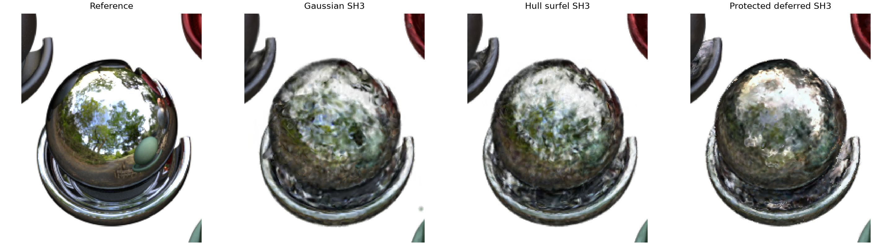
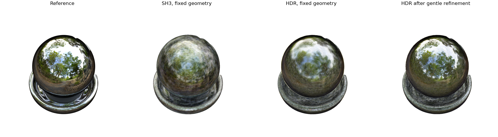
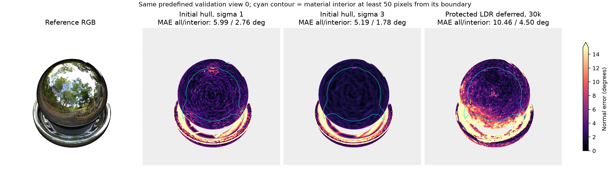
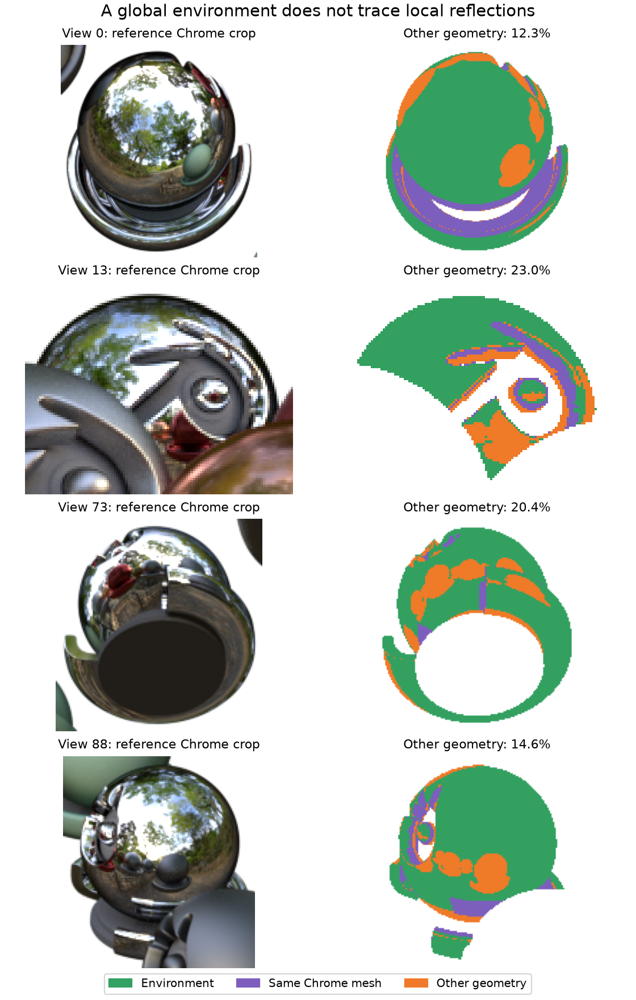

# Reflection research wrap-up — 30 October 2026

Stopped on request at 17:55 Singapore.

**Progress is real, but the sharp-reflection goal is still unfinished.** Pruning
works, the optimizer regression is fixed, and a controlled Chrome experiment
supports deferred appearance. The remaining geometry and transport errors are
visible in the pictures below.

## Original Materials: primary benchmark

All scores below use **100 validation views, 800px, 1M capacity, 30k steps,
seed 7**, with PSNR/SSIM/LPIPS computed from float renders. Initializers differ;
the hull-only pair isolates the appearance change more closely.

| Model | PSNR ↑ | SSIM ↑ | LPIPS ↓ | Chrome PSNR ↑ |
| --- | ---: | ---: | ---: | ---: |
| Gaussian SH3, random | 27.7246 | 0.944346 | 0.040411 | 16.2963 |
| Surfel SH3, random | 27.8901 | 0.944841 | 0.042719 | 16.1483 |
| Surfel SH3, training-mask hull | 27.7921 | 0.942775 | 0.037801 | 16.0594 |
| Deferred + SH3, same hull | 27.7503 | 0.942333 | 0.038428 | 16.0601 |
| Protected deferred + SH3 | 28.4721 | 0.946323 | 0.038978 | 16.1883 |

The protected treatment raises Chrome PSNR by **0.13 dB** versus the unregularized hull-deferred model. Chrome normal error changes from **42.05° to 15.71°**. It has the highest global PSNR in this table, but Chrome remains below the Gaussian baseline (16.30 dB). Its matched protected SH-only control remains incomplete.

Crops use projected Chrome bounds; Chrome scores use visible material pixels.

The protected method adds ray-plane depth, early reflection and normal/depth
consistency. Its matched protected SH-only control was interrupted during shutdown,
so this row does not isolate a deferred-shading effect.

## A useful positive result: lighting first, then gentle refinement

On the **separate enlarged Chrome scene**, all arms below use the same
training-mask-derived 100k-point basis, 800px, seed 7 and **15k cumulative steps**.
The HDR arms share a 10k fixed-geometry lighting warm-up, followed by matched 5k
continuations. Adam restarts in every continuation. No reference mesh, normals,
material ramp or environment texture enters training.

| Appearance / continuation | PSNR ↑ | SSIM ↑ | LPIPS ↓ | Chrome PSNR ↑ |
| --- | ---: | ---: | ---: | ---: |
| SH3, geometry fixed | 19.0057 | 0.767141 | 0.176790 | 13.5653 |
| HDR angular, geometry fixed | 20.3180 | 0.787574 | 0.169609 | 14.8089 |
| HDR angular, gentle geometry refinement | **21.3361** | **0.821520** | **0.140111** | **15.7505** |

Releasing geometry after the common lighting warm-up gains **1.02 dB** over
keeping it fixed. It gains **2.33 dB** over the equal-budget fixed SH3 arm.
Tree reflections remain blurred: this is a promising diagnostic, not a solved
original-scene reconstruction or a comparison against every optimized SH schedule.

The shader learns a positive HDR environment and 16 shared view-angle offsets,
with RGB plus one reflection scalar per point and no SH. At 10k, its required
files were **8.55 MB versus 23.51 MB** for the matched SH3 model, with better
PSNR, SSIM and LPIPS. This scalar is reflection blend, **not roughness**; a full
roughness BRDF remains unimplemented.

## Why the earlier approach struggled

- **Optimizer:** children inherited inappropriate Adam moments. Clearing new-child
  histories while retaining existing-point histories improved the matched 10k
  policy test by **7.47 dB**. The recovered 30k Gaussian scores 27.72 dB versus
  23.09 for the failed inherited-history run.
- **Geometry:** RGB fitting can damage initially useful normals. The figure shows
  fixed-camera errors before and after fitting; smoother initialization helps,
  but does not recover hidden concavities. Original-scene sigma-3 initialization
  still has **18.31° Chrome normal error** across its visible validation views.
- **Appearance/transport:** Chrome contains a strong view-angle color ramp.
  The old constant blend and LDR environment omit that response. A global
  environment also cannot directly trace nearby objects: in four predefined
  original-scene views, **12–23%** of Chrome mirror rays hit other geometry.

[Unit 11](https://weitsang.github.io/gaussian-splatting-notes/unit-11/) supports
using low-order SH for smooth directional residuals. SH3 has 48 RGB scalars total
(45 beyond RGB). SH does not repair normals
or supply arbitrary sharp reflection detail. [RGS-DR](https://github.com/gkouros/RGS-DR)
shows the broader surfel/deferred direction is feasible, with stronger surface
constraints, roughness-aware lighting and residual shading than our current model.

## Pruning and foreground/background

Training-alpha rejection is implemented in
[foreground_pruning.py](../../src/cp4282_gs/surfels/foreground_pruning.py): repeated
background contradictions over 16 training views, with full-footprint safeguards.
Training can prune and immediately refill slots, so a constant active count does
not imply pruning is broken.

Actual all-training-view contribution weights support a frozen **1M → 600k**
export. Its removal fraction was chosen on validation, then fixed for **all 200
test views**:

| Model | Test PSNR | Test SSIM | Test LPIPS | Files | Forward FPS |
| --- | ---: | ---: | ---: | ---: | ---: |
| Full 1M surfels | 27.3063 | 0.939810 | 0.045083 | 238.88 MB | 57.17 |
| Pruned 600k | 27.3129 | 0.939948 | 0.044983 | 142.30 MB | 103.96 |

These tiny score changes mean **preserved quality**, with 40.4% smaller files.
Timing uses the same four test poses and ten repeats after other research GPU
work finishes; it includes host tiling/rendering/MSE and excludes downloads and
metrics. An overlapped shutdown sample was discarded and remeasured after all
research jobs stopped. This export saves inference/storage cost, not its parent's training cost.

The joint Chrome model's boundary/background error exposed another gap: direct
alpha supervision is needed alongside conservative pruning. A combined HDR/angular
and mask-BCE preset passed gradient/integration checks; its full runs were
cancelled before training, so no quality claim is made for that preset.

## Stopped here; next session

The intended active fits and validation finished. A queued protected SH-only
control briefly started during shutdown and was stopped; it remains incomplete.
Other waiting long runs and new-method test/video jobs were cancelled. Ship
and the early-SH reference remain unrun. Ship includes reflective water;
it should not be described as a purely diffuse control.

Next, complete the original-scene matched control, improve surface-normal accuracy
during staged refinement, then run untouched test views. More capacity or more
iterations alone is a poor next bet. The visible artifacts are substantial;
this is a geometry/model issue rather than excessive perfectionism.

Latest checks cover CPU/CUDA gradients, checkpoint reloads, alpha composition and
exact frozen geometry: **10 HDR/freeze tests per device**, plus legacy trainer
regressions. Original random-control 1M training Warp allocation peaks were
**2.52 GB Gaussian / 2.98 GB surfel/deferred**; the protected deferred run used
**2.98 GB**, excluding driver/context memory.
Training wall times overlapped diagnostics and do not establish a speedup.

All new quality runs include LPIPS; new output folders use `MonDD-HHMM-` prefixes.
Images and [per-view CSVs/provenance](assets/2026-10-30/) are committed here;
large checkpoints and full logs remain local under `outputs/`.

[Detailed session log](../experiments/2026-10-30-backbone-resume.md) ·
[Frozen appearance protocol](../experiments/2026-10-30-frozen-appearance.md) ·
[Staged refinement protocol](../experiments/2026-10-30-staged-refinement.md) ·
[HDR/mask protocol](../experiments/2026-10-30-angular-response.md)
