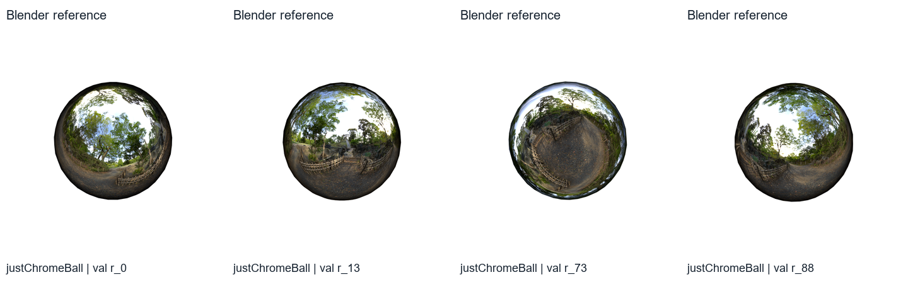
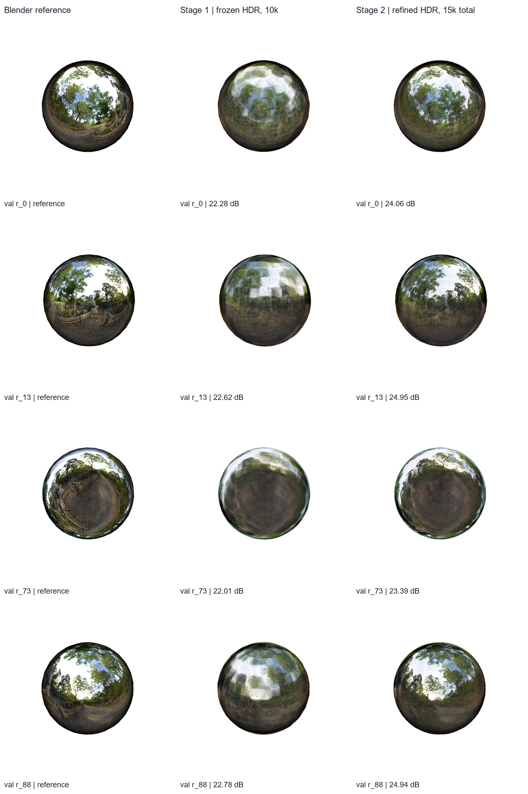
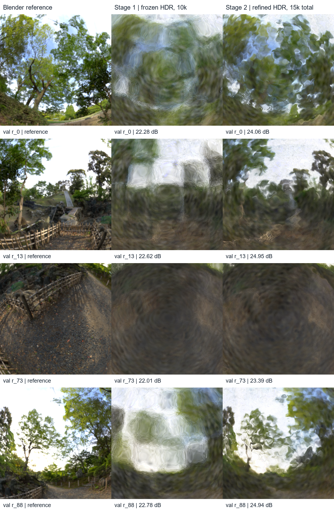
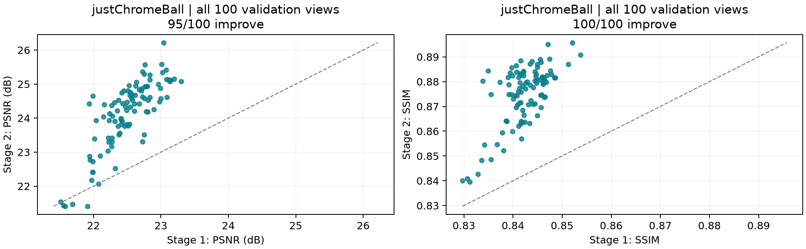
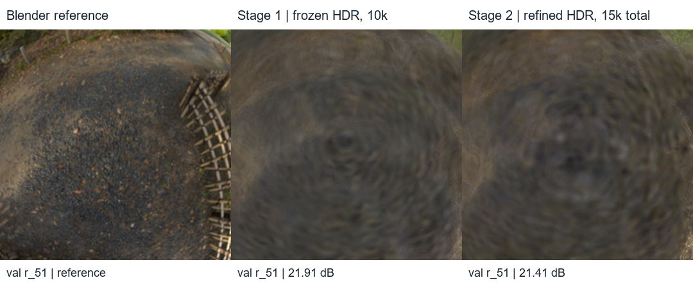
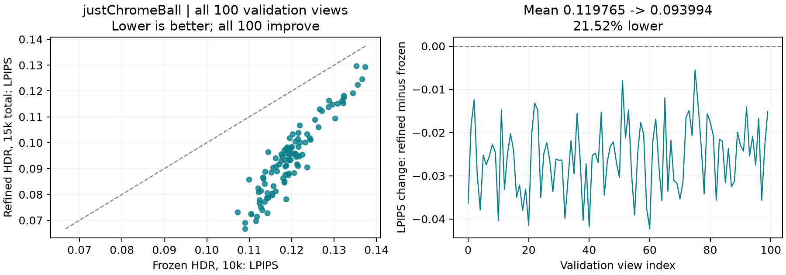

# Research closeout: a new chrome-sphere dataset and staged HDR training

2 November 2026, Singapore. Both new training stages and their validation runs
completed by 20:25. No further training is queued by this closeout.

*3 November addendum: LPIPS was subsequently evaluated on the saved checkpoints;
results and verification are linked below. The 2 November images are unchanged.*

**We now have a captured plain-sphere dataset and a working one-command HDR
workflow.** On the new scene, 10k steps of frozen-geometry appearance fitting
followed by 5k refinement raised mean validation PSNR from **22.50 to 24.13 dB**.
The images improve, while fine forest reflections remain unresolved.

## What changed today

- Completed the [original Materials protected SH3 control](../experiments/2026-11-02-protected-control.md).
  Deferred + SH3 gains 1.1147 validation dB over its matched SH3 control, but
  LPIPS is worse and tree reflections remain blurred.
- Completed the [Chrome position-rate trial](../experiments/2026-11-02-logo-position-rate.md).
  Fivefold position rates improved global PSNR by 0.3716 dB but did not recover
  the recessed logo. That failure is preserved; logo-specific tuning is closed.
- Followed the [reflection scope decision](../research-scope-2026-11-02.md):
  created a simpler scene, captured it, and transferred the preferred Oct30 HDR
  schedule to it using a fresh initializer. Original Materials stays the primary
  benchmark; the sphere is an auxiliary diagnostic.

## New dataset: `justChromeBall`

Source: [justChromeBall.blend](../../data/blender/justChromeBall.blend).
The scene contains one mesh, `Sphere`, without a logo or pedestal. Read-only
[material inspection](assets/2026-11-02-sphere/material-inspection.json)
confirms the `Chrome` material: zero glossy roughness, a view-angle color ramp,
and the `forest.exr` world environment. This is a captured Blender scene, not
an analytic sphere supplied directly to the trainer.

Capture reused the Materials camera poses/FOV: **100 train, 100 validation,
200 test**, at **800x800**, 128 Cycles samples, GPU denoising, seed 7,
Standard display transform, and 8-bit RGBA PNGs. The trainer composites onto
white. The capture is complete; all 400 recorded image hashes and the source
Blender hash were checked. The three splits have no shared camera matrices
when compared at seven decimal places.



*Figure 1. `justChromeBall`, validation r_0, r_13, r_73 and r_88, left to right.
Actual Blender references composited onto white and downsampled for display.
These camera indices reuse earlier reports' selection, independently of the new
metric gains. All figures below use saved experimental images.*

## Two training stages, one execution

The [new launcher](../../scripts/run_staged_hdr.py) automates the dependency chain:

| Step | What ran | Key settings |
| --- | --- | --- |
| Initialization | Carve training silhouettes into an estimated surface | 512-cubed grid, smoothing 3 voxels, 100k sampled surface points |
| Stage 1 | Fit lighting and appearance for 10k steps | Geometry and opacity frozen; HDR/angular shading; no SH; image MSE |
| Stage 2 | Continue appearance fitting and gently release geometry for 5k steps | Image MSE + mask BCE 0.1 + normal/depth consistency 0.01, ramped over 1k steps |

Both stages use 800x800, seed 7, capacity 100k and a learned 512x256 HDR
environment. Growth, pruning, propagation and opacity resets are disabled.
Both logs confirm the image-loss phase stayed **MSE**; the YAML's D-SSIM weight
does not mean D-SSIM was active. Normal/depth consistency uses rendered depth,
not Blender reference geometry. The source environment texture is not supplied
to optimization.

Stage 2 loads Stage 1's `model.ply` **and** `model.surfel.npz`; their hashes
match its recorded inputs. Adam restarts at the handoff. Geometry learning rates
are position 1e-5 to 1e-6 over 5k steps, scale 5e-4, rotation 1e-4, opacity 5e-3.
This repeats the preferred **Oct30-1733** schedule, rather than the separate
fivefold position-rate trial.



*Figure 2. `justChromeBall`, validation r_0, r_13, r_73 and r_88, top to bottom.
Columns: Blender reference; Stage 1 after 10k frozen steps; Stage 2 after 5k
additional refinement steps, 15k cumulative. Labels give whole-image validation
PSNR. Camera, framing and display scale match within each row.*

## Results and what the pictures show

Scores are arithmetic means over the same **100 validation cameras**, computed
from the existing float-render evaluation CSVs. PNGs are display copies.

| Measure | Stage 1: frozen HDR | Stage 2: refined HDR | Change |
| --- | ---: | ---: | ---: |
| Mean PSNR, dB | 22.4996 | **24.1250** | +1.6254 |
| Mean SSIM | 0.842281 | **0.874920** | +0.032639 |
| LPIPS AlexNet, lower better (3 November follow-up) | 0.119765 | **0.093994** | -0.025771 |
| Cumulative training steps | 10,000 | 15,000 | +5,000 |
| Surfels | 100,000 | 100,000 | No structural updates |

PSNR improves on **95/100** views; SSIM improves on **100/100**. In views 0,
13 and 88, refinement makes sky openings and tree/foliage structure more
recognizable than the cloudy frozen fit. The ground-facing view 73 still lacks
fine texture. Across the crops, wavy distortions and lost high-frequency detail
remain: this is better reconstruction, not recovered sharp reflections.



*Figure 3. Same scene, views and columns as Figure 2. Each central square is
derived from the reference alpha bounding box and applied identically to all
three images; crops are enlarged uniformly. The dB labels remain whole-image
scores, not crop metrics. Exact pixel bounds are in the figure provenance.*



*Figure 4. `justChromeBall`, every validation view, frozen 10k versus refined
15k-total HDR. Each point is one matched camera; points above the dashed
identity line improve. This plot is derived from recorded evaluation CSVs.*

Five views lose PSNR: **22, 51, 65, 75 and 92**. View 51 has the largest drop,
**21.9145 to 21.4096 dB** (-0.5050 dB), despite improved SSIM. The ground
reflection remains blurred in both variants.



*Figure 5. `justChromeBall`, validation r_51, identical central crop for reference,
Stage 1 and Stage 2. Selected after reviewing the scores specifically to preserve
the largest PSNR regression; it is not an independently selected illustration.*

This continuation adds training time, releases geometry and introduces geometry
losses together. It does **not** isolate the benefit of staging or beat an
equal-budget frozen, SH3, LDR or joint-from-start sphere control: those comparisons
have not run. Independent sphere normal/depth error has not been measured.
LPIPS was deferred at closeout and completed on 3 November, as recorded below.
The 200 test images were captured, but these models were evaluated on validation
only. New-scene scores should not be ranked against the older Chrome scene.

Observed initializer time was 68.79s; trainer-reported times were 109.08s and
63.84s for the two stages. These are session timings, not controlled speed claims.

## 3 November follow-up: perceptual evaluation

LPIPS AlexNet improves **0.119765 -> 0.093994**, a **21.52% decrease**, on the
same 100 validation cameras. Every view improves. Checkpoints were unchanged;
the re-rendered PSNR/SSIM reproduce the original results to reporting precision.
[Full follow-up, verification and the splat-size hypothesis](../experiments/2026-11-03-sphere-lpips.md).



*Figure 6. `justChromeBall`, all 100 validation views, Stage 1 frozen 10k versus
Stage 2 refined 15k total. Lower LPIPS is better; all 100 points lie below the
identity line. This is additional evaluation of the existing models, not training.*

## Reproduce and find the evidence

From the repository root, in Git Bash:

```bash
source .venv/Scripts/activate
python scripts/run_staged_hdr.py data/justChromeBall
```

Use `--prepare-only` to inspect newly generated configs without training, or
`--metrics psnr ssim lpips` to request LPIPS as well. Each invocation reserves
fresh output folders; it does not resume a prepared run. The launcher reads
[frozen](../../config/materials_chrome_frozen_hdr.yaml) and
[refinement](../../config/materials_chrome_staged_hdr_refine.yaml) source presets,
replaces scene/checkpoint paths, and writes resolved `frozen.yaml` and
`refine.yaml`. `configg/justChromeBall.yaml` is not used by this command.

Completed evidence:

- [Pipeline record](../../outputs/Nov02-202000-justChromeBall-staged-hdr-pipeline/pipeline.json)
  and [initializer](../../outputs/Nov02-202000-justChromeBall-staged-hdr-pipeline/initializer/initialization.json).
- [Stage 1 run](../../outputs/Nov02-2021-justChromeBall-frozen-hdr-10k/summary.md)
  and [Stage 2 run](../../outputs/Nov02-2023-justChromeBall-staged-hdr-refine-5k/summary.md).
- Portable [frozen config](assets/2026-11-02-sphere/frozen.yaml),
  [refinement config](assets/2026-11-02-sphere/refine.yaml),
  [frozen metrics](assets/2026-11-02-sphere/frozen.metrics.csv),
  [refinement metrics](assets/2026-11-02-sphere/refine.metrics.csv), and
  [verification, image hashes and crop bounds](assets/2026-11-02-sphere/figure-provenance.json).
  Run records, capture metadata and initialization metadata are copied alongside
  these figures because `outputs/` is ignored by Git.

The launcher's three dependency/config tests pass. Figure generation verifies
capture hashes, split separation, matched CSV order and the geometry/material
handoff without retraining. The [figure script](assets/2026-11-02-sphere/build_figures.py)
can rebuild all five figures from the saved source outputs.

Today's stopping point is a reproducible sphere dataset and a completed staged
HDR reconstruction. Next research work is an equal-budget appearance comparison
on the same fixed estimated geometry, followed separately by matched refinement.
No further tuning or test evaluation is started here.
