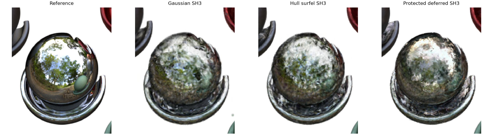
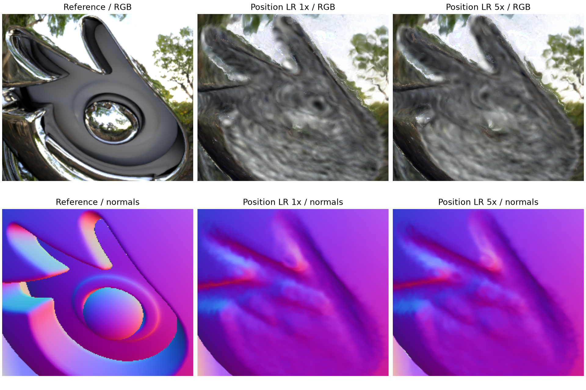
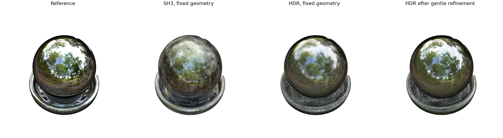

# Scope decision: focus on specular reflection reconstruction

Recorded 2 November 2026 (Singapore), following the user's scope clarification.

**Superseded on 3 November:** the user made `justChromeBall` the main experimental
scene and existing Materials runs supporting evidence, with a matched SH3/HDR
comparison and one bounded size investigation. See the current
[scope, commands and results](sphere-study-commands-2026-11-03.md). Primary/auxiliary
roles below record the earlier decision and do not reopen deferred studies.

**Evening update:** the sphere was subsequently created as `justChromeBall`,
captured and trained with 10k frozen HDR + 5k refinement. See the
[illustrated closeout](reports/2026-11-02-research-wrap-up.md). The equal-budget
SH3/LDR/HDR appearance comparison below remains planned; today's continuation
does not supply those controls.

## Research objective

Investigate whether deferred shading with explicit surfel normals improves the
reconstruction of sharp, view-dependent reflections relative to SH appearance,
and measure the associated storage, rendering, training-time and memory costs.
The target is fidelity to reference images, rather than increasing apparent
shininess or reflection strength regardless of the reference.

Normals determine reflection directions and remain an explanatory factor in
reflection quality. Recovering complex recessed geometry is outside the current
investigation's main objective.

*Original Materials, validation view 0: reference, Gaussian SH3, hull surfel SH3
and geometry-regularized deferred SH3. These historical variants have different
initialization/geometry treatments; the figure illustrates the reflection target
and remaining blur, rather than isolating the shader's effect.*

## Close the logo investigation

The enlarged `materials_chrome` scene contains a logo, a recessed diffuse core
and a base; it is not a plain sphere. Its silhouette-derived initialization misses
local shape. The completed position-rate trial improved overall validation PSNR
from 21.3361 to 21.7076 dB, but logo-region normal error changed only 28.23 to
27.84 degrees and the recessed structure remained visibly incorrect.

Preserve the [trial, images and negative local result](experiments/2026-11-02-logo-position-rate.md)
as evidence that geometry complexity can obscure an appearance comparison.
Close further logo-specific optimization for this phase. Multiview geometry
losses, depth reseeding and further logo-driven learning-rate sweeps remain
deferred. The logo is unresolved; closure reflects the research scope, not proof
that reconstruction is impossible.

*Enlarged Chrome, user-selected validation view 18. Columns: reference, original
position rate, fivefold position rate. Rows: RGB and normals in the same fixed
logo rectangle. The recessed centre and sharp normal transitions remain missing.
This development diagnostic explains why the logo investigation was closed.*

## Benchmark and proposed diagnostic

**Original Materials remains the primary benchmark.** Retain its runs, matched
controls, full-image/material metrics and failure cases. The sphere supplements
this benchmark. Secondary-scene requirements remain in the project plan.

**Proposed auxiliary scene: one smooth chrome sphere**, without a logo or pedestal,
under the same forest environment and matched camera poses. Preserve the old Chrome
dataset separately. At the time of this scope decision, the sphere had not yet
been created, captured or trained; the evening update above records completion.

*Existing enlarged Chrome scene, validation view 0: reference, fixed-geometry SH3,
fixed-geometry HDR/angular, and HDR/angular after geometry refinement, all at 15k
cumulative steps. Reflection detail improves but remains blurred. The refined
arm also changes geometry. This is evidence from the existing scene; no plain-sphere
result appears in this historical figure; new sphere results are in the evening closeout.*

Before implementation, fix the material response, capture settings, disjoint
splits, initialization, resolution, budgets, metrics and comparison arms:

1. Fit SH3, LDR deferred and HDR/angular appearance on the same fixed estimated
   sphere geometry, including fixed opacity, to isolate appearance-model behavior.
   Match the SH residual setting between the two deferred arms. Describe HDR/angular
   as a combined appearance treatment.
2. Evaluate joint fitting separately if needed, giving compared appearance models
   equivalent geometry-refinement opportunities and matched total budgets.

Use training images/masks for fitting and initialization. Keep reference mesh,
normals, depth and environment texture out of optimization. Any future experiment
using known analytic/reference geometry must be explicitly labelled as an
appearance-only diagnostic, separate from learned-geometry reconstruction.

Report PSNR, SSIM, LPIPS and fixed reflection crops together, including metric
disagreements. Select settings on validation and freeze them before final held-out
evaluation. Disclose prior inspection of historical Materials test results.
Higher global PSNR or stronger highlights alone do not establish sharper reflections.

## Report wording

The following wording records the earlier scope decision, before the sphere
capture and training reported in the evening closeout.

> We evaluated the deferred surfel pipeline on Materials and an enlarged Chrome
> diagnostic. Inspection of the Chrome logo exposed errors in recessed geometry
> that persisted despite a matched position learning-rate increase. We therefore
> closed logo-specific geometry tuning and proposed a plain-sphere diagnostic to
> separate appearance-model limitations from complex surface reconstruction.
> Original Materials remains the primary benchmark, while the unresolved logo is
> retained as a limitation. The plain-sphere study is planned; no results from it
> are claimed.
