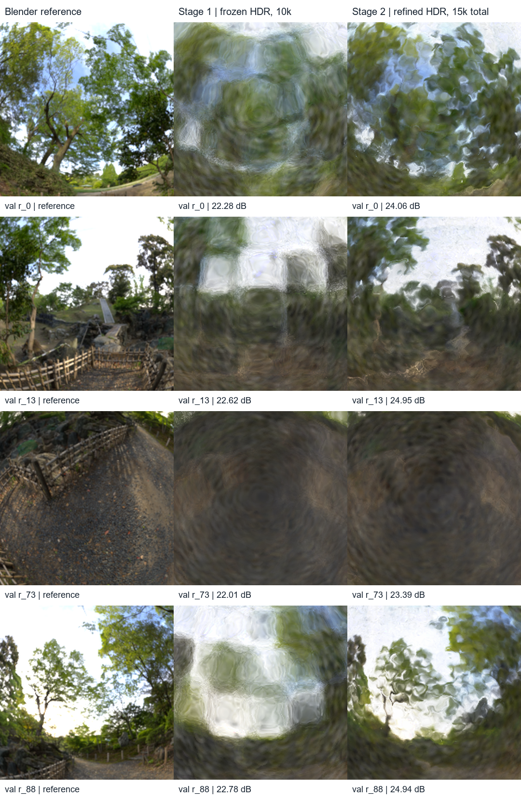
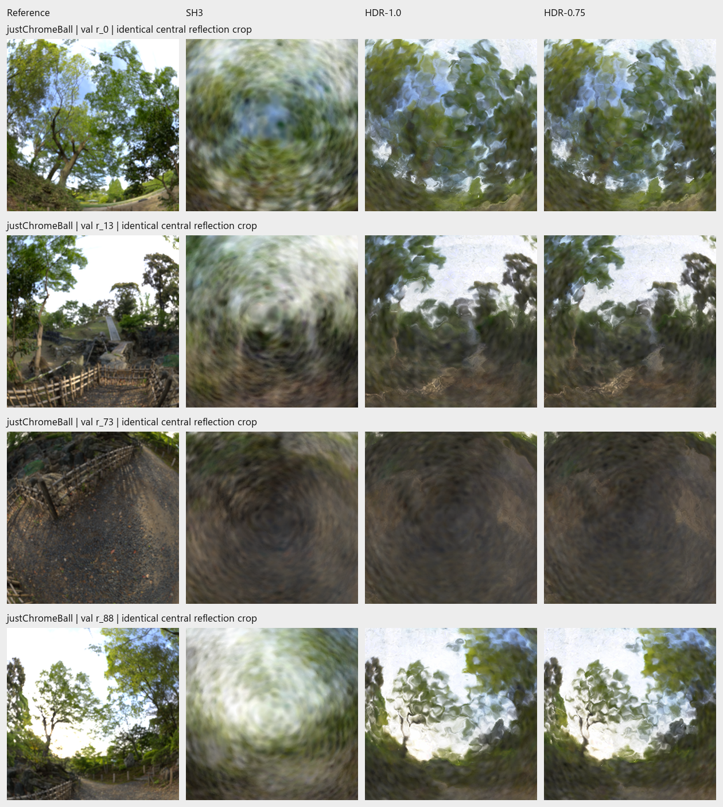
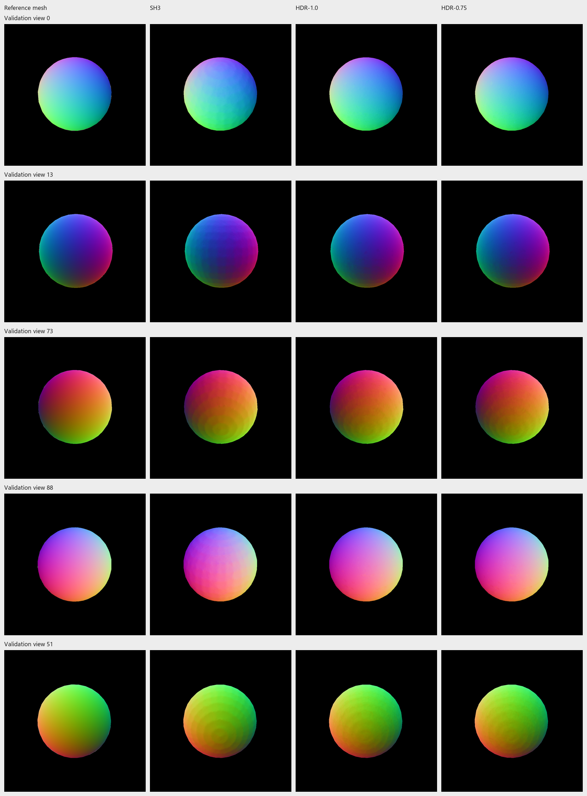
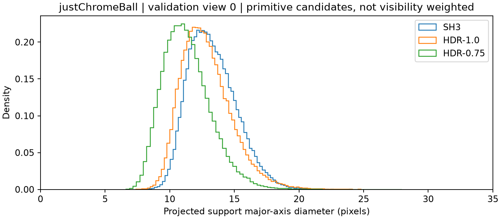
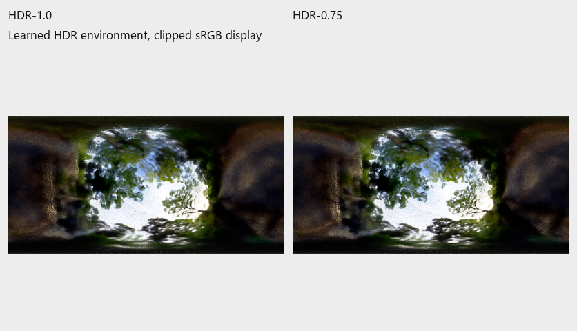
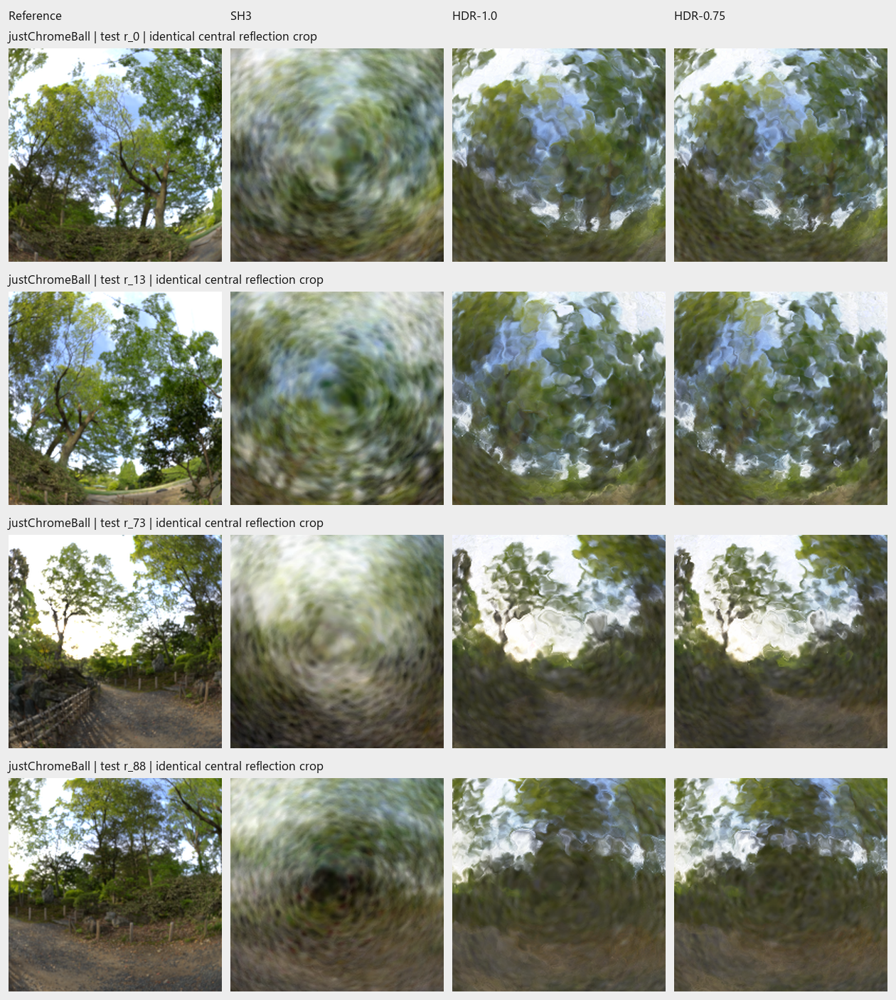
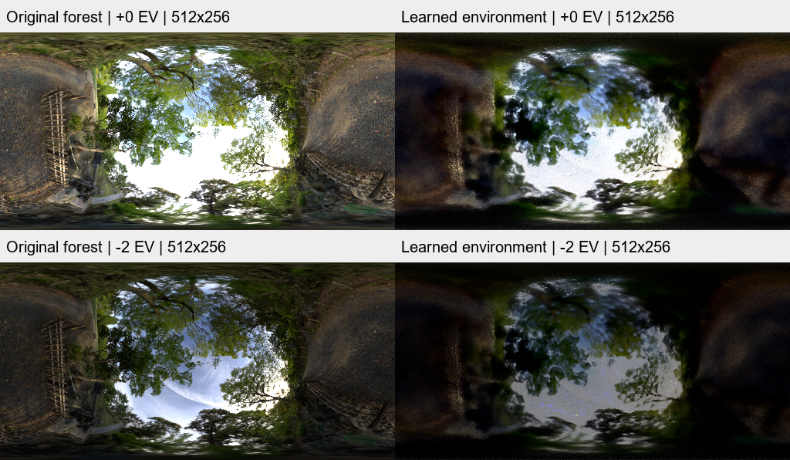
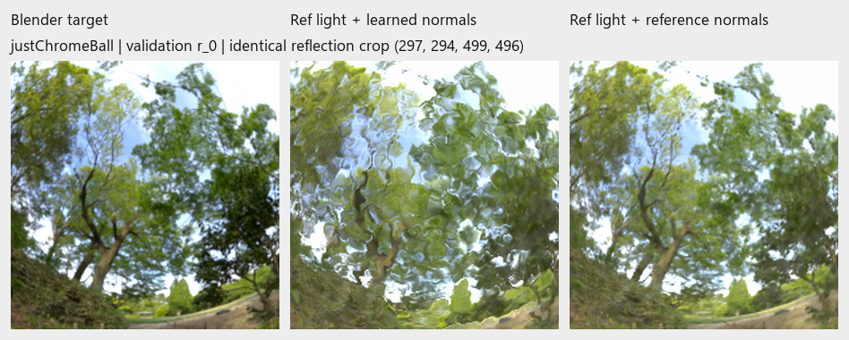

# Sphere study: commands and completed results

Specified 3 November 2026, Singapore, before new SH3/size results. This is the
bounded continuation of the [reduced project scope](reports/2026-11-02-research-wrap-up.md#current-scope-sphere-as-the-main-experiment-3-november).
Run commands in **Git Bash from the repository root**.

**Later defaults update:** new fresh runs use **200k points, multiplier 1, 10k +
5k steps**. The completed study below used 100k; its archived configs/results
are unchanged. See the final section before repeating historical commands.

**Completed 3 November, 14:12 Singapore:** matched SH3/HDR training, the single
size trial, validation-only selection and all 200 test views. Commands below
reproduce completed work; reruns require fresh output names.

## Fixed comparison

| Setting | SH3 control | HDR/angular reference |
| --- | --- | --- |
| Dataset / seed | `justChromeBall` / 7 | Same |
| Images / points | 800x800 / 100k | Same |
| Initial surface | Existing training-mask hull | Same hull |
| Schedule | 10k frozen geometry + 5k gentle refinement | Same |
| Image / geometry losses | MSE; refinement mask 0.1, normal/depth 0.01 | Same |
| Appearance | SH3; bands at 1k/2k/3k | HDR map 512x256 + shared angular response; SH0 |

Both arms disable density changes, opacity resets and early stopping. Adam
restarts between stages. Identical geometry policy does not imply identical
learned geometry. This compares complete appearance treatments, not only the
shader kernel. Existing verified HDR runs are reused; Materials supplies
historical supporting evidence. No new LDR, Ship, NeRO or logo study is planned.



*Observed starting point: `justChromeBall`, validation r_0, r_13, r_73, r_88
from top to bottom; reference / frozen HDR 10k / refined HDR 15k-total.
Identical central crops, with whole-image PSNR labels. These are existing
results, not a preview of the new SH3 or size trial.*

## 1. Activate Python and check the launcher

```bash
source .venv/Scripts/activate
export WARP_CACHE_PATH="$(pwd -W)/outputs/warp-cache"
python scripts/test_staged_hdr_pipeline.py
python scripts/test_sphere_footprints.py
python scripts/test_sphere_selection.py
```

## 2. Run the matched SH3 control

```bash
python scripts/run_staged_hdr.py data/justChromeBall \
  --appearance sh3 \
  --init-ply outputs/Nov02-202000-justChromeBall-staged-hdr-pipeline/initializer/initial.ply \
  --metrics psnr ssim lpips
```

The launcher prints a fresh pipeline directory and final model path. It saves
the resolved `frozen.yaml`, `refine.yaml` and `pipeline.json`; the last records
the two actual run directories. SH3 sidecars must survive the stage handoff.
Add `--prepare-only` to generate configs without training. Preparation copies
the small initializer but launches no optimizer or evaluation.

## 3. Diagnose footprints, normals and lighting

Inspect the baseline before changing size. Use validation views **0, 13, 73, 88**
for the main figures and retain view **51**, the prior largest PSNR regression.
Report projected covariance/support distributions, coverage and matched normal
maps alongside RGB/reflection crops and the learned environment preview.
Any Blender normal/depth export is **evaluation only**, never a training target.

Export evaluation-only mesh normals/depth for the five diagnostic views:

```bash
"/c/Program Files/Blender Foundation/Blender 5.0/blender.exe" \
  --background --disable-autoexec data/blender/justChromeBall.blend \
  --python-exit-code 1 --python scripts/export_blender_geometry.py -- \
  --manifest data/justChromeBall/transforms_val.json \
  --output outputs/Nov03-sphere-geometry-val --resolution 800 \
  --views 0 13 73 88 51
```

Then inspect the saved models (replace the SH3 path if you made a new run):

```bash
python scripts/diagnose_sphere_footprints.py \
  outputs/Nov02-2021-justChromeBall-frozen-hdr-10k \
  outputs/Nov02-2023-justChromeBall-staged-hdr-refine-5k \
  outputs/Nov03-1357-justChromeBall-staged-sh3-refine-5k \
  --labels HDR-frozen HDR-refined SH3-refined \
  --output outputs/Nov03-sphere-footprints \
  --geometry-reference outputs/Nov03-sphere-geometry-val
```

These output directories must be new/empty; choose new names when repeating.
The first diagnostic finds a 12.61px median support diameter in view 0 after HDR
refinement (candidates include occluded primitives), full foreground coverage on
the five views, normal-map waviness and blurred learned lighting. That motivates
one bounded size trial; it does not establish size as the cause.

## 4. One conditional size trial

If the diagnostic supports testing overlap, compare **0.75x initial tangent
size against the existing 1.0x**. Copy the same hull so positions, normals,
colors, opacity, point count and sampling are identical; change only its two
tangent scales. Preserve the original checkpoint. No size grid is queued.

Here, **size means the individual Gaussian splat's two tangent scales**.
Every variant still contains **100,000 splats**. During the refinement stage,
those scales remain learnable; 0.75x specifies initialization, not a fixed final size.

```bash
python scripts/run_staged_hdr.py data/justChromeBall \
  --appearance hdr --scale-multiplier 0.75 \
  --init-ply outputs/Nov02-202000-justChromeBall-staged-hdr-pipeline/initializer/initial.ply \
  --metrics psnr ssim lpips
```

Selection is validation-only: prefer the smaller-size HDR candidate only if
mean whole-image LPIPS improves, foreground PSNR does not decrease and predicted
mean coverage across the 100 validation views reaches at least 99% of reference
foreground pixels (coverage >=0.5, reference alpha >=0.95). Inspect the fixed
reflection crops and retain failures.
Otherwise keep the original HDR model. This tests initialization size under
the same learning schedule, not a hard size limit during refinement.

## 5. Freeze selection, then evaluate test views

Run one paired validation report for all three completed 15k-total models:

```bash
python scripts/evaluate_reflection_suite.py \
  outputs/Nov03-1357-justChromeBall-staged-sh3-refine-5k \
  outputs/Nov02-2023-justChromeBall-staged-hdr-refine-5k \
  outputs/Nov03-1402-justChromeBall-staged-hdr-refine-5k \
  --labels SH3 HDR-1.0 HDR-0.75 \
  --output outputs/Nov03-sphere-validation \
  --manifest transforms_val.json --views 0 13 73 88 51 \
  --metrics psnr ssim lpips --cpu-threads 2
```

Inspect `index.html`, the fixed crops and foreground coverage before finalizing.
The next command records checkpoint hashes and the validation-only selection
reason **before** evaluating all 200 test cameras. **Before-test protocol
clarification:** retain SH3 and HDR-1.0 as the same-size primary comparison;
include HDR-0.75 as an additional selected variant if it passes the rule.
Comparing only SH3-1.0 against HDR-0.75 would confound appearance with initial size.

```bash
python scripts/finalize_sphere_study.py outputs/Nov03-sphere-validation \
  --selection outputs/Nov03-sphere-study/selection.json \
  --test-output outputs/Nov03-sphere-final-test
```

Use `--select-only` to freeze the choice and print its intended command without
running test evaluation. The full command is stored in `selection.json`.
Selection files are never overwritten. Test illustration indices are fixed to
**0, 13, 73, 88**. The report includes PSNR, SSIM, LPIPS, foreground quality,
file size and forward timing. Timing covers host tiling + rendering + MSE,
excluding metrics, image download and file I/O. Test scores will not trigger
more tuning.

After the size trial, its diagnostic comparison can be reproduced with:

```bash
python scripts/diagnose_sphere_footprints.py \
  outputs/Nov03-1357-justChromeBall-staged-sh3-refine-5k \
  outputs/Nov02-2023-justChromeBall-staged-hdr-refine-5k \
  outputs/Nov03-1402-justChromeBall-staged-hdr-refine-5k \
  --labels SH3 HDR-1.0 HDR-0.75 \
  --output outputs/Nov03-sphere-footprints-size \
  --geometry-reference outputs/Nov03-sphere-geometry-val
```

The portable figures/CSV/selection archive is rebuilt after all reports finish:

```bash
python docs/reports/assets/2026-11-03-sphere-study/archive.py
```

These commands name this session's actual runs. Training reruns reserve fresh
timestamped directories: substitute their paths in the comparison commands.
Use fresh output/selection names when repeating evaluations. Full PLY/material/SH
checkpoints stay under `outputs/`; archive them separately when moving machines.

## Completed validation and size decision

All models below completed **10k frozen + 5k refinement**, 800px, 100k points,
seed 7. Scores are means over the same 100 validation cameras using one evaluator.

| Model | PSNR, dB | SSIM | LPIPS AlexNet, lower better | Foreground PSNR | Foreground coverage |
| --- | ---: | ---: | ---: | ---: | ---: |
| SH3, size 1.0 | 20.6530 | 0.824708 | 0.127524 | 14.0362 | 100% |
| HDR/angular, size 1.0 | 24.1249 | 0.874920 | 0.093994 | 17.7520 | 100% |
| HDR/angular, initial size 0.75 | **24.2308** | **0.877177** | **0.091814** | **17.8693** | **100%** |

The same-size HDR/SH3 contrast gains **3.4719 dB** and lowers LPIPS by 0.033530.
The size-only initialization trial adds **0.1058 dB**, lowers LPIPS by
**0.002180 (2.32%)**, and improves foreground PSNR by 0.1173 dB. It improves
PSNR on 88/100 views and LPIPS on 90/100; regressions remain in the CSVs.
All three selection checks pass, so HDR-0.75 is the selected size variant.



*`justChromeBall`, validation r_0, r_13, r_73, r_88, top to bottom. Columns:
Blender reference, SH3-1.0, HDR-1.0, HDR-0.75. Identical central crops of actual
saved renders, enlarged uniformly. HDR improves structure over SH3; the size
change is modest, and fine branches/ground texture still collapse into blobs.*

In the five diagnostic views (0, 13, 73, 88, 51), mean mesh-normal error is
2.0914 degrees for SH3, 1.5728 for HDR-1.0 and 1.4678 for HDR-0.75. These are
five-view diagnostic means, not full-validation geometry scores. View-0 median
projected support diameter changes **12.61 -> 11.14 pixels**; statistics include
occluded/back-side primitives and are not visibility weighted. Initial scales
are learned again during refinement, so the final footprint is not simply 0.75x.

This bounded trial supports a small improvement from the smaller initialization;
it does **not** solve the reflection-detail problem or establish splat size as
the sole cause. The largest validation PSNR regression is r_73 (-0.1547 dB),
visible in the third crop row; LPIPS regresses on 10 validation views. No
additional size grid or geometry/lighting tuning is queued.



*`justChromeBall`, validation r_0, r_13, r_73, r_88, r_51, top to bottom.
Reference mesh / SH3 / HDR-1.0 / HDR-0.75. Mesh normals are evaluation-only;
prediction previews use reference foreground with coverage >=0.5. Fine waves
remain despite low mean angular error. Invalid/background pixels are black.*



*`justChromeBall`, validation r_0; SH3, HDR-1.0 and HDR-0.75 after refinement.
Major-axis support diameters are computed from stored scales, camera projection,
pixel filtering and compact support. Candidate distributions include occluded
primitives; they are not weighted by contribution to the visible image. Display
range is 0-35px; quantiles are retained in the diagnostic CSV.*



*Learned environment previews from HDR-1.0 and HDR-0.75, left to right, after
15k total steps. Clipped sRGB display of the saved HDR maps, without rotation or
alignment to a reference environment. This illustrates remaining learned-lighting
blur, not a calibrated environment-reconstruction score.*

## Final test results: selection frozen before evaluation

The [selection record](reports/assets/2026-11-03-sphere-study/selection.json)
was written at **14:08:37 Singapore**, before test evaluation began. The same
frozen checkpoint hashes were verified after evaluation. All **200 test cameras**
were used, with no subsequent model changes or test-driven retuning.

| Model | Test PSNR, dB | SSIM | LPIPS AlexNet, lower better | Foreground PSNR |
| --- | ---: | ---: | ---: | ---: |
| SH3, size 1.0 | 20.2655 | 0.821398 | 0.128760 | 13.6520 |
| HDR/angular, size 1.0 | 24.5732 | 0.880892 | 0.083517 | 18.2494 |
| Selected HDR/angular, initial size 0.75 | **24.7453** | **0.884031** | **0.080988** | **18.4427** |

The **same-size primary comparison** gains **4.3077 dB** and lowers LPIPS by
0.045243 for HDR versus SH3; PSNR, SSIM and LPIPS improve on all 200 views.
The additional size variant gains **0.1721 dB**, improves LPIPS on **189/200**
views, and retains **100% foreground coverage**. It improves PSNR on 198/200
views; all regressions are preserved in the per-view CSVs.



*`justChromeBall`, predefined test r_0, r_13, r_73, r_88, top to bottom. Columns:
Blender reference, SH3-1.0, HDR-1.0, selected HDR-0.75. Identical central crops
of actual saved renders. HDR reconstructs more tree/sky structure than SH3,
while both HDR variants still lose fine branches and ground detail.*

| Final checkpoint | Required files, MB | Observed forward FPS |
| --- | ---: | ---: |
| SH3 | 23.503 | 273.63 |
| HDR-1.0 | 8.540 | 287.61 |
| HDR-0.75 | 8.541 | 303.98 |

Checkpoint size includes PLY and required SH/material sidecars, excluding PNGs
and diagnostic buffers. Timing uses the four test illustration poses, ten
repeats, warm-up and GPU synchronization; host tile preparation and MSE are
included, image transfer/I/O/metrics excluded. It measures these separately
learned models, not isolated shader cost or end-to-end application FPS. Native
training times and Warp allocation peaks are in the archived run/performance
records; allocator peaks exclude driver/context memory and are not total VRAM.

**Decision:** retain HDR-0.75 as the validation-selected sphere reconstruction
and HDR-1.0 as the matched scientific reference. The bounded study is complete.
These are one-scene, one-seed, fixed-budget results, with one SH3 training
schedule; they do not establish universal SH/HDR performance or recovered sharp
reflections. No further experiments are queued.

## Evidence and commit point

- [Validation summary](reports/assets/2026-11-03-sphere-study/validation/summary.csv),
  [per-view metrics](reports/assets/2026-11-03-sphere-study/validation/metrics.csv),
  [report](../outputs/Nov03-sphere-validation/index.html).
- [Test summary](reports/assets/2026-11-03-sphere-study/test/summary.csv),
  [per-view metrics](reports/assets/2026-11-03-sphere-study/test/metrics.csv),
  [report](../outputs/Nov03-sphere-final-test/index.html).
- [Appearance/config audit](reports/assets/2026-11-03-sphere-study/preflight.json),
  [size-only audit](reports/assets/2026-11-03-sphere-study/size-preflight.json),
  [footprint/normal diagnostics](reports/assets/2026-11-03-sphere-study/diagnostics.csv),
  [figure/source provenance](reports/assets/2026-11-03-sphere-study/figure-provenance.json).

Resolved configs and run records for all six training stages are archived with
the portable figures/CSVs under `docs/reports/assets/2026-11-03-sphere-study/`.
All rendering-source checks pass, the size audit preserves every other stored
PLY field, and **eight targeted tests pass** (five pipeline, two footprint,
one selection-rule test). Report links and CSV row counts were checked.

**Good commit point:** updated launcher/diagnostics, tests, this command guide,
scope/status notes and the portable experiment evidence. Full checkpoints remain
in ignored `outputs/` and should be retained separately from the Git commit.

## Environment-map diagnostic (3 November)

Compare a saved HDR map against the packed `forest.exr` without retraining:

```bash
python scripts/test_environment_comparison.py
python scripts/compare_environment.py \
  outputs/Nov03-1402-justChromeBall-staged-hdr-refine-5k \
  --output outputs/Nov03-environment-comparison
```

That command was run successfully. Use a fresh output name when repeating it,
or replace the run path to examine another completed HDR model. Open the
resulting `comparison.png`. Blender is used only to read the packed scene-linear
texture; the scene and checkpoints are never saved or modified.



*`justChromeBall` world versus the learned map from the 100k-point, initial-size
0.75 HDR model after 10k + 5k training. Left: original 1024x512 forest texture
resampled to the renderer's world-direction convention at 512x256. Right:
learned HDR map decoded from its sidecar. Rows: identical 0 EV and -2 EV display
transforms; no fitted rotation or brightness normalization. This is a lighting
diagnostic, not another training result or a calibrated radiance-error metric.*

The original retains substantially more branch, fence and ground structure at
the same displayed resolution. The learned map's broad blur/warping remains at
-2 EV, so highlight clipping alone does not explain the lost detail. This
supports a learned-lighting-fit limitation, while leaving normal/light/material
ambiguity unresolved; it does not establish that more splats cannot help.

Reference direction mapping follows
[Blender 5.0.1's projection implementation](https://github.com/blender/blender/blob/v5.0.1/intern/cycles/kernel/camera/projection.h).
Three analytic direction/sampling tests pass. Source hashes, projection,
sampling and exposure details are in the
[comparison record](reports/assets/2026-11-03-environment-check/comparison.json);
[aligned scene-linear arrays](reports/assets/2026-11-03-environment-check/aligned-linear.npz)
are preserved alongside the figure. Reference lighting remains evaluation-only.

## Later 3 November direction: close footprint tuning; use 200k defaults

The user reported that the visible blobs persisted after footprint changes and
a longer refinement attempt. Stop further footprint sweeps and return the
multiplier to **1**. Refinement was reverted to **5k** (position decay over 5k),
with the frozen stage still 10k. This records the user's visual assessment,
not a claim that every extended run's numerical score failed to improve.

The two source presets now set `model.capacity` and `model.initial_splats` to
**200000**. The launcher's fresh initializer uses `--max-points 200000`.
For a fresh higher-density run:

```bash
python scripts/run_staged_hdr.py data/justChromeBall \
  --appearance hdr --scale-multiplier 1 --metrics psnr ssim lpips
```

Omit `--init-ply` here: reusing a 100k PLY retains 100k actual primitives.
The reuse helper currently accepts the historical 100k initializer only.
Raising allocation capacity alone cannot create points while growth is disabled.
The initializer also adjusts tangent sizes with sampling density: doubling
points reduces initial scales by approximately sqrt(1/2), even at multiplier 1.
This is a denser representation experiment, not an isolated size-fixed count test.

For exact 100k replays of the earlier study, restore both presets' capacity/
initial-count fields and the fresh initializer limit to 100000, or use the
archived resolved configs with their recorded parents. Historical study/test
results remain frozen; later exploratory runs are listed separately in the
[output index](output-index.md). Previously inspected test scores are development
context, not a fresh untouched benchmark for further tuning.

## Reference-lighting swap: completed diagnostic

The older 100k, size-0.75 checkpoint was rendered under the original forest
lighting with geometry and materials fixed. On all 100 validation views,
LPIPS improves **0.091814 -> 0.079982**, while PSNR falls
**24.2308 -> 20.6415 dB** and SSIM falls **0.877177 -> 0.848285**.
Finer texture returns, but reflections remain warped. Investigate normals
next; the swap does not fully isolate them from fitted material compensation.

[Illustrated results, repeat command and integrity checks](experiments/2026-11-03-reference-lighting-swap.md).

## Reference-normal follow-up: completed five-view diagnostic

At fixed original forest lighting, replacing only the shading normal direction
recovers much more recognizable reflection structure. Across the five existing
diagnostic views, PSNR improves **20.4016 -> 22.7073 dB**, SSIM
**0.844558 -> 0.943615**, LPIPS **0.085452 -> 0.056796**. Learned normal error
averages 1.47 degrees. Reference normals with the learned map remain blurred,
supporting an interaction between normal error and the learned lighting fit.
These are five-view evaluation interventions, not retrained models or new test
scores. The separate consistency-weight training trial below subsequently completed.

[Four-combination pictures, normal maps, repeat command and checks](experiments/2026-11-03-reference-normal-swap.md).

## Normal-training trial: completed; closeout added 7 November

The trial below completed on 3 November in `outputs/Nov03-1753-justChromeBall-normal003-100k`.
The earlier "prepared, not run" heading was stale. Evaluation-only closeout on 7 November found
slightly worse validation image scores and reference-normal errors despite higher normal coherence.
[Actual figures, paired results and reproduction](experiments/2026-11-07-normal-weight-closeout.md).
The commands below retain the original protocol for reference; no further trial is queued.

Use the primary **100k, initial-size multiplier 1.0** baseline from
`Nov02-2023-justChromeBall-staged-hdr-refine-5k`. The separate trial config is
`config/experiments/justChromeBall_normal003_100k.yaml`. It changes only
`geometry_loss.normal_depth_weight` **0.01 -> 0.03** and the output destination.
It retains the same `Nov02-2021-justChromeBall-frozen-hdr-10k/model.ply` parent
and material sidecar, seed 7, 800px, 5k refinement and learning-rate schedules.
This uses the size-1.0 baseline, rather than the size-0.75 diagnostic model.
The current 200k defaults do not affect this archived-config trial.

From the repository root with the project environment active:

```powershell
python scripts/run_experiment.py config/experiments/justChromeBall_normal003_100k.yaml `
  --pipeline surfel --name normal003-100k-refine-5k `
  --eval-manifest transforms_val.json --metrics psnr ssim lpips
```

Only refinement runs; the saved frozen 10k stage is reused. The runner creates
a fresh timestamped output directory and prints its path. Optimizers restart,
as in the baseline. The post-training evaluation covers all 100 validation
views, even though its legacy output filenames say `test-metrics.csv` and
`test-renders`. Training inputs remain RGB and masks, with self-consistency
from rendered depth; no Blender reference normals or lighting enter training.

After completion, compare the new run against the baseline (replace only the
placeholder path with the directory printed by the runner):

```powershell
python scripts/evaluate_reflection_suite.py `
  outputs/Nov02-2023-justChromeBall-staged-hdr-refine-5k `
  outputs/NEW_NORMAL003_RUN `
  --labels normal001 normal003 --output outputs/sphere-normal003-validation `
  --manifest transforms_val.json --views 0 13 73 88 51 `
  --metrics psnr ssim lpips --cpu-threads 2
python scripts/diagnose_sphere_footprints.py `
  outputs/Nov02-2023-justChromeBall-staged-hdr-refine-5k `
  outputs/NEW_NORMAL003_RUN `
  --labels normal001 normal003 --output outputs/sphere-normal003-normals `
  --geometry-reference outputs/Nov03-sphere-geometry-val --views 0 13 73 88 51
```

Choose fresh diagnostic output names when repeating. Judge the trial by
reference normal error and matched reflection crops alongside LPIPS and
foreground PSNR; smoother-looking normals alone do not establish improvement.
The prior oracle diagnostic illustrates what needs fixing:



*`justChromeBall`, validation view 0, actual size-0.75 checkpoint evaluation.
Left: Blender target; middle: reference lighting with learned normals; right:
reference lighting with reference mesh normals. This is prior diagnostic
evidence, not a result of the proposed size-1.0 normal-weight trial.*
